# Xavier Champoux — Portfolio design

**Design review draft 01 · 13 November 2026**  
**Recommended direction: Centered / paper, ink and a small kinetic machine**

This document translates [PLAN.md](PLAN.md) into a reviewable visual system. It contains genuine reference snapshots, three Home directions, detailed page designs, light/dark and desktop/mobile variations, machine concept art, and proposed interaction states. It does not approve the application rebuild or replace the functional requirements in PLAN.md.

**Reading the images:** website snapshots are research evidence; page mockups are proposed final layouts; state boards describe intended behavior; AI machine illustrations are **Conceptual**, not tested geometry. The UI mockups use the actual agreed fonts, logo geometry, portrait and project images. All new prose, translated copy, discipline assignments and CV wording remain drafts for factual review. No production application files were changed for this document.

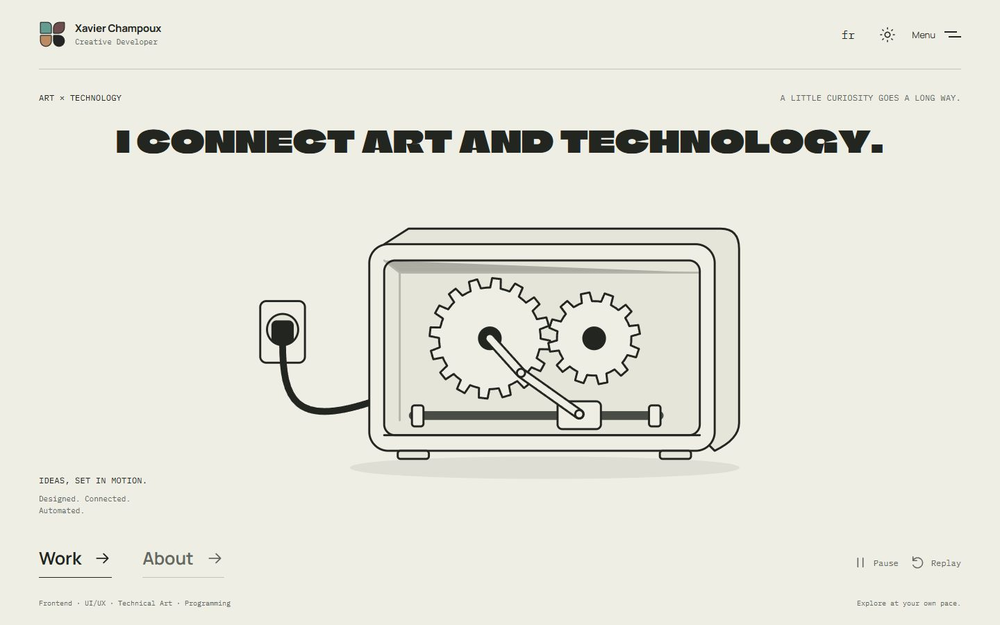

## Contents

1. [Intent and recommendation](#1-intent-and-recommendation)
2. [References and visual evidence](#2-references-and-visual-evidence)
3. [Visual foundations](#3-visual-foundations)
4. [Three Home directions](#4-three-home-directions)
5. [Recommended page designs](#5-recommended-page-designs)
6. [Machine art direction and intro](#6-machine-art-direction-and-intro)
7. [Interaction and motion](#7-interaction-and-motion)
8. [Responsive design and accessibility](#8-responsive-design-and-accessibility)
9. [French samples and content review](#9-french-samples-and-content-review)
10. [Recommendations and review checklist](#10-recommendations-and-review-checklist)
11. [Deliverables, validation and reproduction](#11-deliverables-validation-and-reproduction)

## 1. Intent and recommendation

The portfolio should feel like a person who can design an interface, build it, and understand the systems behind it. Its audience includes hiring teams and collaborators considering frontend development, UI/UX design, technical art and programming work. Visual playfulness introduces that range; project evidence explains it.

The primary journey is **Home → Work → About and CV**. Work should be reachable immediately, including during the intro. Archive supports deeper exploration through the menu. Contact belongs near the end of About, following useful evidence of capabilities and experience.

### Recommended direction

Choose **Centered**. A single introductory sentence and a clearly isolated machine create a memorable arrival without making the interface compete with the interaction. Broad ink typography supplies confidence; the machine supplies character; real project imagery supplies proof.

Use light and dark as equivalent themes. Neither is a secondary skin. Start with the system preference, remember manual choices and render the correct theme before the first visible frame. The colored logo remains recognizable in both.

### Non-negotiable design constraints

- Keep Climate Crisis, Manrope, IBM Plex Mono and the exact palette from PLAN.md.
- Keep the four independently colored logo shapes, with theme-aware outlines.
- Keep Home as one ordinary viewport when space allows; let it scroll when content needs more room.
- Keep four selected projects in order: **Feltkutur → Ryker → Schluter → Simona**.
- Keep twelve other active projects in Archive; exclude Portfolio V1/V2.
- Make the full-screen menu the only site navigation entry to Archive.
- Keep the four-step intro, visible Skip, explicit Replay and equivalent touch/keyboard actions.
- Keep the machine near-monochrome, shallow and readable. Use the agreed fixed, slightly angled orthographic camera.
- Preserve normal scrolling on content pages, bilingual content and the retained noise/cursor components with their accessibility adaptations.

## 2. References and visual evidence

All seven requested websites were opened in Browser during research. Portfolio, WebGL, Animation, Transitions and Interaction Design collections were also browsed. The snapshots below were captured on **13 November 2026**. Source sites may change after this date. Capture dimensions and states are recorded in the [reference manifest](docs/design/references/manifest.json); these reference viewports vary and are separate from the standardized mockup sizes.

The observations below concern visible composition or the author's published account. They are not measurements of animation timing, accessibility or source implementation.

### R01 — Sharlee / Charles Bruyerre

**Type:** live portfolio. **Source:** [itssharl.ee](https://itssharl.ee/). **Creator:** Charles Bruyerre / Sharlee.

| Home snapshot | Menu snapshot |
|---|---|
| 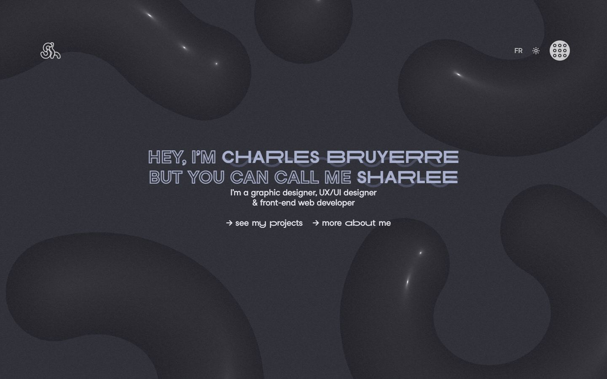 | 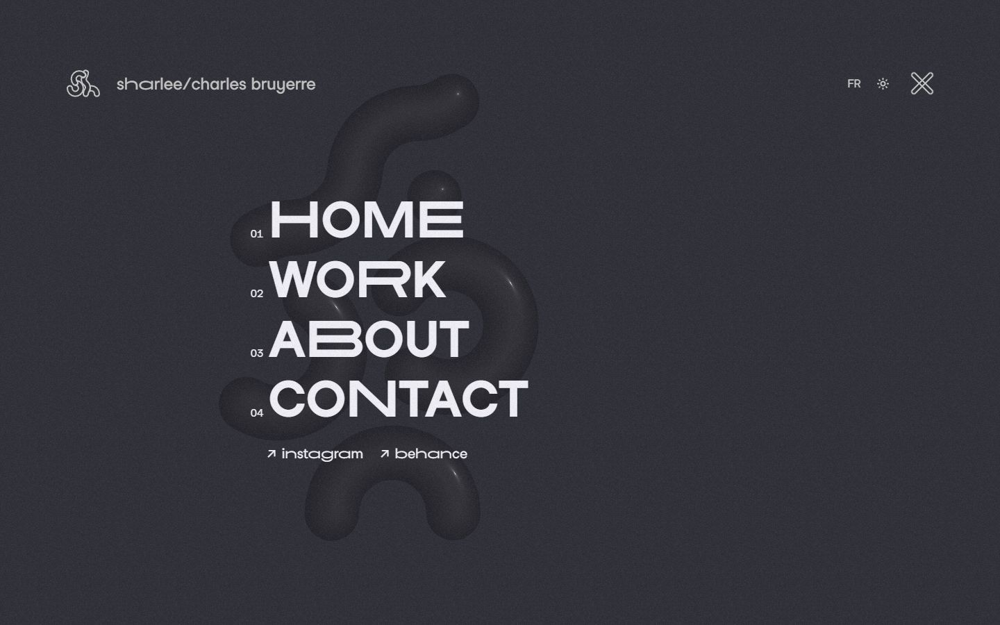 |

**Observed:** a central introduction, two clear onward links, compact corner controls and a numbered menu over a sculptural background. Arrival/loading content was observed during the initial visit; the saved images show settled Home and menu states.

**Apply:** one framed arrival composition, persistent navigation and clear Work/About choices. Separate essential loading from the interactive machine intro. **Adaptation:** the portfolio's machine is the subject; large glossy background forms would weaken its silhouette. The menu follows our Home/Work/Archive/About order.

### R02 — Lucas Lima

**Type:** live portfolio. **Source:** [lucaslima.design](https://www.lucaslima.design/). **Creator:** Lucas Lima.

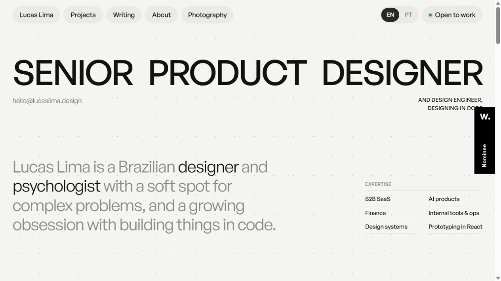

**Observed:** oversized black typography, a pale background, generous empty space and quieter supporting information. This is the current inspected site, rather than an assumed historical version.

**Apply:** strong scale contrast, paper/ink hierarchy and confidence through typography. Use our existing font families. The final design uses Climate Crisis for brief uppercase display copy and Manrope for reading; long blocks of dense display type lose clarity.

### R03 — Matthieu Givelet / Archive

**Type:** live archive. **Source:** [matthieugivelet.com/archive](https://matthieugivelet.com/archive). **Creator:** Matthieu Givelet. **Snapshot state:** scrolled project rows.

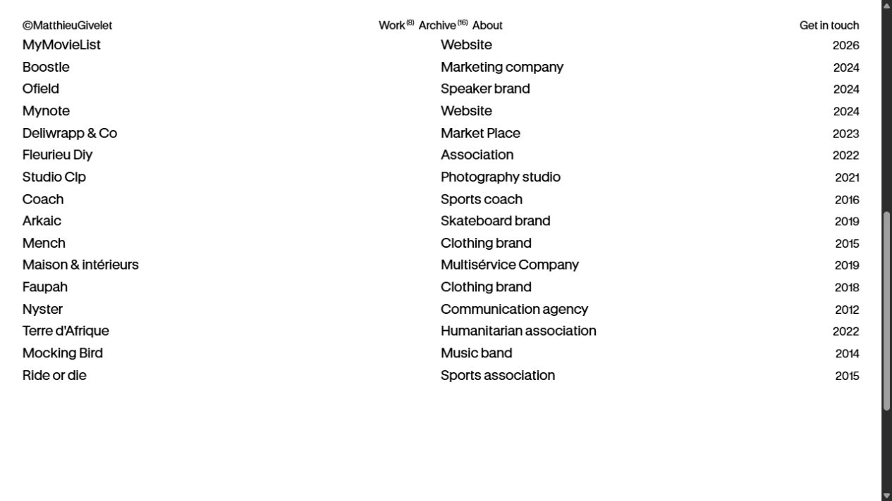

**Observed:** a straightforward editorial index with aligned names, details and dates. Its restraint makes a varied collection easy to scan.

**Apply:** consistent row rhythm, aligned metadata and typography-led browsing. Our discipline filter, sort controls, pointer preview and keyboard preview are requirements from PLAN.md; their proposed behavior is specified later rather than inferred from this still image. Our Archive is linked only from the menu.

### R04 — Awwwards discovery collections

**Type:** curated discovery pages, not individual implementations. **Publisher:** Awwwards; site thumbnails retain the creators credited on the source pages.

| Collection and link | Snapshot |
|---|---|
| [Portfolio](https://www.awwwards.com/websites/portfolio/) | 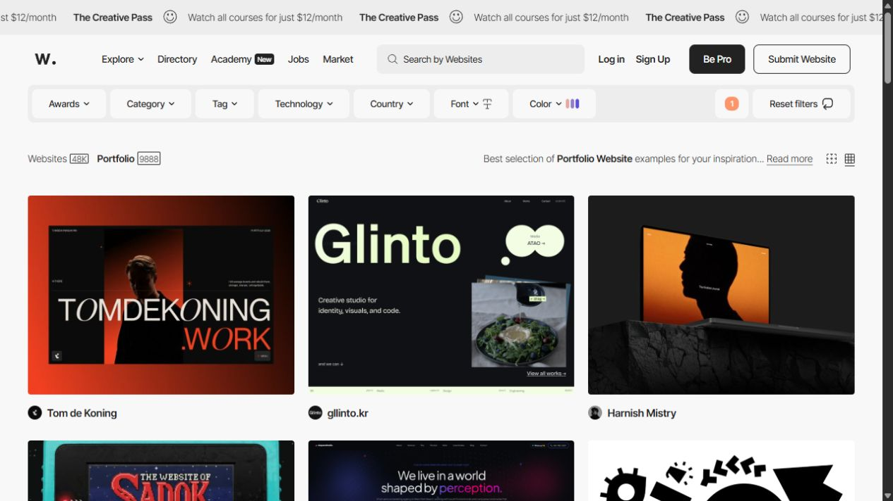 |
| [Animation](https://www.awwwards.com/websites/animation/) | 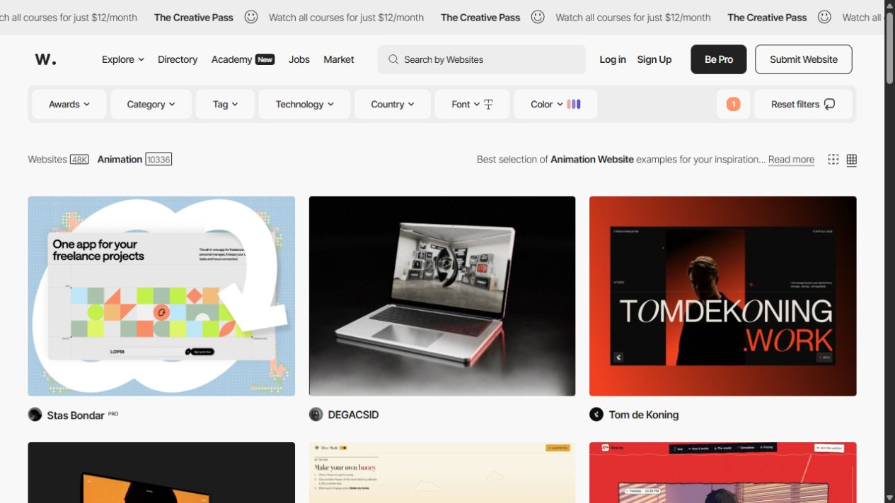 |
| [Transitions](https://www.awwwards.com/websites/transitions/) | 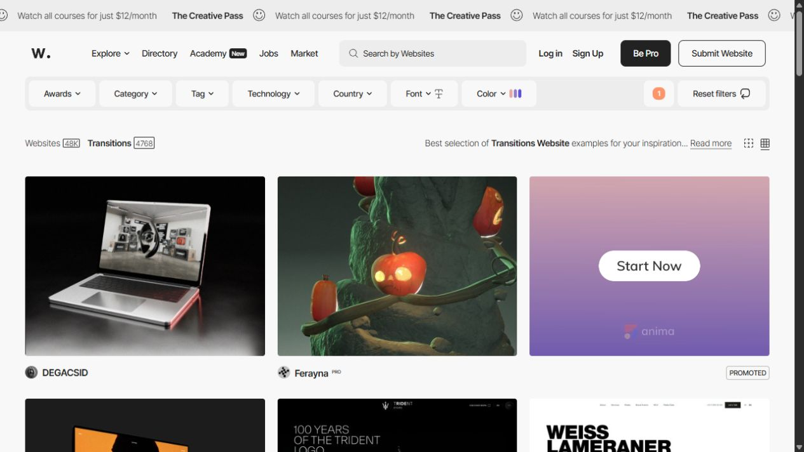 |
| [Interaction Design](https://www.awwwards.com/websites/interaction-design/) | 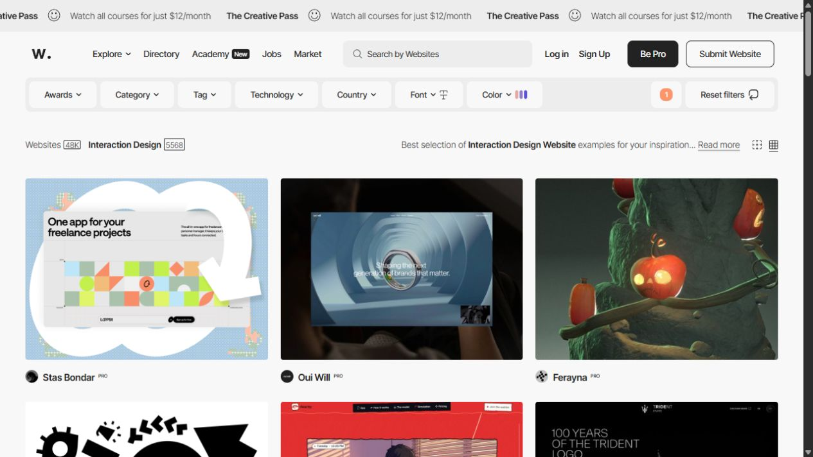 |

**Apply:** selective comparison of scale, pacing and hierarchy. These collections broaden the research without adding requirements. Their thumbnails do not establish whether a technique is appropriate, performant or accessible for this portfolio. Proposed motion timings in this document are original recommendations.

### R05 — Dymas Alfin / Mikan Team

**Type:** published design/motion presentation. **Source:** [Personal Portfolio Website — Animations](https://dribbble.com/shots/26995447-Personal-Portfolio-Website-Animations). **Creator:** Dymas Alfin for Mikan Team. **Snapshot state:** shot opening with a frame of the embedded presentation.

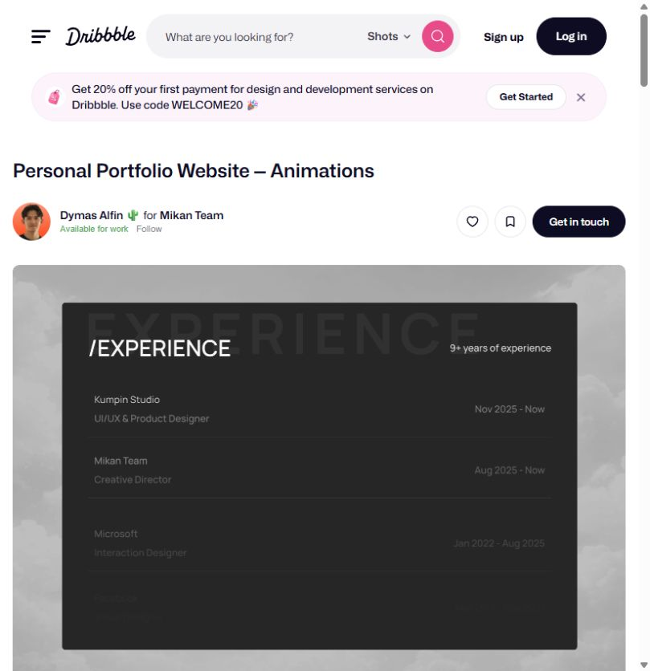

**Observed:** an editorial hierarchy, substantial typography and distinct content sections within a restrained palette. The source is a design presentation, so it is not evidence of a shipped site's behavior.

**Apply:** clear section hierarchy and readable project evidence. Our Home remains machine-led; the portrait is reserved for About. Project contribution and credit information remain explicit.

### R06 — CollectUI

**Type:** curated discovery collections. **Publisher:** CollectUI / Panda Network; individual entries belong to their credited creators.

| [Portfolio collection](https://collectui.com/designs/portfolio-ui-design-inspiration) | [WebGL collection](https://collectui.com/designs/webgl-ui-design-inspiration) |
|---|---|
| 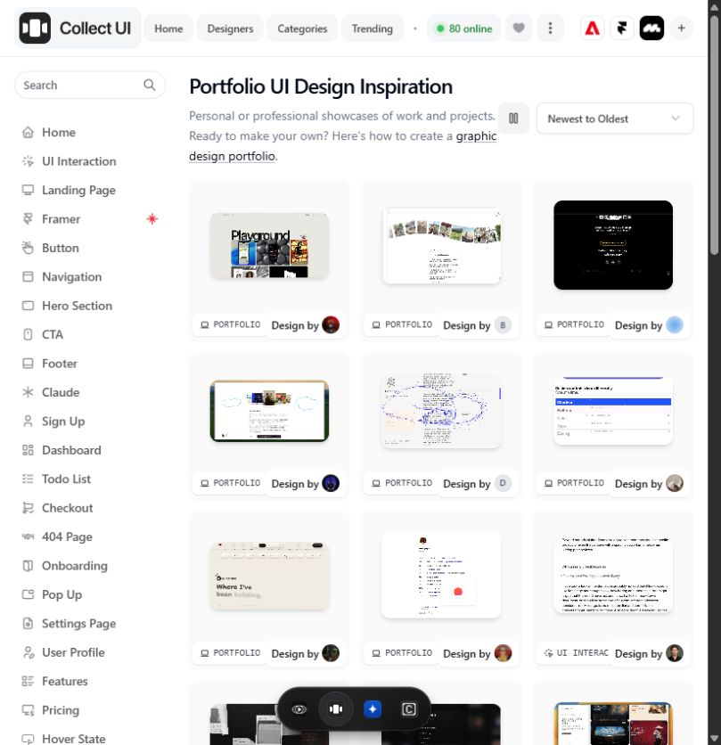 | 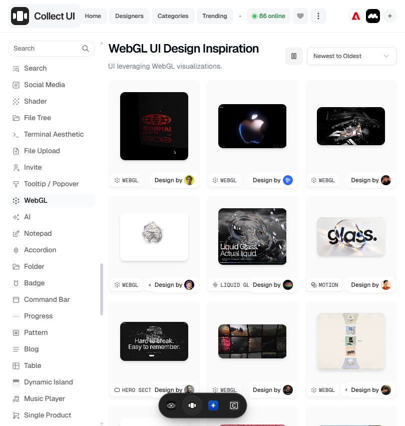 |

**Apply:** compare portfolio information density and the relationship between interactive objects and readable UI. These are supporting research boards. They do not justify adopting every visual effect or copying an entry's composition wholesale.

### R07 — Canvas UI / Ink Object

**Type:** live component demonstration and documentation. **Source:** [Ink Object](https://canvasui.dev/docs/components/ink-object). **Creator:** David Haz / Canvas UI.

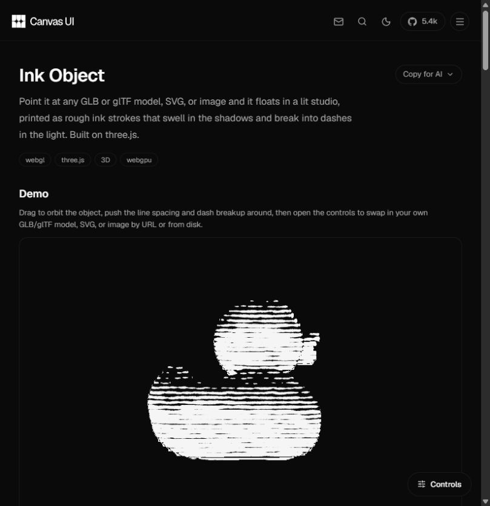

**Observed:** an object rendered with a strong printed-ink stroke treatment. Its texture is a useful comparison for the machine's silhouette.

**Recommendation:** retain clean, flat shading and outlines for the main machine. Dense hatching can hide the socket, gear recess and linkage. Canvas UI is a visual research reference here; this design task introduces no Canvas UI dependency, custom shader or new production rendering requirement.

### R08 — Stefan Vitasović / Codrops

**Type:** published case study. **Source:** [Case Study: Stefan Vitasović Portfolio — 2025](https://tympanus.net/codrops/2025/03/05/case-study-stefan-vitasovic-portfolio-2025/). **Author:** Stefan Vitasović. **Published:** 5 March 2025. The [live portfolio](https://stefanvitasovic.dev/) was also opened during research.

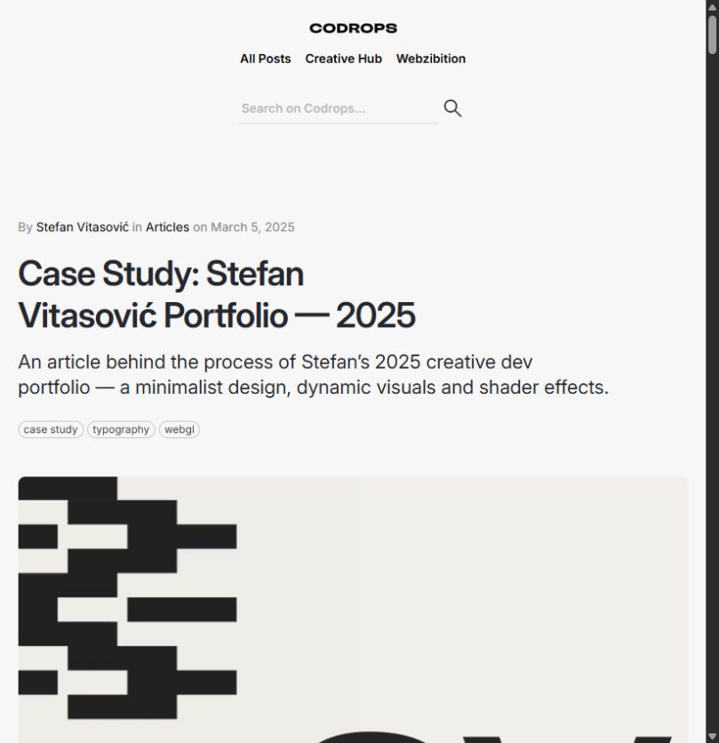

**Published account:** the author explains a relationship between structured typography, motion motifs and page continuity.

**Apply:** repeat a small number of motion ideas so the site feels coherent. This portfolio keeps ordinary content scrolling, short navigation transitions and its existing Nuxt/AnimeJS direction. The case study's stack and experimental navigation are not adopted.

## 3. Visual foundations

### Color roles

| Token | Light | Dark | Role |
|---|---|---|---|
| Paper | `#eeeee5` | `#111211` | Page background and negative space |
| Surface | `#e5e5da` | `#191a19` | Quiet panels, selected rows, image framing |
| Ink | `#232520` | `#eeeee7` | Main text, controls, scene outlines |
| Muted | `#64685f` | `#a1a39c` | Secondary text on Paper |
| Line | `#c2c6b9` | `#393b36` | Decorative rules and separators |
| Frontend | `#649c91` | `#649c91` | Frontend identification |
| UI/UX | `#6F4E4C` | `#6F4E4C` | UI/UX identification |
| Technical Art | `#BE8B61` | `#BE8B61` | Technical Art identification |
| Programming | `#252525` | `#DEDED8` | Programming identification |

Use discipline colors as markers beside text labels, rather than assuming they are suitable text colors in both themes. Project media keep their original colors. The near-monochrome rule applies to the portfolio shell and machine, not to the work itself.

**Contrast rule:** light Ink/Paper is **13.26:1**, light Muted/Paper **4.88:1**, dark Ink/Paper **16.11:1**, and dark Muted/Paper **7.36:1**. Light Muted/Surface is **4.49:1** and is prohibited for ordinary text: use Ink on light Surface panels. Line is decorative; use Muted or Ink when a control boundary must be distinguishable. These ratios are calculated from the locked solid colors, without a noise overlay.

| Light foundations | Dark foundations |
|---|---|
| 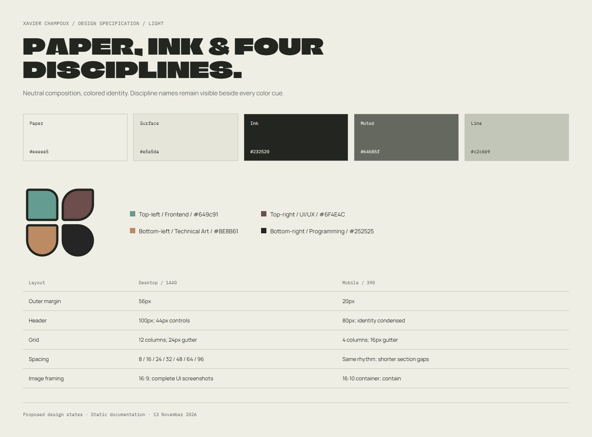 | 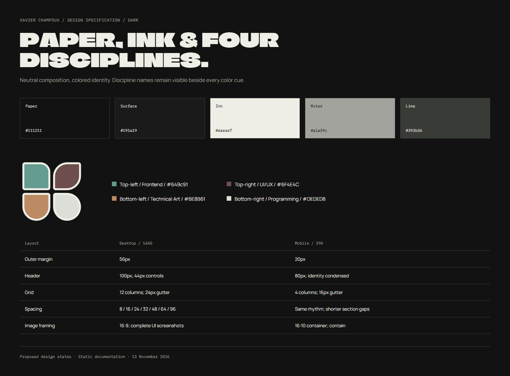 |

### Typography

| Role | Family and weight | Desktop | Mobile |
|---|---|---|---|
| Page title | Climate Crisis 400 | 92–108px | 32–49px, adjusted to title length |
| Home introduction | Climate Crisis 400 | Centered 43px; Split 42px; Framed 40px | 26–27px |
| Short About statement | Climate Crisis 400 | 54px | 31px |
| Project title in Work | Manrope 700 | 46px | 31px |
| Reading copy | Manrope 400–600 | 16–20px / 1.5–1.65 | 14–16px / 1.6 |
| Section headings | Manrope 600–750 | 23–27px | 23px |
| Labels and metadata | IBM Plex Mono 400 | 10–14px | 10–12px |

Climate Crisis is deliberately broad and heavy. Use uppercase, natural word boundaries and **+0.015em** tracking in these studies. Do not force large titles into one line or squeeze letters with negative tracking. Long project names may reduce display size or wrap at words. Body copy uses normal sentence case. Small decorative footer text may be smaller, but essential instructions and controls must remain readable and enlarge normally.

The local font files are from Google Fonts, include the French accents used here, and have their licenses preserved in [the fonts folder](docs/design/fonts/manifest.json). The application will load them through Nuxt Fonts as agreed.

| Light typography | Dark typography |
|---|---|
| 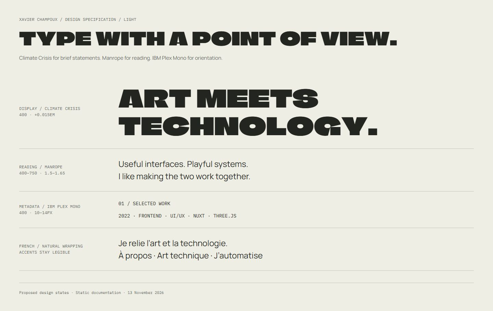 | 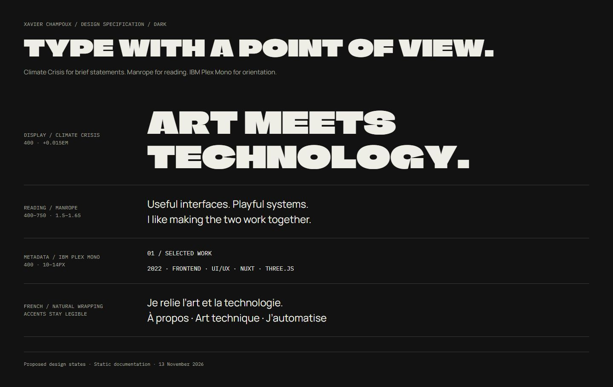 |

### Grid, rhythm and imagery

- Desktop reference: **1440 × 900**, 56px side margins, 12-column alignment system and 24px gutters. Use two-column relationships for project metadata and longer content, without turning every section into cards.
- Mobile reference: **390 × 844**, 20px side margins, four-column alignment system and 16px gutters. Most content becomes one column.
- Spacing rhythm: 8 / 16 / 24 / 32 / 48 / 64 / 96px. Major sections get breathing room; metadata stays close to its subject.
- Header: 100px desktop and 80px mobile in the studies. Implement it fixed above pages with matching content clearance. Condense the descriptor before reducing control targets.
- Rules: 1px decorative separators. Controls have stronger boundaries where needed. Corners remain mostly square or subtly rounded; the machine and logo carry the softer forms.
- Work and project heroes use landscape frames. Use `contain` for complete interface screenshots; avoid cropping away controls as a side effect of uniform cards. Mixed media may have their own aspect ratios further down the project.
- Use the retained portrait in monochrome on About, with a crop that preserves the head. Keep product and client imagery in its original color.

### Logo, icons, noise and cursor

The logo follows the existing SVG geometry: **top-left Frontend, top-right UI/UX, bottom-left Technical Art, bottom-right Programming**. Keep all four colors at rest, with Ink outlines. The application SVG identifiers must be safe for multiple instances. The logo belongs in the header; the machine is the Home centerpiece.

Use one Material Symbols collection in implementation: **Rounded**, through Nuxt Icon, with `light_mode`, `dark_mode`, `arrow_forward`, `arrow_outward`, `play_arrow`, `pause`, `replay`, `close`, `fullscreen` and `expand_more`. The static studies use simple SVG silhouettes to establish their size and placement; they are not a replacement icon library.

Retain AnimatedNoise and CustomCursor. The images freeze the interface and omit live cursor decoration. Keep noise low enough that text contrast remains intact, fix the existing missing effect class, and disable moving decoration where reduced motion or the input device calls for it. The native pointer remains usable.

| Light controls | Dark controls |
|---|---|
| 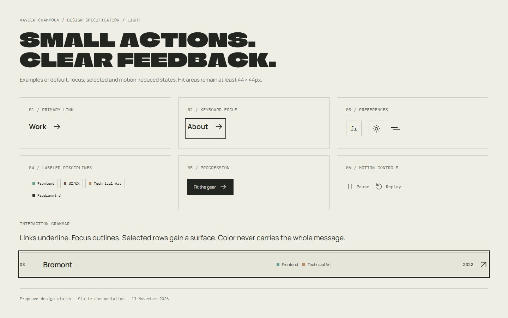 | 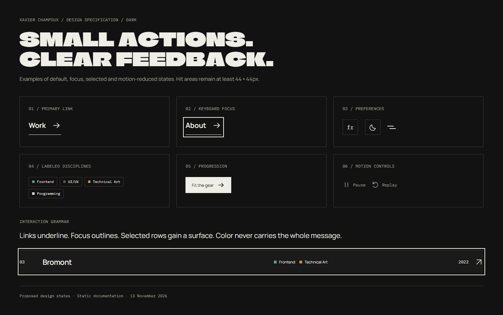 |

## 4. Three Home directions

Every variation uses the same introduction, machine, navigation, palette and type families. These are composition alternatives within the agreed identity, not three competing brands. The images show the completed scene; the same stage accommodates assembly.

### A — Centered / recommended

The sentence leads into a single isolated scene. Work/About sit below, with playback controls at the opposite edge on desktop and a separate row on mobile. There is enough negative space for the pen, cable and loose gear without covering navigation.

| Desktop · light | Desktop · dark |
|---|---|
|  | 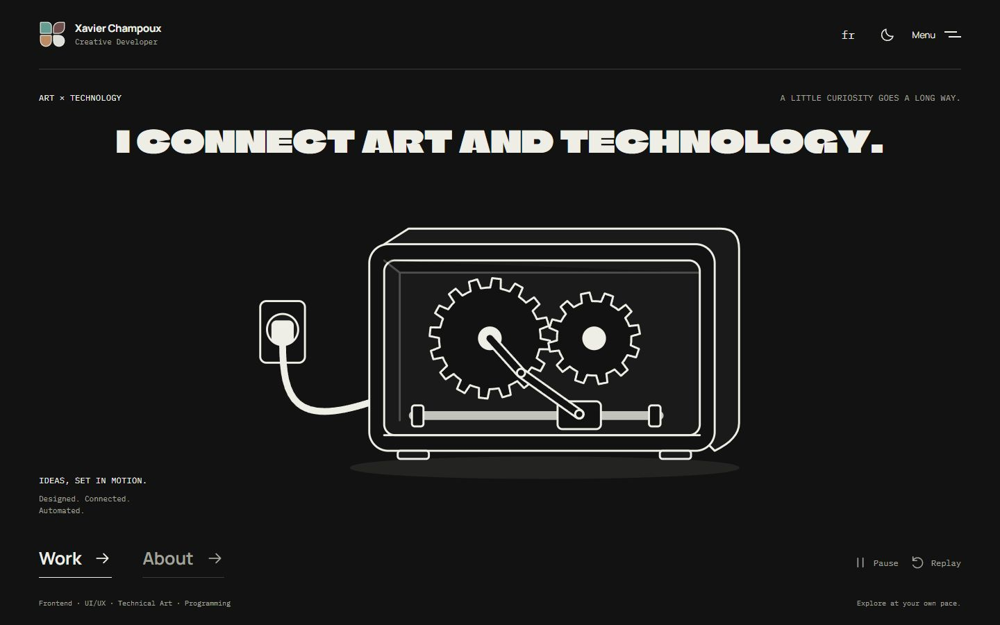 |
| **Mobile · light** | **Mobile · dark** |
| 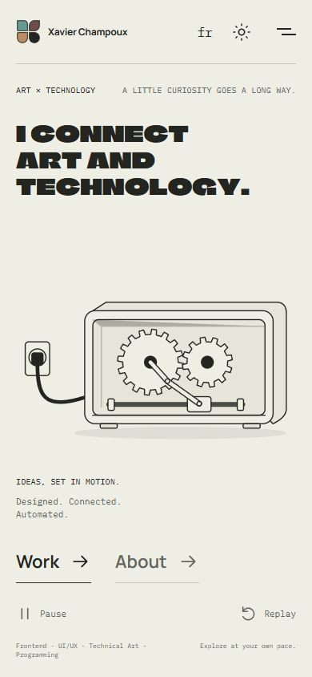 | 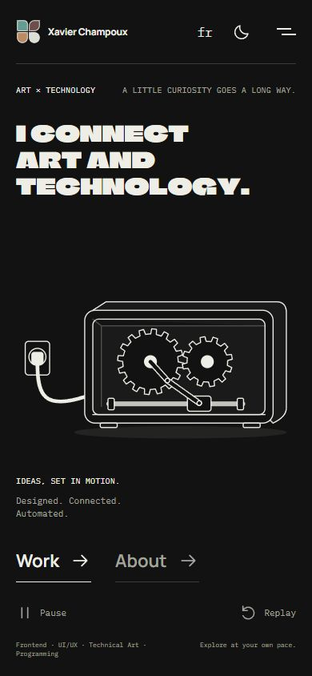 |

### B — Split

The statement occupies the left side, with the machine on the right. This is more editorial and puts text first. It gives the mechanism less horizontal freedom, so display size is deliberately lower than the initial exploration. On mobile, it converges toward the same reading order as Centered.

| Desktop · light | Desktop · dark |
|---|---|
| 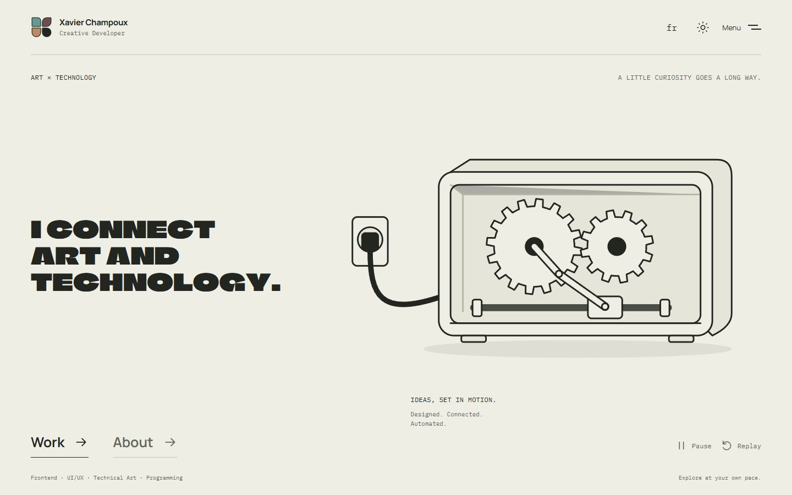 | 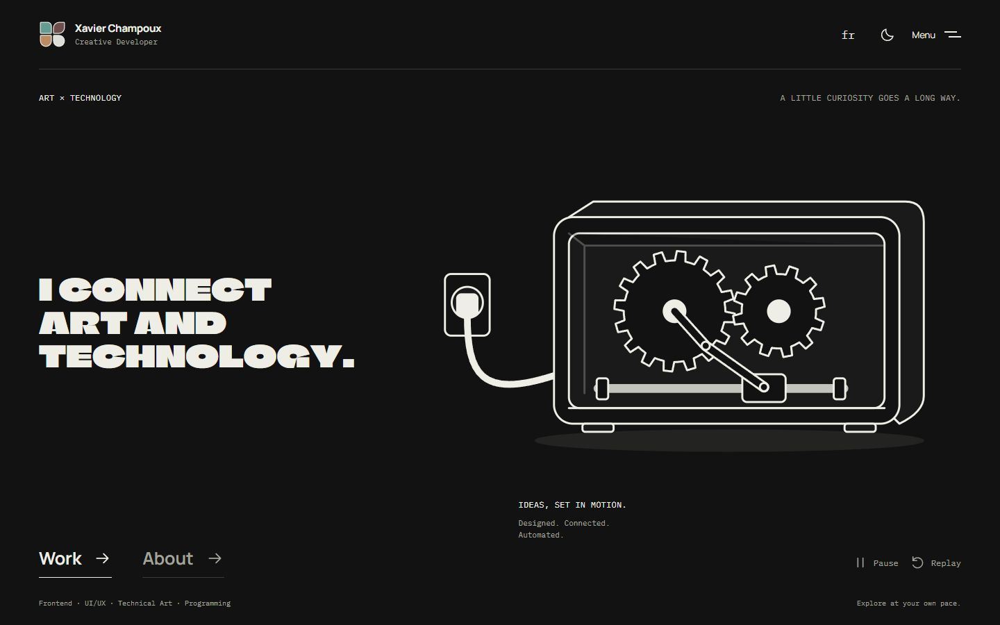 |
| **Mobile · light** | **Mobile · dark** |
| 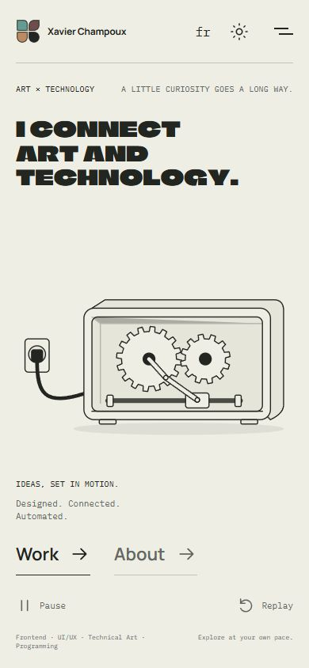 | 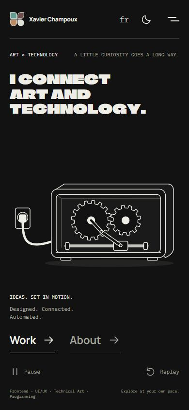 |

### C — Framed

The scene sits within a thin technical frame with discreet registration marks and an object index. It suggests a workshop drawing or exhibit. It has the strongest technical character, while requiring more space for framing and labels on small screens.

| Desktop · light | Desktop · dark |
|---|---|
| 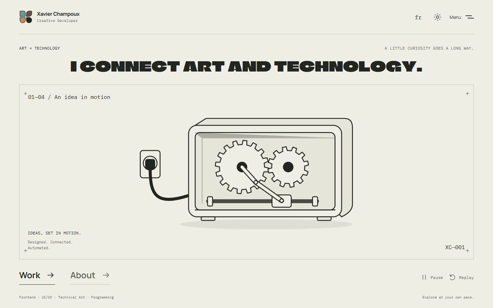 | 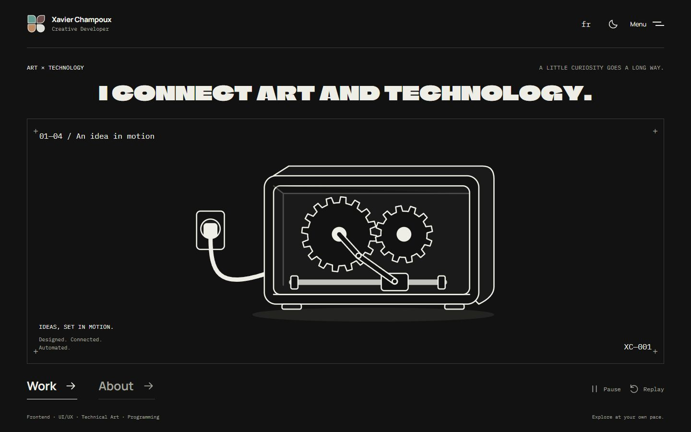 |
| **Mobile · light** | **Mobile · dark** |
| 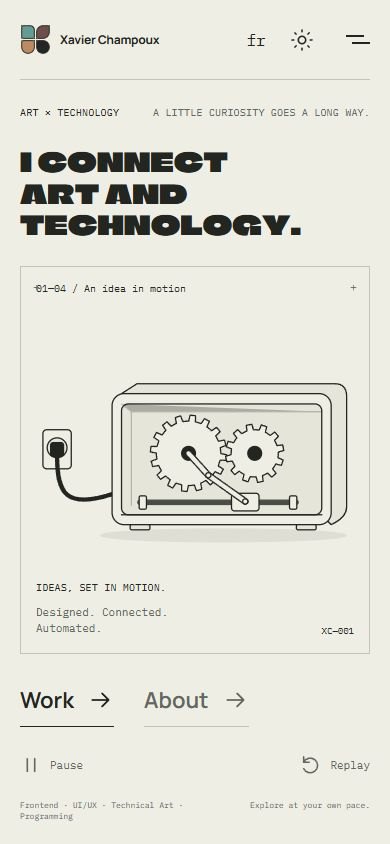 | 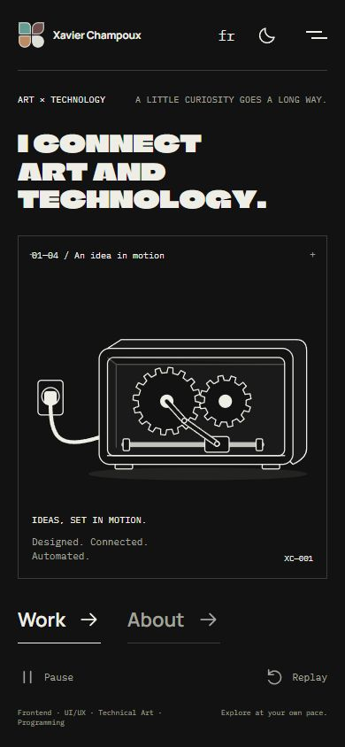 |

### Comparison

| Criterion | Centered | Split | Framed |
|---|---|---|---|
| First impression | Calm, object-led | Editorial, text-led | Precise, workshop-like |
| Assembly space | Most flexible | Tighter beside text | Defined but bounded |
| Work/About visibility | Clear below the stage | Strong lower-left anchor | Clear below the frame |
| French copy | Natural centered wrapping | More sensitive to column width | Good, with extra labels to fit |
| Mobile | Simplest composition | Similar hierarchy after stacking | Most visual furniture |
| Accessibility adaptation | Fewest layout constraints | Must protect the reading column | Must let the frame expand |
| Recommendation | **Develop this direction** | Keep as an editorial alternative | Keep as a technical alternative |

The recommended draft introduction is **“I connect art and technology.”** / **“Je relie l’art et la technologie.”** It expresses the existing art/technology bridge idea without adding a new achievement claim.

## 5. Recommended page designs

The following full-page images extend the recommended identity across the site. Long pages use normal vertical scrolling. Open an image directly to inspect the original size.

### Work / selected evidence

Use four large entries and no filter bar. Each has its number/year, real hero media, project title/link, a concise summary, discipline labels and secondary tools. Keep the selection finite and intentional. The final transition leads to About/CV.

Hero selections reviewed for these studies:

| Project | Image | Reason |
|---|---|---|
| Feltkutur | `public/images/projects/feltkutur/1.webp` | Shows the configurator in use, including its interface |
| Ryker | `public/images/projects/ryker/0.webp` | Clear opening composition and recognizable subject |
| Schluter | `public/images/projects/schluter/7.webp` | Shows the layered construction rather than an instructions overlay |
| Simona | `public/images/projects/simona/0.webp` | Landscape configurator view; more informative in a broad hero than the retained portrait-format cover |

Schluter is explicitly **Technical Art**, with **Unreal Engine 4**, **Level Creation** and **Blueprint** tags. Other assignments and summary wording are proposed editorial labels pending content review. No project media were altered.

| Desktop · light | Desktop · dark |
|---|---|
| 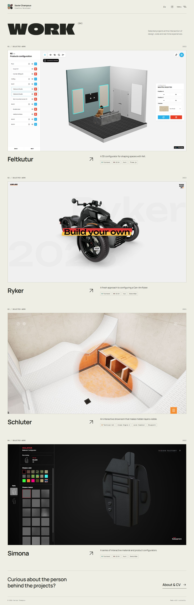 | 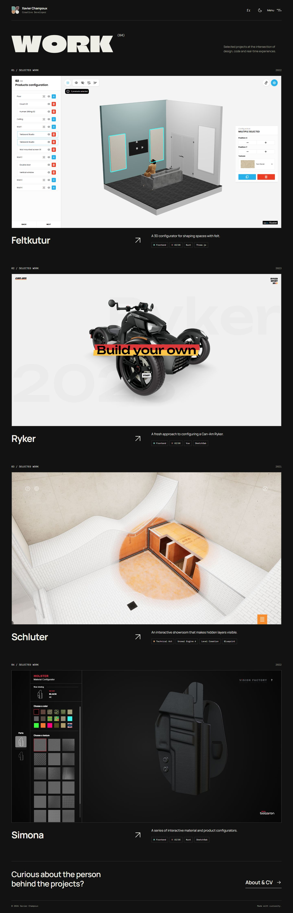 |
| **Mobile · light** | **Mobile · dark** |
| 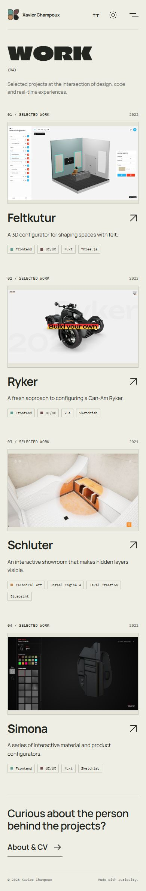 | 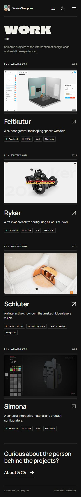 |

### Archive / an editorial index

Put the heading and short description above two explicit controls: one discipline and one sort order. Default to all disciplines and newest first. Use aligned name, discipline and year columns, with the whole row acting as the project link. On mobile, place discipline metadata below the title and retain year alignment.

The twelve rows in the studies are American Biltrite, ECD, Bromont, Cloner, Cyberblade, GrowNShrink, Identity, Living Typo, Monologue, Tile Map Generator, Unstable and Amie. Equal-year entries use title order in the mockup. The four selected projects and old portfolio versions are absent.

Preserve browsing choices in the URL and restore scroll position after browser Back. Direct loading and history work normally. There is no Archive link in the header, footer, Home, Work, About or project template; its only site navigation entry is the menu.

| Desktop · light | Desktop · dark |
|---|---|
| 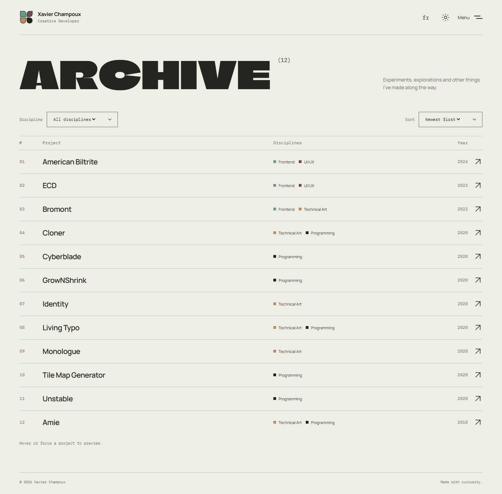 | 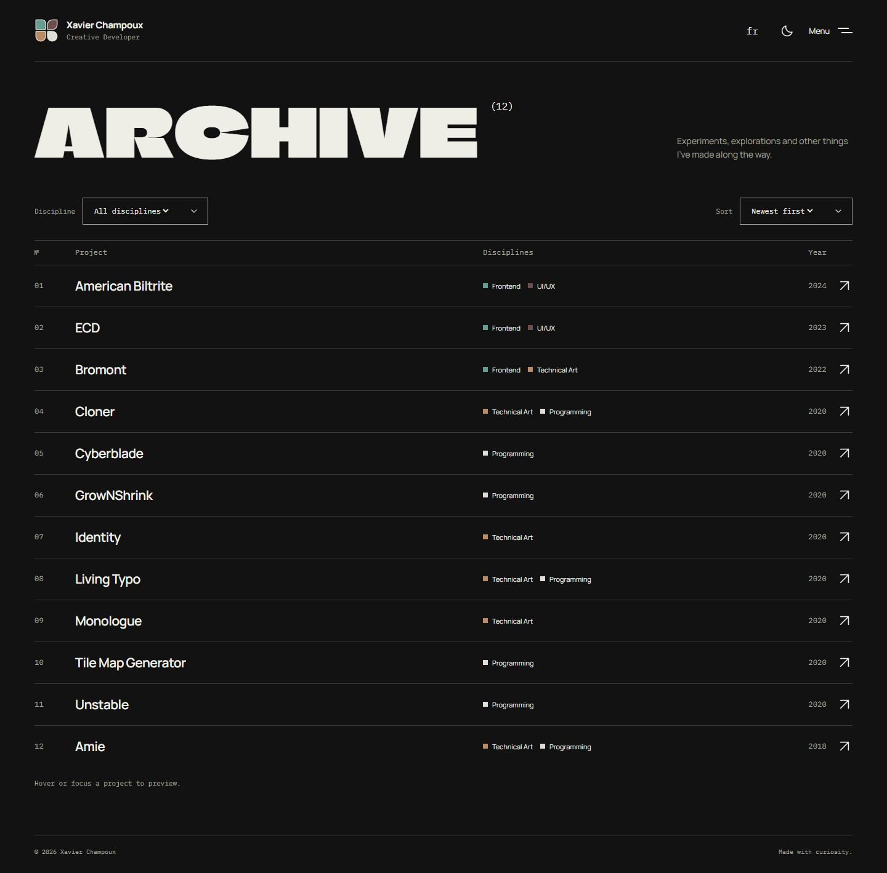 |
| **Mobile · light** | **Mobile · dark** |
| 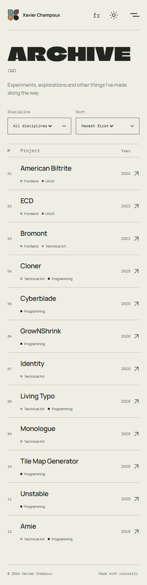 | 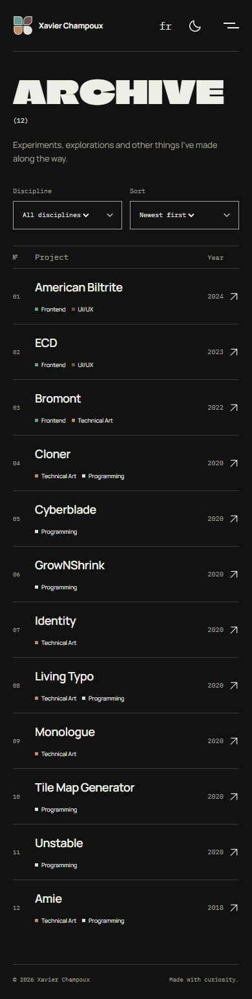 |

### About / a person, capabilities and a readable CV

Follow the established content order: three personal ideas, four disciplines, CV, robotics interest, then contact. The portrait supports the personal statements. Avoid proficiency meters and long tool-logo walls; concise examples and links supply more useful evidence.

The four sections link to representative project pages: Feltkutur, Ryker, Schluter and Tile Map Generator. Linking to an individual project also found in Archive does not add an Archive navigation link. CV groups remain separate: experience, education, awards, teaching and public presence.

The industrial robotics paragraph describes an **interest and potential direction**, not employment experience. Contact uses the supplied email and GitHub/Instagram/LinkedIn/YouTube links. Dates, degree names, organization names, roles and award wording in the images are source-derived drafts requiring factual review before publication.

| Desktop · light | Desktop · dark |
|---|---|
| 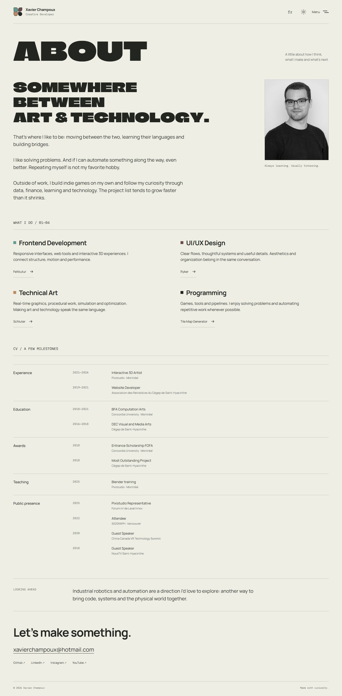 | 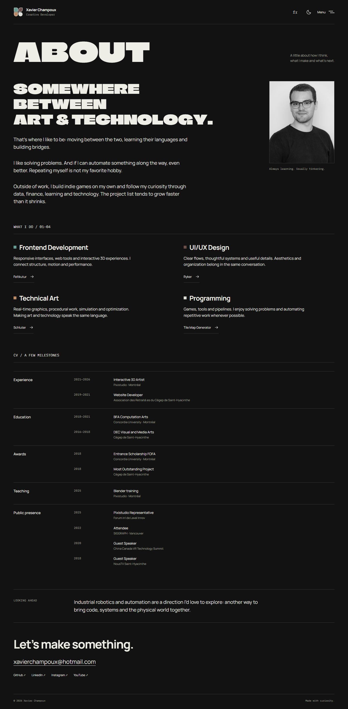 |
| **Mobile · light** | **Mobile · dark** |
| 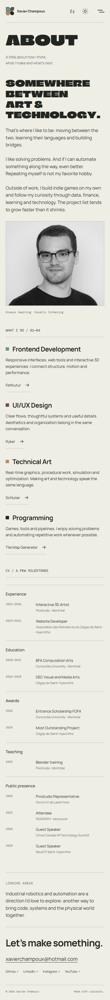 | 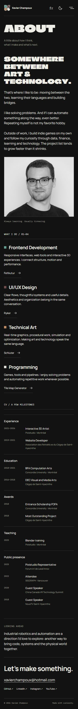 |

### Project / context, contribution and media

Feltkutur demonstrates the shared template. Put title/year/disciplines before a large hero. Follow with two distinct text sections: **The project** and **My contribution**. Place applicable live/demo/repository links alongside context. Then show the ordered media sequence, captions, video poster and credits.

Two-up media is appropriate for related desktop interface details. Mobile uses a single column. Preserve complete screenshots; visitors can enlarge them. A video appears as a poster with an explicit Play action and playback controls after activation. The example playback time on the media state board is illustrative.

The closing link returns to Work. Visitors who arrived through Archive use browser Back to recover their browsing state; do not add a separate return-to-Archive link. Process or outcome sections should appear only where the project material supports them. Do not manufacture results or responsibility claims to fill a template.

| Desktop · light | Desktop · dark |
|---|---|
|  | 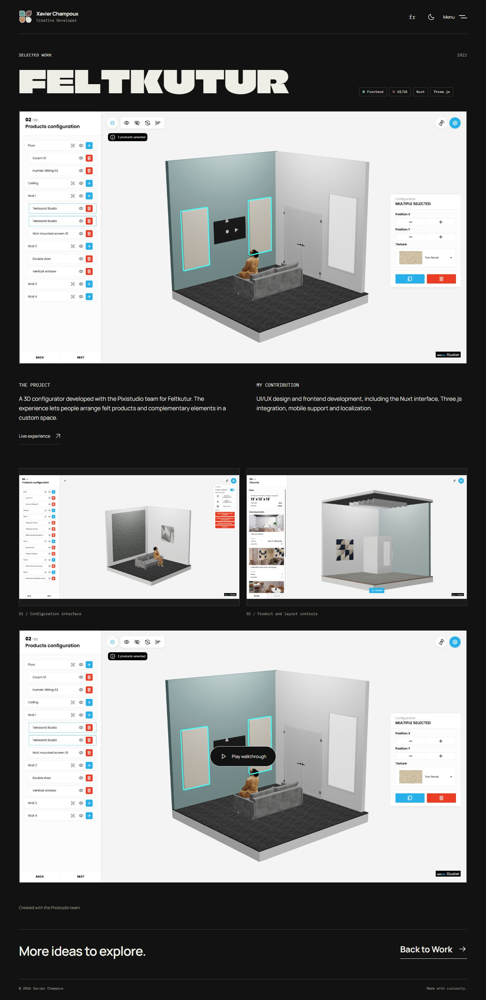 |
| **Mobile · light** | **Mobile · dark** |
| 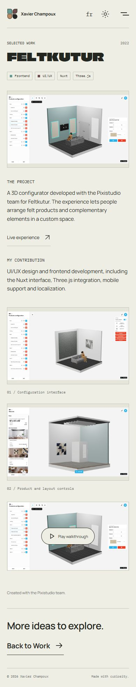 | 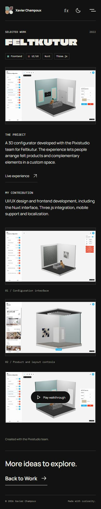 |

### Menu / one clear navigation view

Use bold numbered links in the exact order **01 Home / 02 Work / 03 Archive / 04 About**. The header identity and preferences remain in place, with the menu trigger changing to Close. Use a full-screen surface matching the active theme. The overlay slides from the right, with no second competing page transition.

Trap focus within the overlay, make the page behind it inert, lock background scrolling, close on Escape and return focus to the trigger. A link closes the menu and navigates once. These are implementation requirements; the documentation study illustrates the visual states rather than providing a completed modal component.

| Desktop · light | Desktop · dark |
|---|---|
| 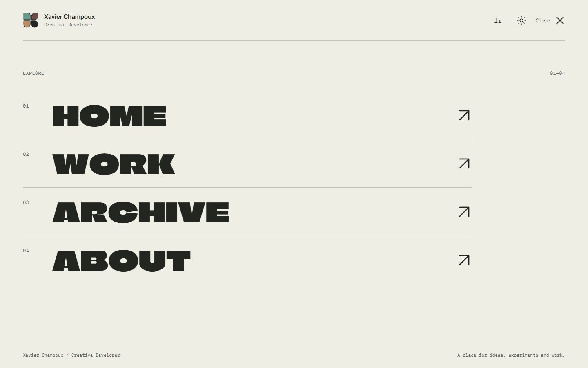 | 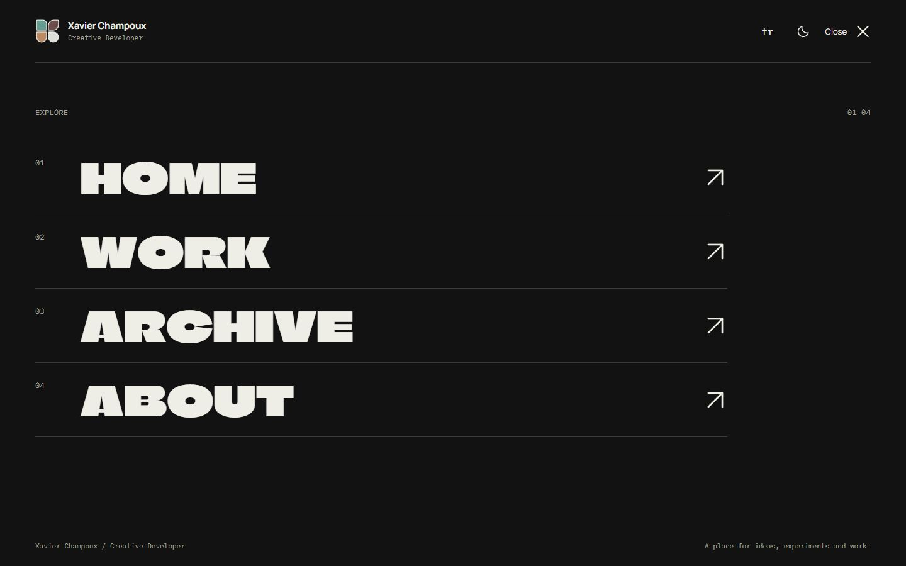 |
| **Mobile · light** | **Mobile · dark** |
| 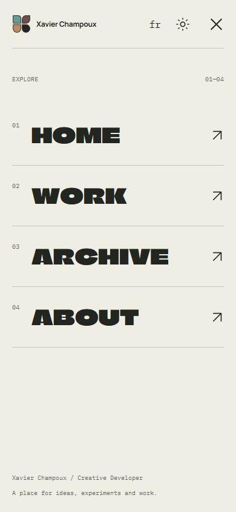 | 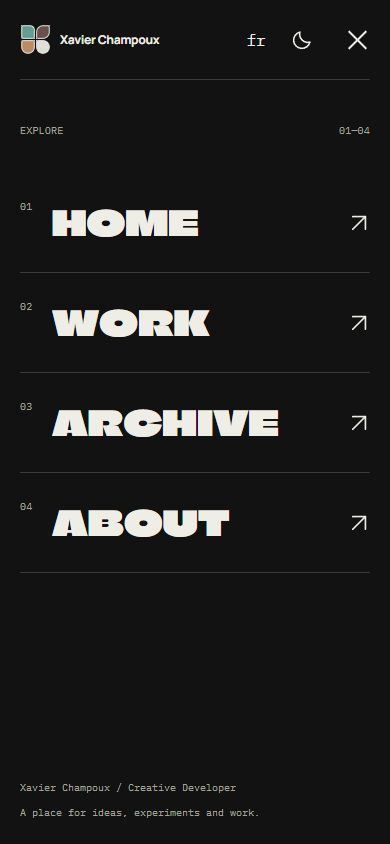 |

### Missing projects and 404 pages

Use the same header and theme, a brief localized display heading, a plain explanation and clear Home/Work links. Keep the layout readable without the scene. Do not place an Archive call to action on the error page. Draft copy: “Page not found. Let’s get you back to the work.” / “Page introuvable. Revenons aux projets.”

## 6. Machine art direction and intro

### Conceptual illustrations

The two illustrations below were created with the built-in image generation tool. They explore volume, outline polarity and material mood. The dark study was generated from the light study to maintain the same composition. Exact prompts are preserved in [image-prompts.json](docs/design/source/image-prompts.json).

| Conceptual · light | Conceptual · dark |
|---|---|
|  |  |

Use matte faces, a shallow casing, rounded corners and clear ink edges. Keep the socket, cable, two gears and crank-driven slider visually distinct. The dark version changes the value structure rather than adding neon or bloom. Soft contact shadows may ground the object without turning it photorealistic.

These generated pictures are documentation assets only. Their tooth shapes and linkage are not an engineering drawing. The page mockups instead use a consistent vector schematic so that layout and interactive targets are unambiguous. Production still starts with procedural TresJS/Three.js geometry, followed by the working-prototype checkpoint in PLAN.md.

### Four-step sequence

| Step | Visual instruction | Pointer/touch action | HTML equivalent | Visual result |
|---|---|---|---|---|
| 01 — I design / Je conçois | Dashed rectangular outline, pen at the active edge | Guide the pen; generous path tolerance | Draw the casing / Tracer le boîtier | Outline gains shallow depth and becomes the casing |
| 02 — I connect / Je connecte | Loose plug, clearly visible socket | Bring plug into socket; tap alternative | Connect the plug / Brancher la fiche | Connection resolves and cable settles |
| 03 — I automate / J’automatise | One existing gear, one empty recess, one loose gear | Drag or tap to fit the gear | Fit the gear / Placer l’engrenage | The two gears engage |
| 04 — I create / Je crée | Complete stationary mechanism, explicit Play | Press Play | Play machine / Démarrer la machine | Gears and slider begin their coordinated motion |

| Light intro storyboard | Dark intro storyboard |
|---|---|
|  |  |

Keep the camera fixed across steps. Move the subject or control into position instead of making visitors reorient themselves. Targets should have at least 44px equivalent hit areas, larger on touch where the visible object is small. Use generous snapping and retain the explicit button alternative when the illustrated path or drag is difficult.

Navigation and Skip remain available at every step. Skip resolves directly to the complete machine. Leaving Home during assembly records a skip. The intro runs on the first Home visit; completion or skipping is remembered in this browser. Replay explicitly restarts at step 01. Direct visits to other pages bypass assembly.

The finished mechanism has Pause/Resume and Replay. Under reduced motion, the finished mechanism starts still and moves only on an explicit Play action. Pause rendering when the page is hidden. Storage failure must not block the page or navigation.

## 7. Interaction and motion

All timings below are **proposed design defaults**, not measurements copied from the references. Tune them against the working prototype while retaining the same restrained character.

### Arrival and navigation

| Light arrival/transition board | Dark arrival/transition board |
|---|---|
|  |  |

| Event | Proposed treatment | Reduced motion |
|---|---|---|
| Document arrival | Colored logo resolves briefly; dismiss when essential content is ready | Immediate reveal when ready |
| Page navigation | 180ms crossfade through the agreed Nuxt View Transition integration; short fade fallback | Instant change or a minimal opacity fade |
| Menu open/close | 360ms slide from the right, ease-out | Instant overlay state change |
| Work entry reveal | 280ms opacity and up to 12px vertical travel, once as it enters view | Already in place |
| Link hover/focus | 140ms underline/arrow response, up to 4px arrow movement | Underline/focus change without travel |
| Intro state resolve | Roughly 350–500ms, coordinated with the step's object | Discrete completed state |

Never impose a minimum loading delay or wait for gallery media. The approximate two-second arrival target in PLAN.md is a readiness target, not a pause. Do not require a click to continue after loading. Keep arrival and assembly as separate states. Coordinate page transitions and in-page reveals so they do not run as competing overlays.

### Archive preview behavior

| Light preview states | Dark preview states |
|---|---|
|  |  |

For a fine pointer, use a preview around 350 × 220px at the desktop reference width, reduced when available room requires it. Position it near the pointer without covering the active project name. Keep at least 16px viewport clearance and avoid the fixed header. Damped following and a maximum lateral rotation of approximately ±3° should feel like a small object responding, rather than a cursor trail.

Keyboard focus gets a stationary preview with a visible row outline. Mobile/coarse-pointer layouts use text rows only. Reduced motion removes wobbling and eased pursuit. An unavailable preview image never removes the row or its link.

Sorting and filtering update the list without changing the whole page composition. Announce the result count. Provide a clear reset action if a valid selection yields no items. Preserve filter, sort and scroll context when returning from a project.

### Media enlargement and playback

| Light media states | Dark media states |
|---|---|
|  |  |

Image enlargement opens a theme-consistent dialog with the complete image, caption, position/count and a labeled Close control. Escape closes it; focus returns to the originating image. Respect available space rather than cropping the work to fill the screen.

Video starts only after Play. Retain a poster, native playback controls and a useful accessible name. Make caption/transcript decisions after reviewing whether each source video contains meaningful speech or sound. Do not add autoplaying media, invented durations or unsupported project claims to the production page.

### Completed, reduced-motion and unavailable-3D states

| Light fallback states | Dark fallback states |
|---|---|
|  |  |

If 3D cannot initialize, show the static machine and keep the same sentence and Work/About links. Remove controls that cannot operate. A retry can be optional and discreet. Keep every project and About/CV readable independently of the Home scene.

## 8. Responsive design and accessibility

### Responsive rules

| Width/context | Layout behavior |
|---|---|
| 1024px and wider | Full identity; two-column metadata/content relationships; pointer previews where the input supports them |
| 701–1023px | Reduce outer margins toward 32px; preserve reading order; stack any pair that cannot maintain comfortable text width |
| 700px and narrower | 20px margins; condensed identity; text rows in Archive; single-column projects and About; controls stay 44px or larger |
| Narrower than the 390px reference | Let headings wrap at words, lower display size where needed, and stack controls before shrinking targets |
| Enlarged text / short viewport | Home becomes a scrolling composition; no clipping, fixed-height trap or inaccessible off-screen action |

These are content-driven breakpoints. Preview exports use 1440 × 900 and 390 × 844, and scrolling pages are captured to their complete content height. Browser scrollbars are omitted from the image export; the application retains ordinary scrolling.

### Interaction requirements

- Use a logical heading hierarchy and document order independent of visual positioning.
- Give language/theme/menu controls accessible names; visible locale codes identify the target language. Sun/moon represents the current theme.
- Provide a skip-to-content link and visible focus. Use a 2px Ink focus outline with enough offset to avoid merging with a border.
- Keep meaningful names beside discipline markers. Never rely on hue, hover, sound or animation alone.
- Keep equivalent labeled HTML actions for all four scene steps. Avoid keyboard focus targets inside an opaque canvas-only interaction.
- Handle menu/dialog focus containment, Escape and restoration. The underlying page is inert while an overlay is active.
- Keep content usable at 200% text enlargement and reflow at narrow widths. Treat the supplied viewports as references, not hard limits.
- Disable moving cursor decoration and idle mechanism motion when appropriate. Keep pause controls available for continuous motion.
- Pause or release off-screen scene work as specified in PLAN.md; this document does not claim performance measurements from a static picture.

**Verification boundary:** these images and layout checks establish the design. Keyboard behavior, storage failure, reduced-motion response, scene failure and resource cleanup still require implementation tests during the application rebuild.

## 9. French samples and content review

English is served at `/`; French uses `/fr`. Language switching preserves the equivalent page and relevant query state. All launch content requires both languages, even though the image set uses representative French samples rather than duplicating every composition in French.

| French Home · desktop light | French Home · mobile dark |
|---|---|
|  |  |

| French Work | French About/CV |
|---|---|
|  |  |
| **French Archive** | **French menu** |
|  |  |


### Copy principles

Keep the conversational tone and a little humor. The About draft preserves the three established ideas: moving between art and technology, enjoying problem-solving/automation, and making indie games while exploring other interests. Capabilities describe the kinds of work present in the repository rather than claiming unsupported mastery.

| Review area | Required confirmation before publication |
|---|---|
| Home and navigation | Approve the shortened EN/FR introduction and the visible navigation labels |
| Selected work | Confirm summaries, individual/team contribution, client names and applicable links |
| Discipline mapping | Confirm proposed multi-discipline assignments; retain the explicitly agreed Schluter Technical Art classification |
| CV | Review every date, employment endpoint, degree title, award title, organization and location; French degree wording is provisional |
| Teaching/public presence | Keep training distinct from public speaking and attendance; verify event names and roles |
| Contact | Confirm the supplied email/social destinations are ready to publish |
| Project media | Confirm captions, alt text, posters, credits and any speech/transcript requirements |

The mockups are not a complete translated content catalog. Their wording is a visible draft for review; the production authoring step still needs all sixteen projects and both locale files.

## 10. Recommendations and review checklist

### Recommendations

1. **Choose Centered.** It gives the four interactions the most room and makes the smallest compromises on mobile.
2. **Keep the shell quiet.** The machine and project media already supply visual interest; broad typography and spacing are enough to organize them.
3. **Use flat outlines for the procedural prototype.** Keep Canvas UI's printed-ink effect as a comparison. Review the working scene before considering authored model replacements.
4. **Protect reading contrast.** Use Ink on light Surface; keep discipline colors attached to labels. Recheck text after integrating noise.
5. **Keep Work short and evidence-led.** Four substantial entries are a clearer introduction than mixing selected work with a filterable inventory.
6. **Preserve the explicit contribution block.** It makes multidisciplinary and team projects easier to assess fairly.
7. **Keep motion small and purposeful.** A coherent arrival, menu slide and scene assembly are enough to establish character.
8. **Review bilingual copy and CV facts before implementation hardens the layouts.** Allow natural wrapping rather than shrinking French text to match English line breaks.

### Design approval checklist

- [ ] Reference relevance and the distinction between observations and proposals are accepted.
- [ ] Centered is approved, or a specific alternative is selected.
- [ ] Light/dark value balance, type scale and logo treatment are accepted.
- [ ] Machine shape, angle, outline weight and all four assembly steps are accepted as the prototype direction.
- [ ] Work hero choices and the four-project sequence are accepted.
- [ ] Archive density, filter/sort placement and preview behavior are accepted.
- [ ] About structure, portrait treatment and CV grouping are accepted.
- [ ] Project template, contribution emphasis, gallery and video treatment are accepted.
- [ ] Menu-only Archive access and the menu link order are confirmed.
- [ ] Draft EN/FR copy, CV facts and project credits have a clear content review path.

Application implementation begins after design review. Publication still requires the prototype, content and release checks in PLAN.md.

## 11. Deliverables, validation and reproduction

### Image inventory

| Set | Count | Contents |
|---|---:|---|
| Reference evidence | 13 | Sharlee Home/menu, Lucas, Givelet, four Awwwards collections, Dribbble, two CollectUI collections, Canvas UI and Codrops |
| Page designs | 39 | Twelve Home variations, twenty other page views and seven representative French samples |
| State/foundation boards | 16 | Intro, arrival, archive previews, media, fallback, palette/logo, typography and controls, each in both themes |
| Concept illustrations | 2 | Matching light/dark machine studies |
| **Core illustrated deliverables** | **70** | Local images linked throughout this document |

See the [screen manifest](docs/design/screens/manifest.json), [board manifest](docs/design/boards/manifest.json), [concept manifest](docs/design/concepts/manifest.json) and [reference manifest](docs/design/references/manifest.json) for individual files and dimensions. Auxiliary review contact sheets are stored alongside these folders.

### Validation completed

- Exported at the agreed reference widths. Full scrolling pages retain their complete content height; captures wait for local assets to settle before export.
- Checked all 55 page/board layouts for horizontal overflow and missing image loads at their reference viewport. The saved image files were also inspected, including the corrected export pass.
- Verified the required twelve Home combinations and twenty recommended page combinations, plus the seven French samples.
- Calculated palette contrast and recorded the prohibited light Muted/Surface pairing.
- Checked agreed font files, selected-work order, image dimensions and local document links with the [artifact audit](docs/design/source/audit.mjs).
- Preserved exact image-generation prompts, Google Fonts sources/licenses and browser capture metadata.

The [validation report](docs/design/validation.json) contains machine-readable counts, contrast ratios and link results. Browser layout records are preserved in [main checks](docs/design/browser-validation-main.json) and [additional checks](docs/design/browser-validation-extra.json). These checks concern the documentation artifacts; they do not claim that the future application's behavior or performance has been tested.

### Preview and edit the studies

The Markdown and all exported images can be reviewed directly without starting the application. The editable HTML/CSS/JavaScript studies live under `docs/design/source/` and use only the local fonts and retained repository imagery.

From the project root:

```powershell
node docs/design/source/server.mjs
```

Open [the local design study](http://localhost:4178/docs/design/source/studio.html?page=home&theme=light&variation=centered). Query controls select `page`, `theme`, `variation`, `locale` and illustrative intro `state`. Use `page=gallery&kind=screens` or `page=gallery&kind=boards` to inspect exported files. This is a documentation study: some links/preferences and step switches work for inspection; scene mechanics, complete media controls, routing restoration and overlay accessibility remain implementation work.

After replacing exported files or editing the document, run:

```powershell
node docs/design/source/audit.mjs --write-manifests
node docs/design/source/audit.mjs
```

No package manifest, application route, production dependency, locale file or deployment configuration was changed to create these studies. Existing work in the repository remains separate from this documentation deliverable.
