# Portfolio — Design V2

**Design review · 13 November 2026 · Application implementation remains pending.**

This revision follows your review of [Design V1](DESIGN.md) and updates the shared [implementation plan](PLAN.md). All new studies and captures are isolated in [docs/design_v2](docs/design_v2/). V1 remains a historical comparison; this document supersedes its centered recommendation, rectangular-only machine studies, tutorial-style intro boards, arrival treatment, project media enlargement, and click-to-play-only video specification.

**Recommended combination:** Square Split Home · Machine menu · Editorial sequence Work · Editorial About. The Home preference is now **Split**. The square casing and the particular Work/menu/About alternatives remain proposals for your review.

## 1. What changed, and what stays

| Area | V2 decision or proposal |
|---|---|
| Foundations | Preserve the accepted palette, three fonts, icon style, four-color logo geometry, noise/cursor direction, and discipline identification. |
| Action links | Use a 45° up-right arrow. Compare slide-in and out/in underlines; recommend one out/in cycle on entry. |
| Shared shell | Uppercase EN/FR, smaller logo, no rule under the header or above the footer. |
| Desktop width | Center content within 1120px; reserve an outside lane for the scroll control. |
| Home | Retain the Split baseline; add Square Split, Square Centered, and Offset Square with a distinct mobile composition. |
| Menu | Two new alternatives: links with the machine on the right; an open four-position composition. |
| Work | Keep the introduction; compare two different project-list layouts. |
| Archive | Surface hover color; larger image-only preview without a caption, frame, border, or year. |
| About | Two new layouts, both with the two personal lists and exact profile stacks; remove profile project links. |
| Project | Preserve data order, lead with video when first in data, autoplay muted, no enlargement, collection-specific footer. |
| Intro | Center the active object, small one-liner below, tiny progression/Skip on the right, hints after inactivity. |
| Arrival | A full-screen small loading mark with restrained console-style status lines. |

The audience and main journey stay **Home → Work → About/CV**. Work keeps **Feltkutur → Ryker → Schluter → Simona**. Archive remains a separate twelve-project collection, reachable through the menu as its only site navigation entry. Both languages and themes remain launch requirements.

This is a set of accurate layout studies and proposed behavior, not a rebuilt application. The square mechanism is a deterministic vector composition used to compare space and hierarchy; it is not a final 3D model or a mechanically validated simulation. No new generated production asset is introduced.

## 2. Accepted foundations, refined shell

### Palette and type

| Token | Light | Dark |
|---|---|---|
| Paper | #eeeee5 | #111211 |
| Surface | #e5e5da | #191a19 |
| Ink | #232520 | #eeeee7 |
| Muted | #64685f | #a1a39c |
| Line | #c2c6b9 | #393b36 |
| Frontend | #649c91 | #649c91 |
| UI/UX | #6F4E4C | #6F4E4C |
| Technical Art | #BE8B61 | #BE8B61 |
| Programming | #252525 | #DEDED8 |

Climate Crisis remains the short display voice, Manrope the reading face, and IBM Plex Mono the orientation/metadata face. The studies use locally stored real font files, including French accents. Font sources and OFL licenses are retained in [fonts](docs/design_v2/fonts/). Keep broad display text brief; never compress French text to force English line breaks.

| Use | Desktop reference | Mobile reference |
|---|---|---|
| Collection heading | 73px Climate Crisis | 39px; natural wrapping |
| Split Home statement | 40px | 26px |
| About statement | 34–40px | 26–27px |
| Reading | 15–17px, 1.6–1.65 line height | 14–15px, 1.6 line height |
| Action links | 22–25px main / 14px secondary | 19–22px main |
| Metadata | Generally 10–12px | Generally 9–11px; allow enlargement |

Very small mechanism labels and footer annotations are secondary in the image studies. Essential navigation keeps clear text and generous targets. During implementation, check the chosen type sizes with real text enlargement and zoom, rather than treating these reference pixels as limits.

Use Ink for text on light Surface: light Muted/Surface is approximately **4.49:1**, so it is not approved for ordinary text. Ink/Paper is 13.26:1 in light and 16.11:1 in dark. Discipline colors identify sections beside text; they do not replace readable names. Recheck contrast with actual noise compositing.

### Width, logo, icons and rules

- **1120px maximum content width** gives 160px side margins at 1440px. Do not scale images indefinitely on wider monitors. A two-column gallery image is about 548px wide; Work's paired images are about 542px wide.
- Header and footer share the content alignment. The intended application header remains fixed with content clearance; these full-page studies capture it once at the top.
- Visible logo: **28px desktop / 23px mobile**, with original geometry and colors. The identity link and preference controls retain accessible hit areas.
- Display the target locale as **FR** or **EN**; route codes stay lowercase. Theme and menu labels retain accessible names.
- Remove the header-bottom and footer-top rules. Keep purposeful rules in Archive, CV, controls and chapter lists.
- Every underlined action uses the same up-right arrow; the diagonal arrow indicates continuation and does not imply that every link opens a new tab.
- Preserve the accepted Material Symbols direction for production. The review studies use equivalent outlined SVG silhouettes. Keep the retained cursor/noise treatments subordinate and disable decoration as needed for input and motion preferences.

### Underline comparison

| Light | Dark |
|---|---|
| 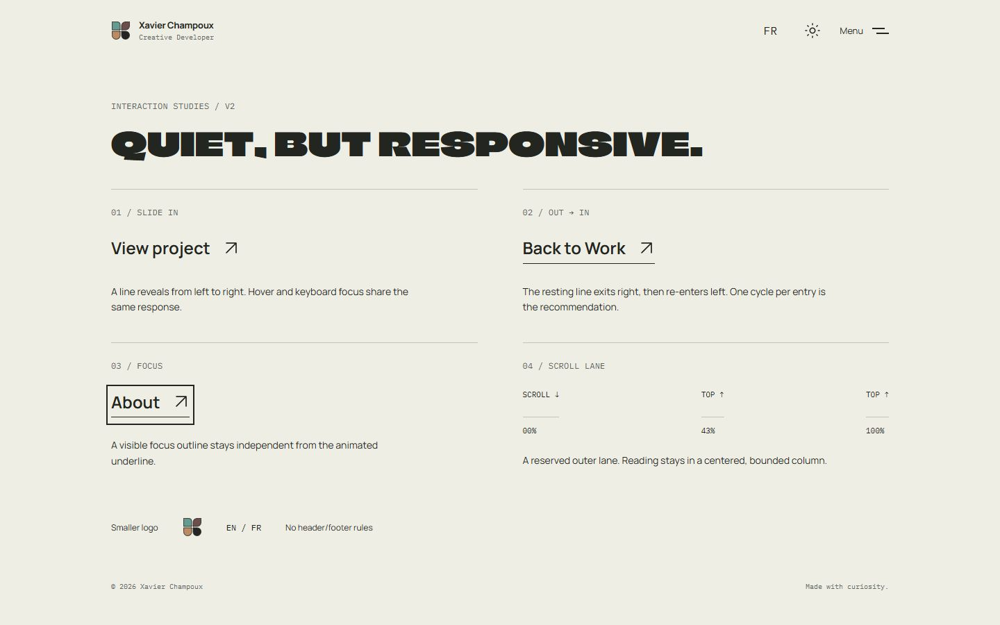 | 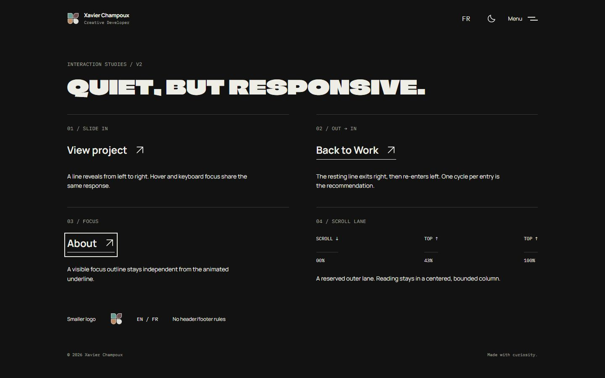 |

| Choice | Behavior | Recommendation |
|---|---|---|
| Slide in | Underline scales from the left on hover or focus, around 250ms; exits on leave. | Good for secondary links and sparse pages. |
| Out → in | Resting underline travels out right and returns from left, around 480ms total. | **Preferred for prominent Work/About/project links.** One cycle per pointer/focus entry. |
| Continuous loop | Repeat the same out/in cycle while hovered. | Optional experiment; avoid making it the default on every link. |

Keep an independent focus outline. Touch keeps the resting underline and pressed feedback. Reduced motion keeps a static underline and immediate state feedback. The isolated study includes both hover/focus animations for comparison; approval of a screenshot does not select an endless loop.

## 3. Home — four compositions

The top eyebrow pair, bottom discipline line, navigation and playback remain familiar. The new box has a **square front face**, not merely a square container around the old rectangular machine: its front is 355 × 355 drawing units. The cable/socket stay outside the casing; meshing gears move diagonally inside it; the crank-driven slider stays near the base. The shallow extrusion and gentle angle preserve depth without making a large industrial render.

### A. Retained Split / rectangular baseline

| Desktop · light | Desktop · dark |
|---|---|
| 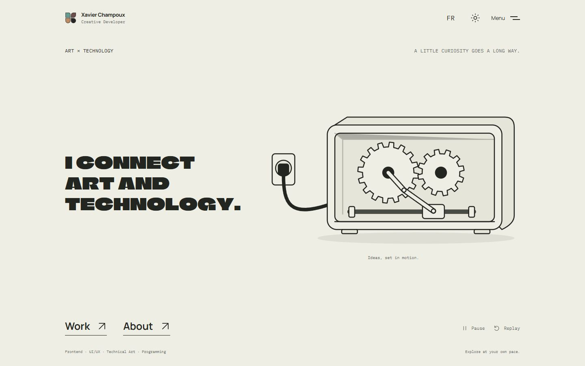 | 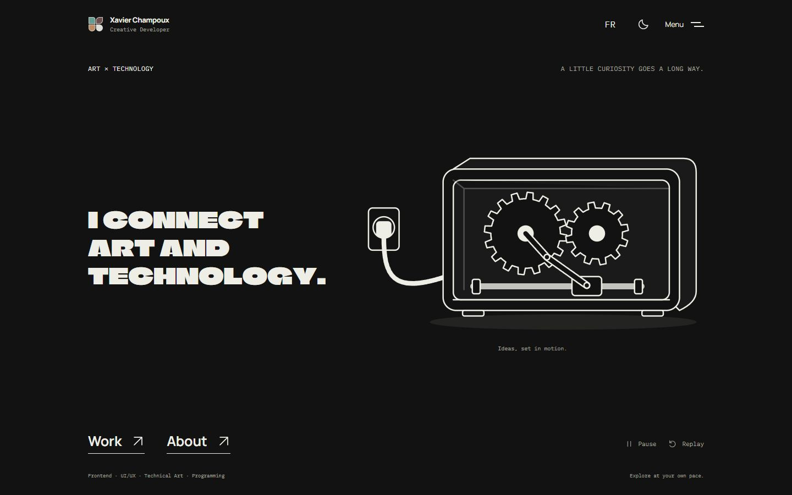 |

| Mobile · light | Mobile · dark |
|---|---|
| 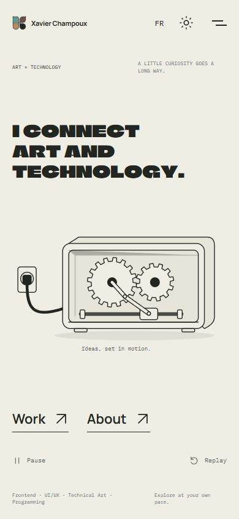 | 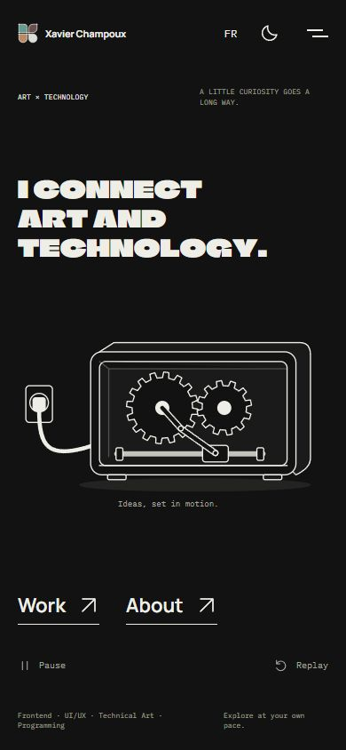 |

This keeps the direction you liked, applying the smaller logo, quieter shell, bounded width, diagonal actions and uppercase locale. On mobile, the statement, mechanism and links form the familiar vertical stack. This is the comparison baseline, not an additional recommendation to return to the old centered direction.

### B. Square Split / recommended

| Desktop · light | Desktop · dark |
|---|---|
| 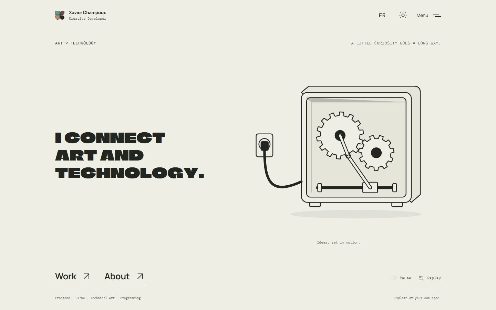 | 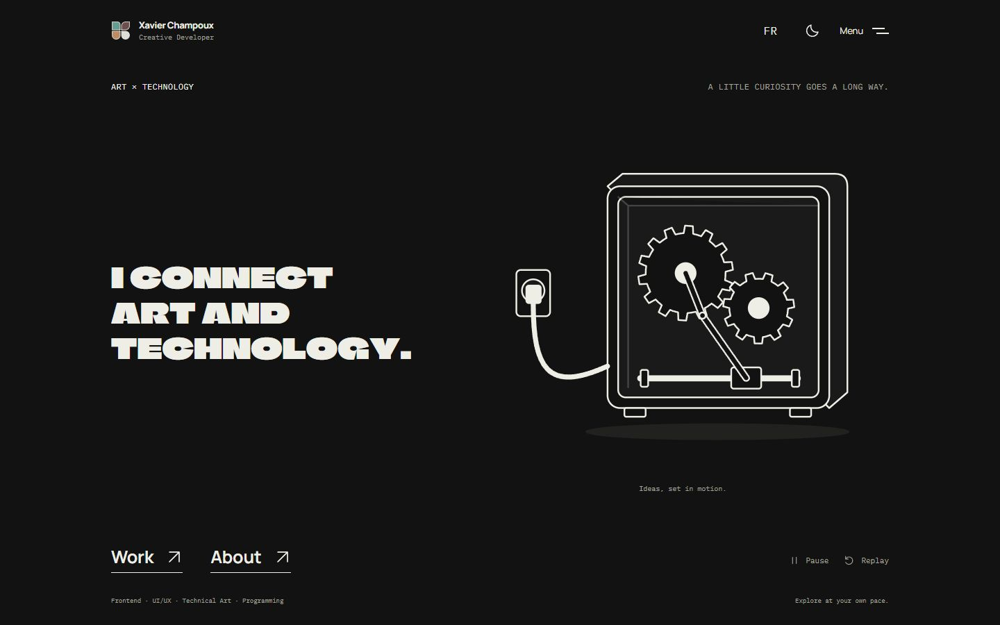 |

| Mobile · light | Mobile · dark |
|---|---|
| 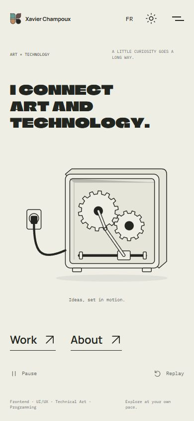 | 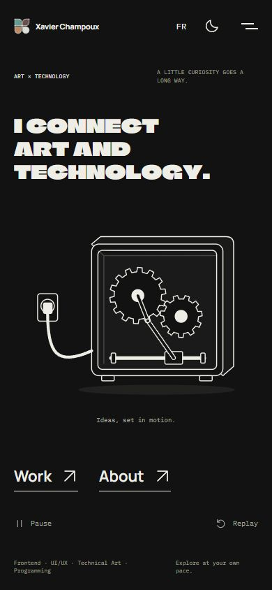 |

The statement occupies the left side; the taller square machine balances it on the right. Links stay at the bottom-left and playback at the bottom-right. The machine has a stronger object-like silhouette and more vertical space for its slider without displacing the next action.

Mobile keeps the successful Split stack, with a larger square silhouette in the middle and the two actions below. French wraps naturally. The casing and cable must fit their scene bounds rather than forcing the type to shrink.

**Strength:** clearest continuation of your preference. **Tradeoff:** the completed Home works well in two columns, but assembly still benefits from the centered intro state described below.

### C. Square Centered / requested alternative

| Desktop · light | Desktop · dark |
|---|---|
| 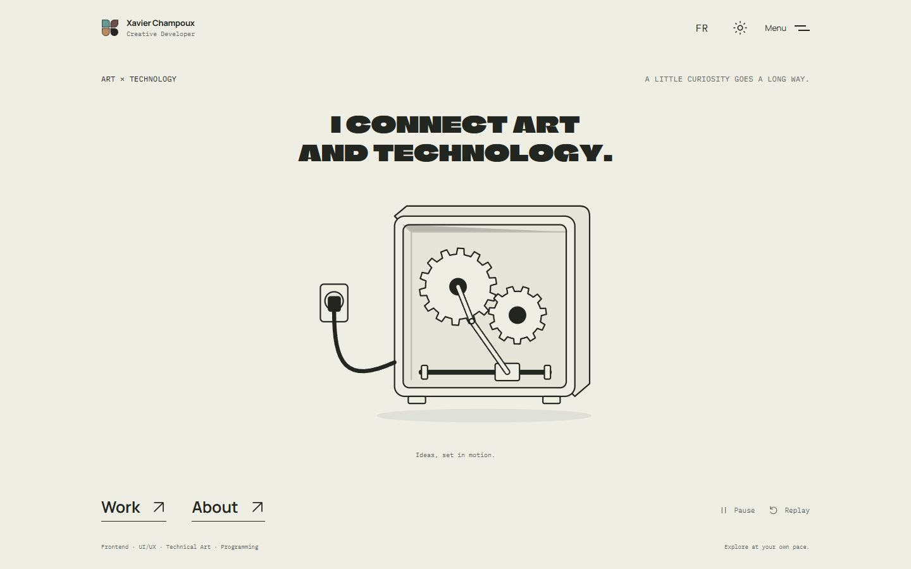 | 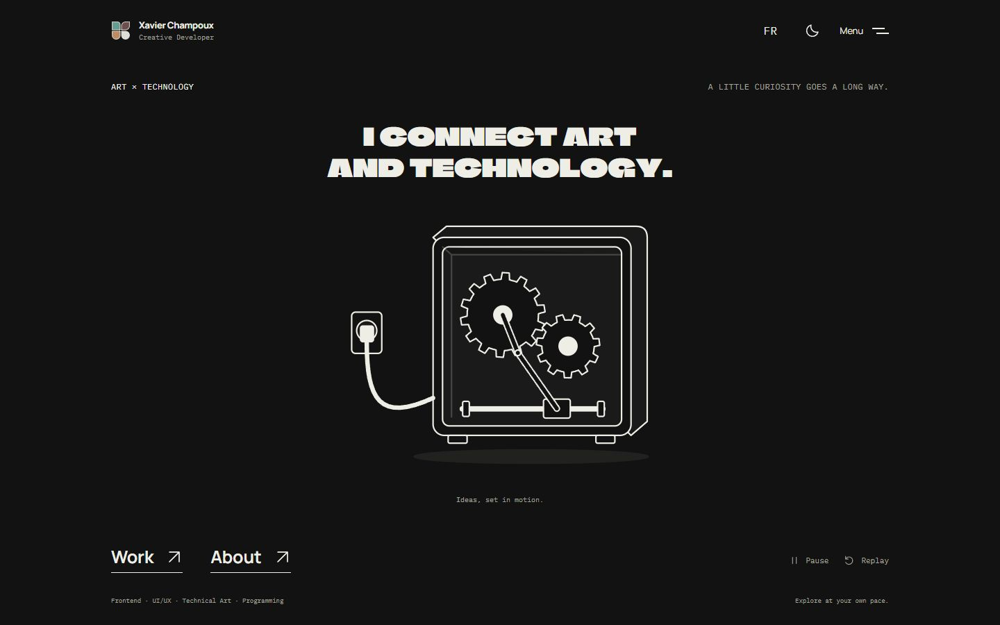 |

| Mobile · light | Mobile · dark |
|---|---|
| 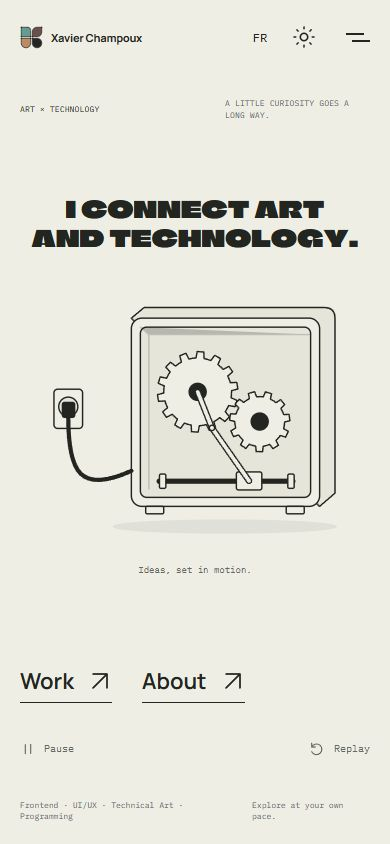 | 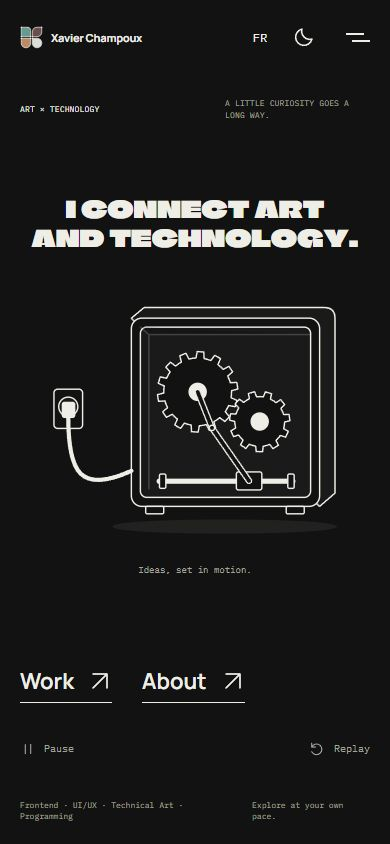 |

A shorter, centered heading sits above the square machine. The bottom action/playback placement stays shared with Split. Compared with V1 Centered, the object is taller and more compact, so the page reads as a single object with an introduction instead of a wide scene.

**Strength:** the most generous central interaction area and symmetrical arrival. **Tradeoff:** less editorial tension than Split. Mobile centers the short statement and mechanism to make the distinction visible rather than reproducing the same left-aligned stack.

### D. Offset Square / a genuinely different composition

| Desktop · light | Desktop · dark |
|---|---|
| 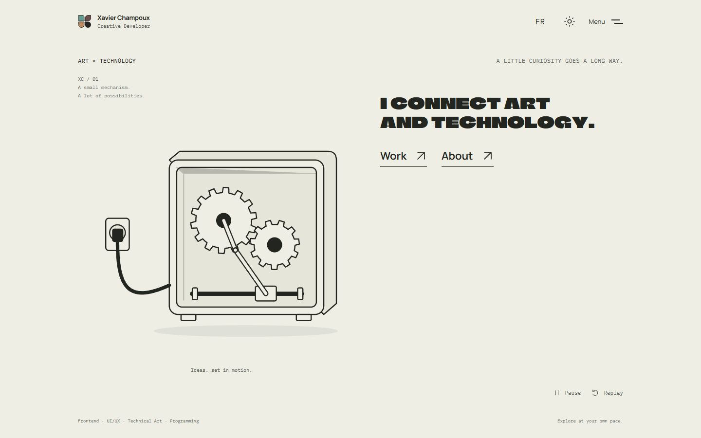 | 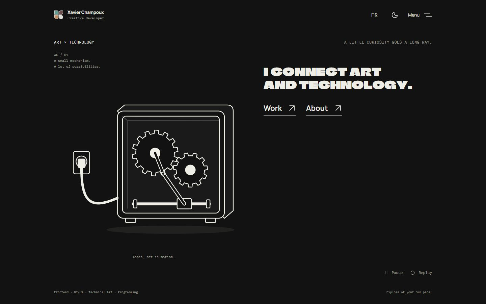 |

| Mobile · light | Mobile · dark |
|---|---|
| 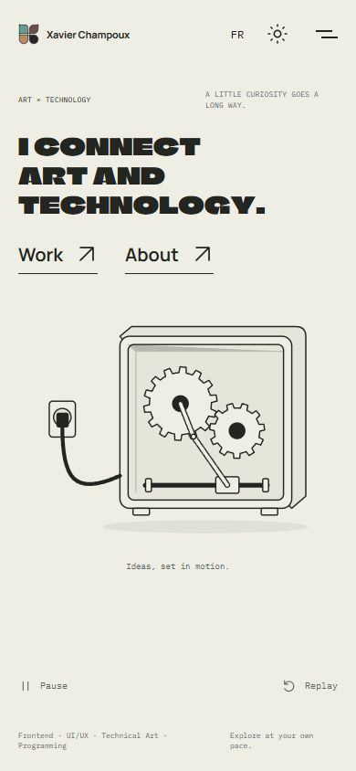 | 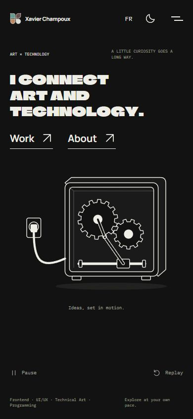 |

Move the machine to the lower-left, place the statement in the upper-right, and put Work/About directly below that statement. A small index occupies the open upper-left. Playback remains low-right and the shared bottom line stays in place.

On mobile, statement and navigation come first, followed by the square object. This gives visitors a useful action before the illustration and creates a different reading rhythm from the preferred mobile Split. Do not duplicate Work/About at the bottom.

**Strength:** more personality, asymmetric whitespace and early access to Work. **Tradeoff:** less direct continuity with the centered assembly state, and more composition work when French copy expands.

| Direction | Clarity | Personality | Interaction room | French fit | Accessibility consideration |
|---|---|---|---|---|---|
| Retained Split | Strong | Familiar | Wide but shallow | Good | Familiar mobile stack |
| **Square Split** | **Strongest fit to feedback** | Balanced | Taller object area | Good | Keep DOM order statement → scene → actions |
| Square Centered | Very clear | Calm | Most symmetric | Strong | Easiest layout for step equivalents |
| Offset Square | Clear with deliberate order | Most distinctive | Good, but off-center | Needs more wrapping | DOM reading order must follow the visible actions |

**Recommendation:** develop Square Split first, retaining the mobile stack. Use Centered as the assembly state, then settle the completed object into Split. That transition is a proposal, not behavior observed on a reference site. Under reduced motion, change layouts immediately; under enlarged text, let Home scroll and show the shared scroll control only if needed.

## 4. Menu — two new alternatives

### M1. Links left, machine right / recommended

| Desktop · light | Desktop · dark |
|---|---|
| 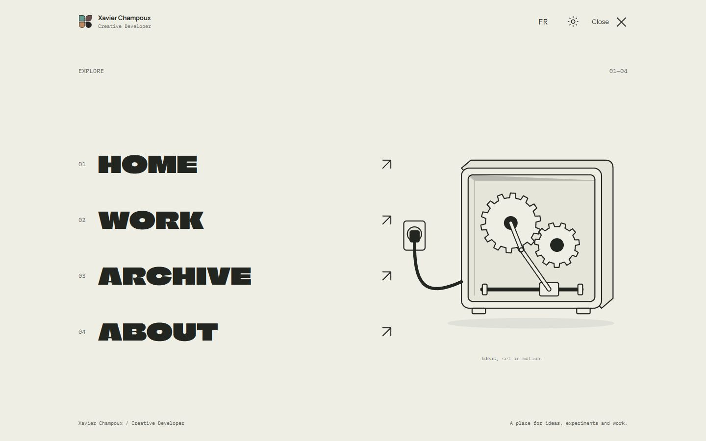 | 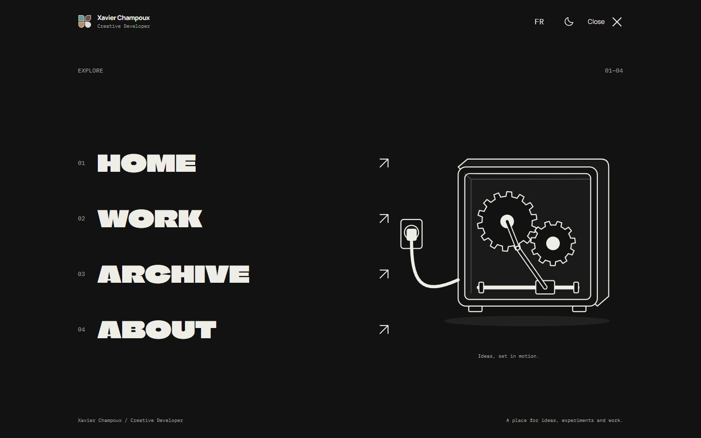 |

| Mobile · light | Mobile · dark |
|---|---|
| 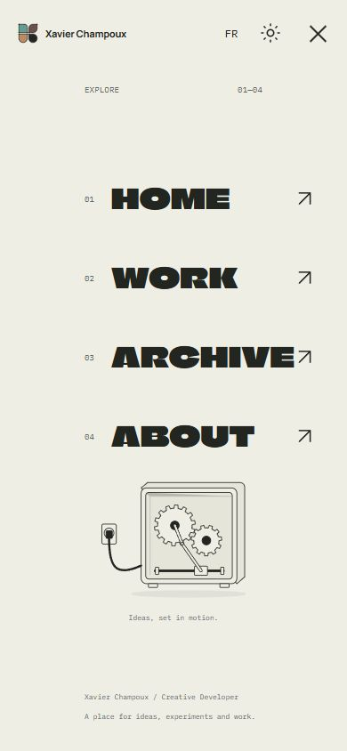 | 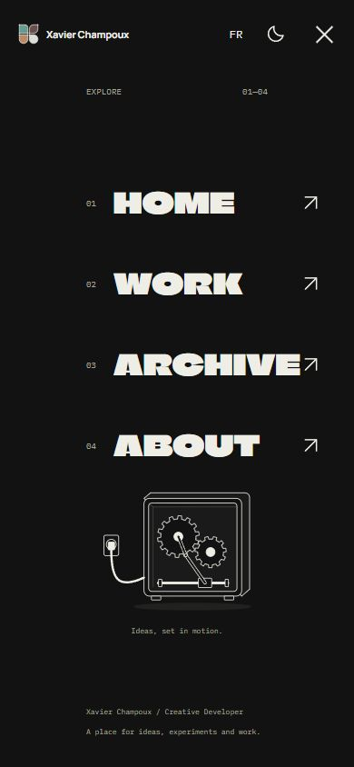 |

Large numbered Home/Work/Archive/About links stay on the left, with the completed Home machine on the right. Keep the object slightly quieter than the links and reuse the scene instead of creating another renderer. On mobile, a smaller static/paused object sits below the links. Hide that decoration if short screens or enlarged text need the space.

The navigation order is unchanged. The machine never becomes a second navigation surface. If the visitor opens the menu during assembly, show a static completed representation without advancing or overwriting their intro state.

### M2. Four-position composition

| Desktop · light | Desktop · dark |
|---|---|
| 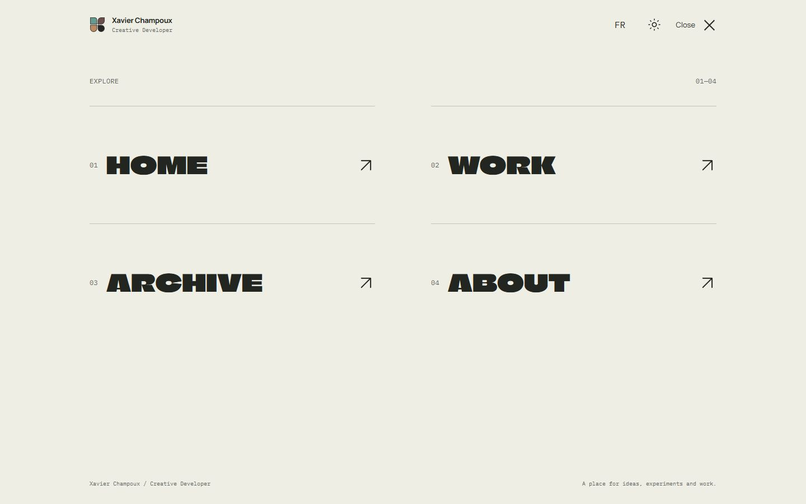 | 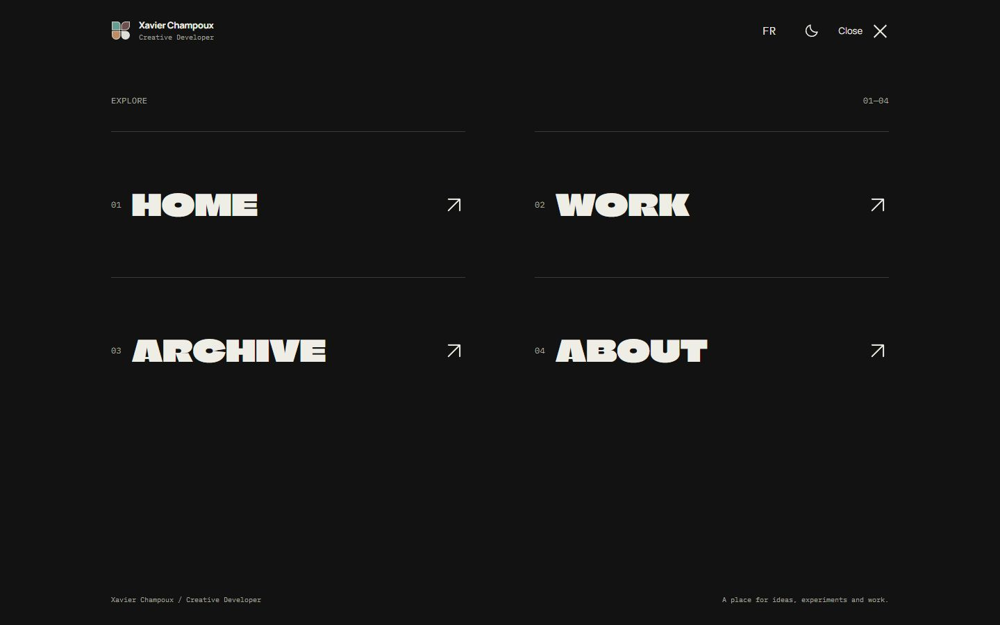 |

| Mobile · light | Mobile · dark |
|---|---|
| 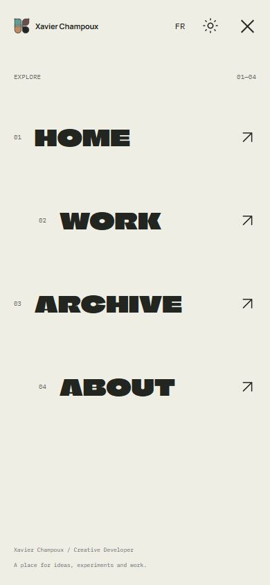 | 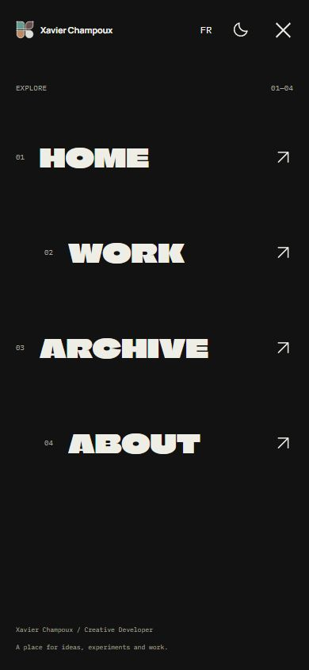 |

Use two open columns: Home/Work on the first row, Archive/About on the second. Whitespace does the framing. Mobile becomes a staggered vertical sequence, keeping the link order Home → Work → Archive → About. At very narrow French widths, reduce this display size before allowing overflow.

**Strength:** a substantial change from V1 without adding content. **Tradeoff:** a four-position menu is less linear at first glance. Keep numbers and keyboard order explicit, and avoid animating each item from a different direction.

Both alternatives retain Escape, focus containment/restoration, inert background and scroll locking in the application specification. The isolated study navigates to a separate review screen and is not a completed overlay/focus-trap implementation.

## 5. Work — same introduction, two project sequences

### W1. Editorial sequence / recommended

| Desktop · light | Desktop · dark |
|---|---|
| 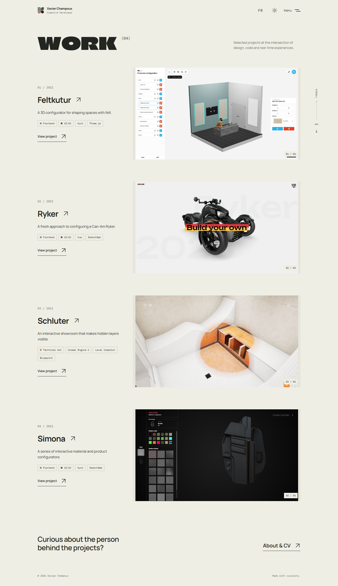 | 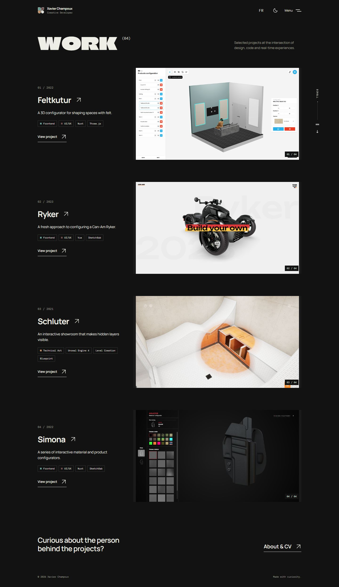 |

| Mobile · light | Mobile · dark |
|---|---|
| 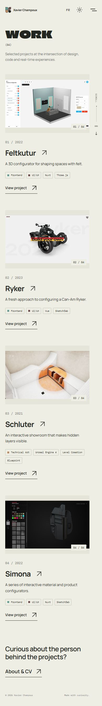 | 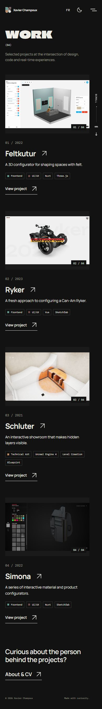 |

Pair a compact metadata block on the left with a substantial image on the right. The metadata includes year/index, title, localized summary, disciplines/tools and a diagonal project action. This changes the list below the introduction while retaining clear visual evidence for all four projects.

**Motion proposal:** a short image reveal within its existing bounds and a quieter text entrance as each project approaches the viewport. On suitable desktop layouts, metadata may remain briefly sticky within its own entry. Do not pin the entire document or require a horizontal gesture to reach project four. Hover can scale the image about 1.025× inside its bounds; focus keeps a stable equivalent.

**Tradeoff:** narrower images than the previous full-width list, but a clearer comparison between capability and evidence. Preserve complete UI screenshots with contain framing where cropping would hide useful work.

### W2. Staggered duet

| Desktop · light | Desktop · dark |
|---|---|
| 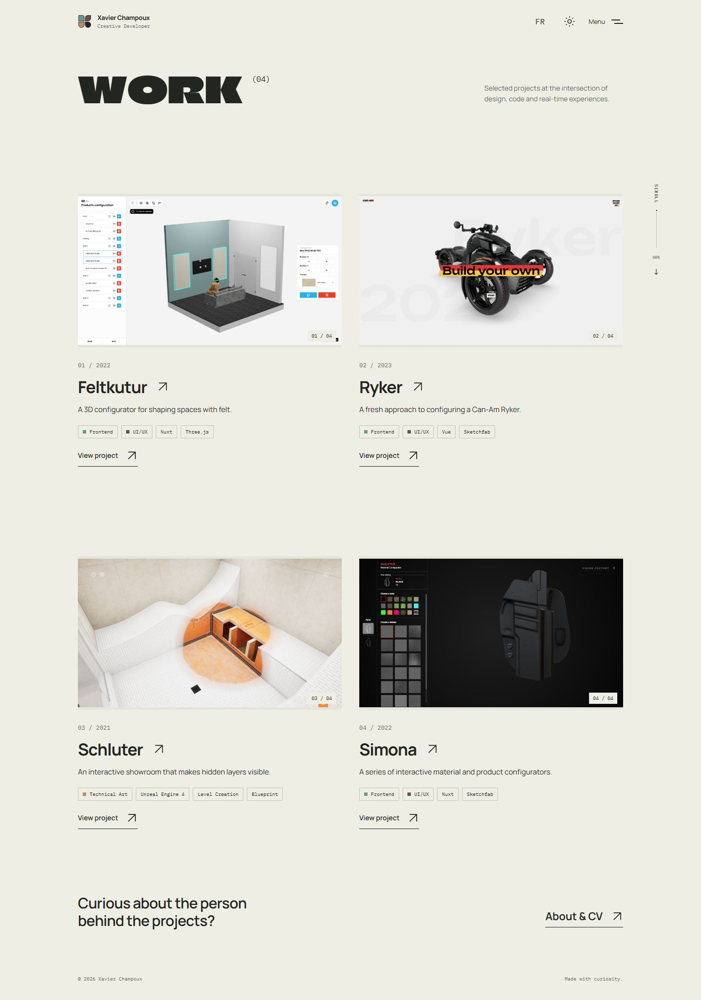 | 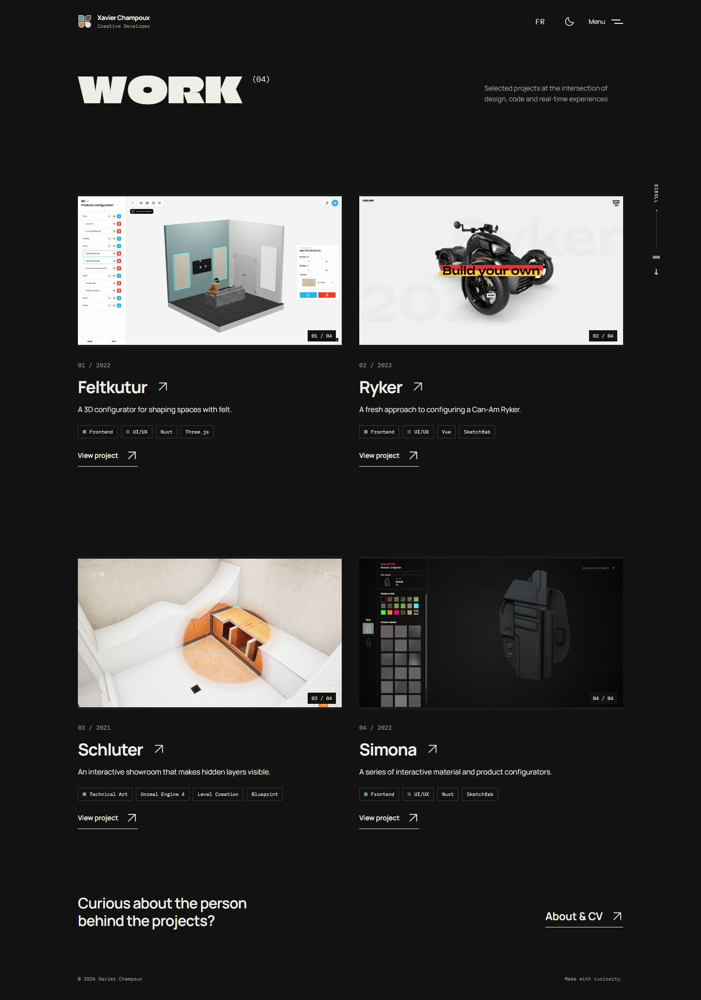 |

| Mobile · light | Mobile · dark |
|---|---|
| 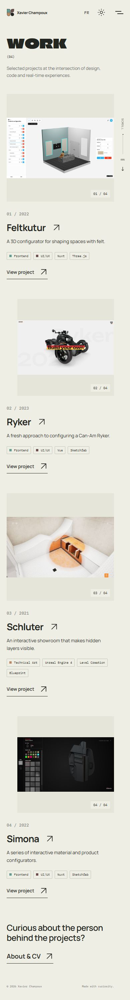 | 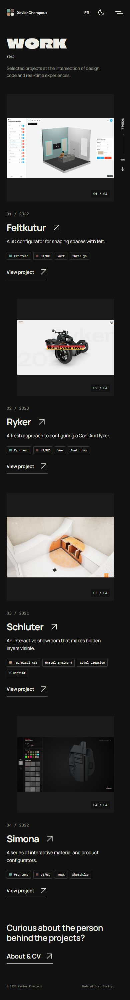 |

Two columns create pairs, with the right-hand entry offset downward. Image first, then title and metadata. The four entries still read row by row: **Feltkutur, Ryker, Schluter, Simona**. Mobile becomes one column in that same order; alternating image widths retain some of the offset character without introducing horizontal scrolling.

**Motion proposal:** paired entries reveal with a small stagger, with at most 12–20px of translation. A returning visitor should not have to wait for already-read projects. Keep the selected-work list distinct from Archive's denser editorial rows.

**Tradeoff:** more visual browsing and a shorter page, but less space per image. Avoid masonry reordering and large parallax that makes adjacent projects hard to compare.

Both proposals keep the existing project imagery and Schluter's Technical Art classification. The displayed copy and contribution summaries remain drafts for content review.

## 6. Archive — refine the preview

| Desktop · light | Desktop · dark |
|---|---|
| 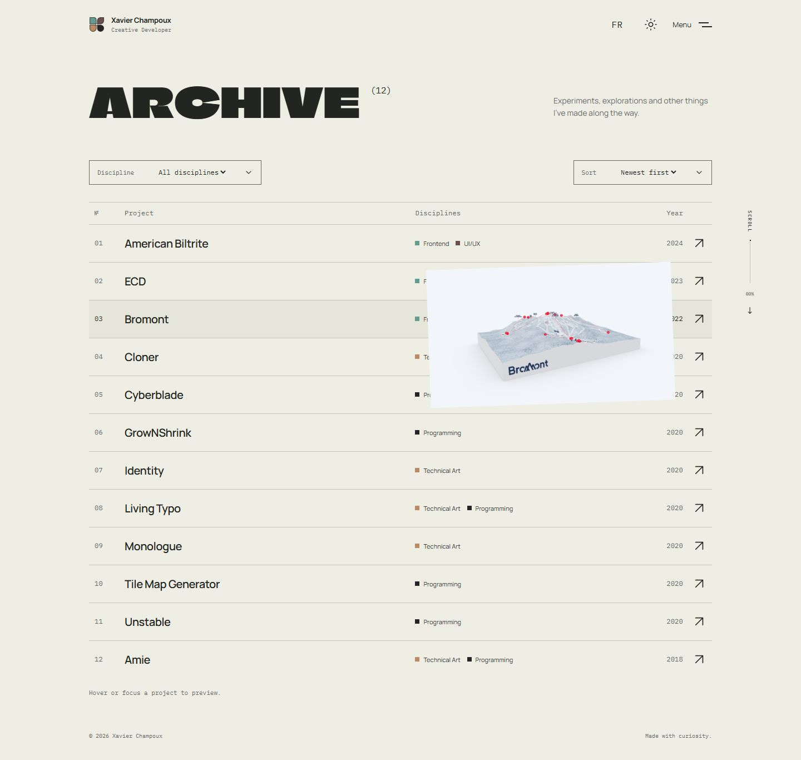 | 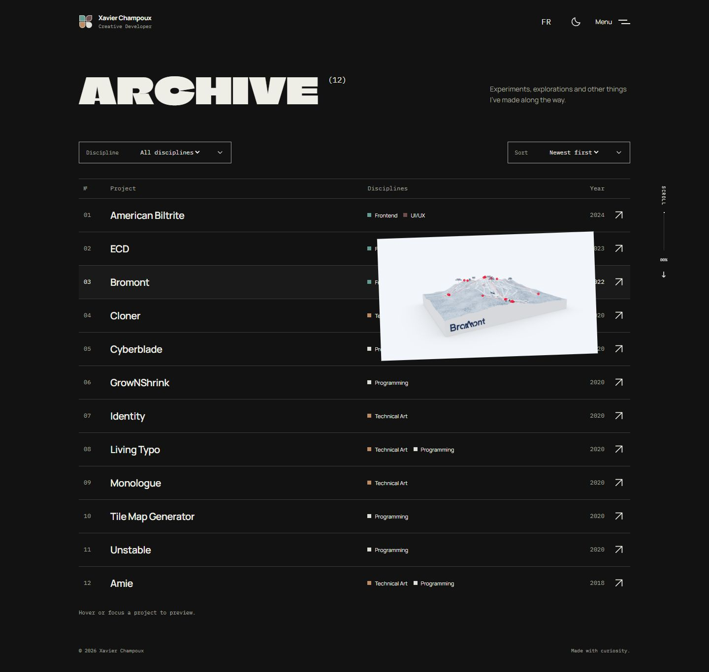 |

| Mobile · light | Mobile · dark |
|---|---|
| 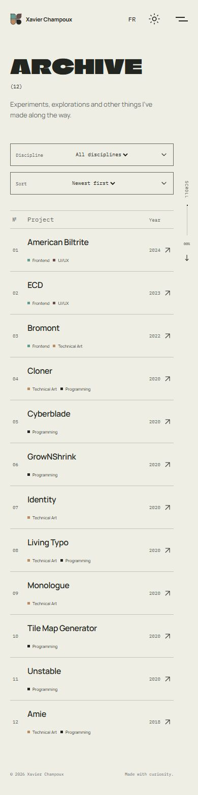 | 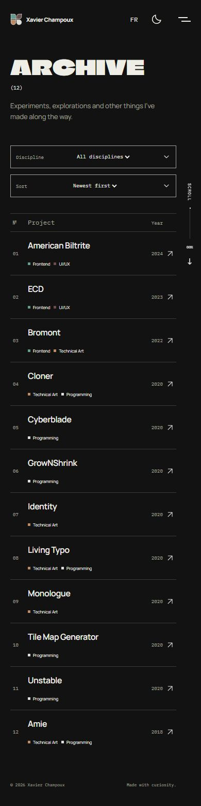 |

Use **Surface** as the hovered row background. On keyboard focus, add a clear Ink outline as well. The row keeps the title, disciplines and year; the floating image repeats none of that metadata.

The desktop preview is approximately **440px wide**, up from the previous 350px, preserving the asset's ratio with a sensible height cap. It has **no added border, caption, name/year block, enclosing card or decorative shadow**. Any white region inside the image belongs to the retained source asset, not a new frame.

Pointer following remains damped, with lateral wobble capped around ±2–3°. Clamp the image within the available viewport, away from the active title, header and scroll lane. Scale it down if space is limited. A larger preview must not make the row harder to read.

| Light | Dark |
|---|---|
| 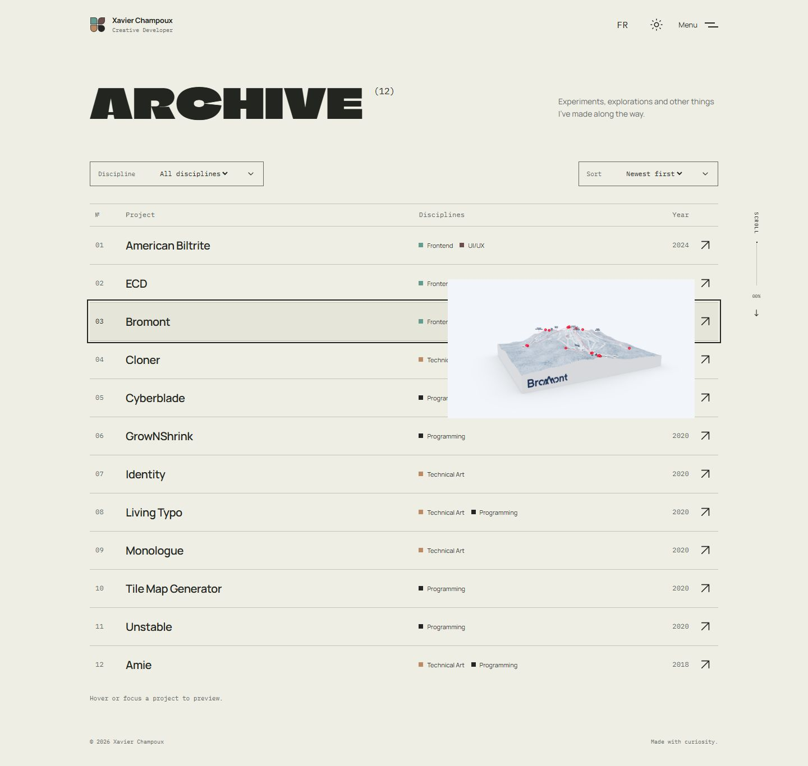 | 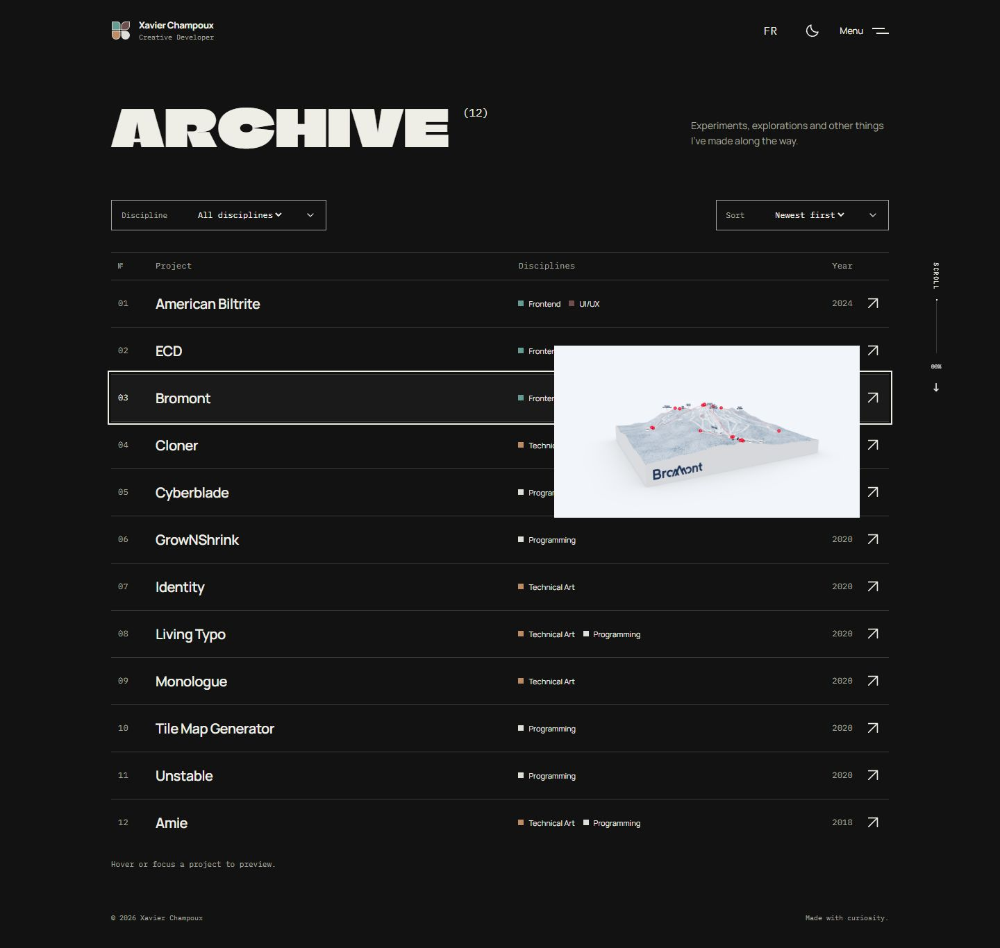 |

Keyboard focus gets the same image in a stable position, without pointer pursuit. Touch/coarse-pointer layouts keep the text-only list and open on tap. Reduced motion removes pursuit/wobble, leaving immediate or short-fade presentation. Missing imagery never removes a working project link.

Filter/sort state still belongs in the URL. Returning with browser Back restores the browsing state and scroll position. The only site-navigation entry to the collection remains in the menu.

## 7. About — two complete proposals

Your [supplied layout](docs/refs/About.jpg) is the source for the two lists and profile stacks. Both proposals keep the conversational three statements, portrait, four capabilities, compact CV, robotics/automation interest and contact information. Neither adds project links beneath the profiles.

### A1. Editorial sidebar / recommended

| Desktop · light | Desktop · dark |
|---|---|
| 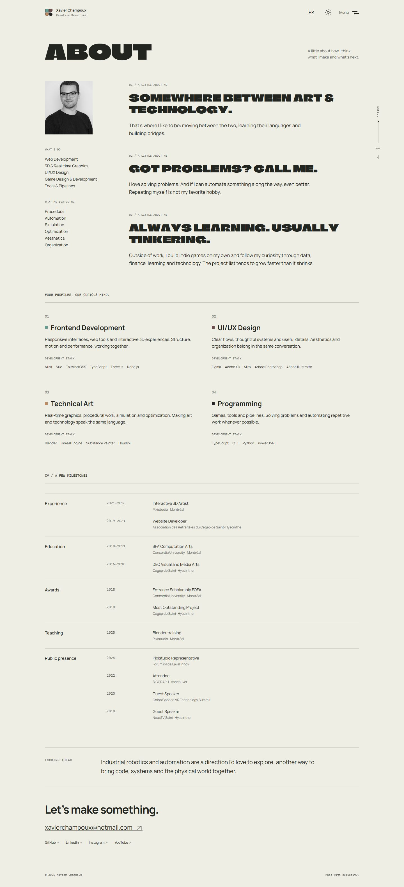 | 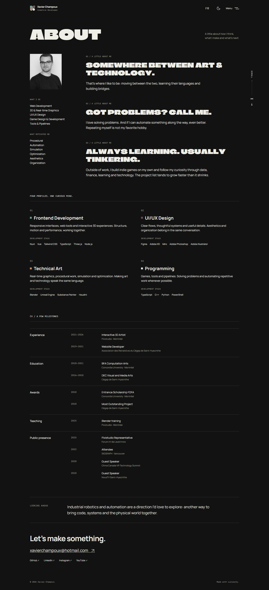 |

| Mobile · light | Mobile · dark |
|---|---|
| 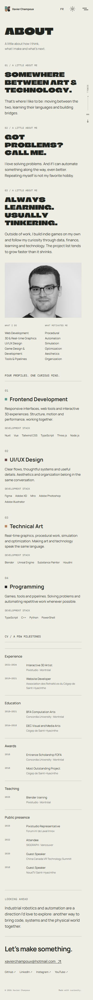 | 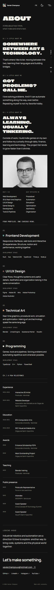 |

The small portrait and personal lists form a quiet left column alongside the three statements. Profiles become a two-column section with their tool stacks directly below each description. This makes the page useful to someone scanning for a role while keeping the personal voice at the top.

Mobile leads with the statements, then portrait/lists, profiles, CV and contact. That reading order should also be the semantic order in the application; desktop column positioning should not make a screen reader jump unpredictably between the sidebar and the statements.

**Strength:** strong connection to your supplied reference with a much more bounded text width. **Tradeoff:** the sidebar must not compete with the main statements or remain sticky across the entire CV.

### A2. Personal chapters / more editorial

| Desktop · light | Desktop · dark |
|---|---|
| 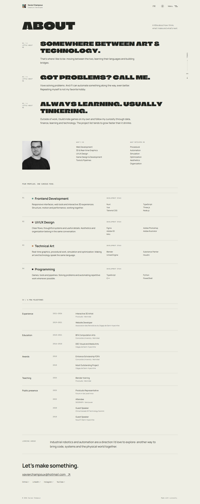 | 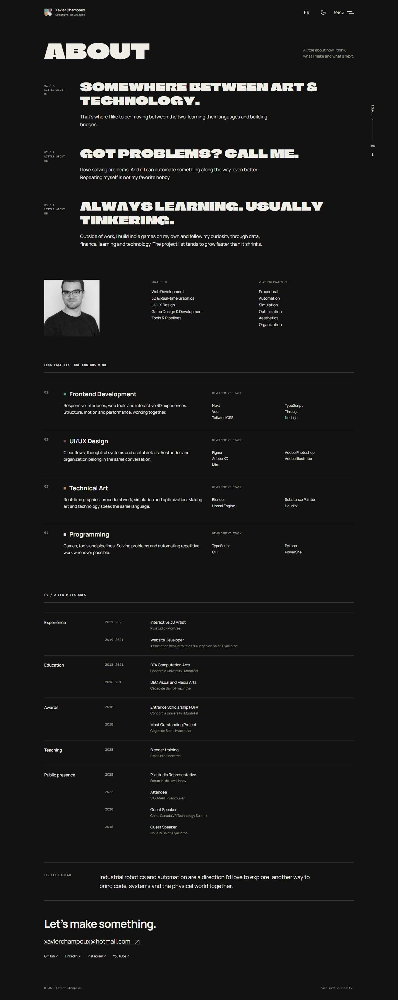 |

| Mobile · light | Mobile · dark |
|---|---|
| 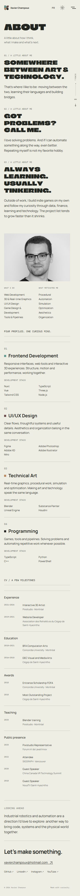 | 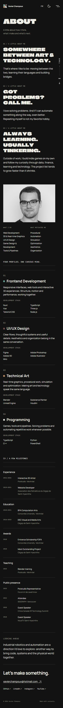 |

Give each personal statement a distinct chapter and a larger line of display text. Place the portrait and two lists together below those statements. Each discipline then becomes a horizontal row with its description in the middle and its stack on the right. On mobile, those rows stack naturally, with a compact two-column tool list where it fits.

**Strength:** more narrative pacing, more individual emphasis on each profile. **Tradeoff:** a longer page and more display text. Use line-level reveals sparingly; do not animate long CV paragraphs character by character.

### Exact lists and stacks

| What I do | What motivates me |
|---|---|
| Web Development | Procedural |
| 3D & Real-time Graphics | Automation |
| UI/UX Design | Simulation |
| Game Design & Development | Optimization |
| Tools & Pipelines | Aesthetics; Organization |

| Profile | Stack, transcribed from your reference and retained About data |
|---|---|
| Frontend Development | Nuxt · Vue · Tailwind CSS · TypeScript · Three.js · Node.js |
| UI/UX Design | Figma · Adobe XD · Miro · Adobe Photoshop · Adobe Illustrator |
| Technical Art | Blender · Unreal Engine · Substance Painter · Houdini |
| Programming | TypeScript · C++ · Python · PowerShell |

The stacks are tool lists, not equal-proficiency ratings. CV dates, job titles, degree wording, awards, speaking and teaching claims still require your factual review. These designs preserve source facts as drafts; they do not invent new accomplishments. Contact remains the supplied email, GitHub, LinkedIn, Instagram and YouTube destinations.

## 8. Individual projects — order, playback and footer

### Selected-work example / Feltkutur

| Desktop · light | Desktop · dark |
|---|---|
| 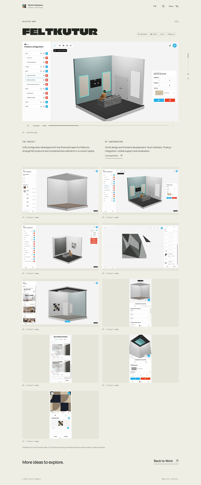 | 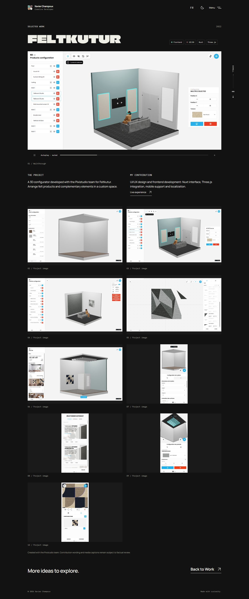 |

| Mobile · light | Mobile · dark |
|---|---|
|  |  |

### Archive example / ECD

| Desktop · light | Desktop · dark |
|---|---|
|  |  |

| Mobile · light | Mobile · dark |
|---|---|
|  |  |

The template is shared. Collection membership changes the final navigation, not the project identity or media data.

| Rule | V2 specification |
|---|---|
| First media | Render data item 0 as the lead media. If it is video, that video is first. Do not prepend a separate cover-image hero. |
| Remaining media | Iterate the stored sequence exactly. A two-column desktop grid uses row-major order; mobile, keyboard and DOM order stay the same. |
| Video | Autoplay **muted**, inline, when visible and ready. Provide pause/resume, seek and explicit unmute. Never start sound automatically. |
| Playback fallback | If autoplay is blocked, show poster + Play. Reduced motion and data-saving preferences default to poster + explicit Play; the video keeps its position. |
| Resource behavior | Pause when off-screen/hidden; avoid starting every gallery video together. No forced looping is required. |
| Enlargement | **Removed.** No lightbox, click-to-enlarge, zoom dialog or custom fullscreen/enlargement action. Images stay inline. |
| Selected footer | **Back to Work**, as in the selected example. |
| Archive footer | **Previous project / Next project**, showing adjacent archive project names. No Back to Work and no separate Archive-index link. |

The screenshot studies represent video with the retained cover/poster and an illustrative muted playback bar. They are not evidence that production video playback or autoplay policy handling has been implemented. The poster is a representation of the first video, not another item inserted into the media sequence.

The Feltkutur example follows its actual ten-item sequence: showcase video, then images 0–8. ECD follows its seven-item sequence: showcase video, then images 0–5. No video is moved to the end. All assets in those example records appear in the studies.

Archive neighbors follow the preserved filtered/sorted archive sequence when available; direct visits fall back to newest-first with a stable slug tie-breaker. Omit unavailable neighbors at either end instead of wrapping. In the ECD example, the neighbors are American Biltrite and Bromont. Selected work never enters that sequence. Browser Back continues to restore Archive context.

Keep project context, individual contribution, team credits and applicable live/demo/repository links. Review captions, alt text and any speech/transcript needs from actual media before release. Inline imagery must remain useful without a fullscreen view, so preserve readable source resolution and avoid destructive cropping.

## 9. Intro — an object, not a tutorial

The intro temporarily uses a centered object composition within the same quiet shell. Remove the large instructional cards, repeated step headings and persistent instruction buttons. Keep a small sentence below the object and a compact progression/Skip group at the right, aligned to Home's playback position.

### Four steps / desktop

| Light | Dark |
|---|---|
|  |  |

**I design.** The pen and forgiving square path are the visual invitation. The path resolves into the shallow casing. Casing shape remains a review decision; the interaction contract is unchanged.

| Light | Dark |
|---|---|
|  |  |

**I connect.** Cable and socket are central. These captures show the optional delayed hint beneath the one-liner; the other steps demonstrate the uncluttered initial state.

| Light | Dark |
|---|---|
|  |  |

**I automate.** The missing gear sits near its recess. Keep generous snapping and an explicit tap/keyboard alternative.

| Light | Dark |
|---|---|
|  |  |

**I create.** Pressing Play starts the gears and slider; reduced motion keeps the completed scene still until requested. Completion settles the object into the chosen Home composition.

### Mobile / clean state and delayed hint

| Light | Dark |
|---|---|
|  |  |

| Light | Dark |
|---|---|
|  |  |

### Behavior

- Reveal the hint after approximately **4 seconds of inactivity**, resetting the timer after meaningful interaction. Once visible, keep it stable rather than blinking or repeatedly disappearing while read.
- Keep Help available immediately. It exposes the hint and a labeled action; keyboard equivalents become visible on focus without waiting. The absence of tutorial copy must not make a canvas-only action mandatory.
- Small visual labels still sit in generous targets. The numbered markers are status, not tiny required click targets. Skip and Help have at least 44px hit areas.
- Skip resolves immediately to the completed Home. Leaving Home during assembly counts as skipping. Replay explicitly restarts; direct collection/project visits bypass assembly.
- The finished mechanism retains Pause/Resume. Pause idle motion for reduced motion, stop rendering while hidden, and retain the static fallback if 3D fails.
- On small/short screens or text enlargement, let the composition scroll rather than clipping the controls. Show the shared scroll control when there is overflow.

The study's step query and Help control allow inspection of these states. It is not the drawing, cable simulation, snapping or persisted intro state machine. Those remain the procedural prototype checkpoint in PLAN.md.

## 10. Full-screen loading / arrival

| Desktop · light | Desktop · dark |
|---|---|
|  |  |

| Mobile · light | Mobile · dark |
|---|---|
|  |  |

Use an almost empty full-screen Paper field, a small centered colored mark, a thin indeterminate readiness line and a compact loading label. A few subdued console-style lines sit to the right on desktop and below on mobile. The supplied Loading.jpg is the visual anchor; the selected-profile block and press-any-key gate are omitted.

Status lines should correspond to real readiness milestones, such as preferences/fonts/shell readiness. Avoid long technical logs, fabricated percentages, repeated fake successes or delayed joke output. The tone can stay lightly personal, as in “One idea at a time,” without obscuring progress.

Dismiss as soon as essential content is usable. Do not impose a minimum delay, wait for the gallery, or hold the page until optional 3D is ready. If the scene fails, continue to the static fallback. On a fast connection the arrival may be barely visible. In-page navigation uses the page transition, not a replay of the loader. No click or key press is needed to continue.

**Proposed handoff:** a short line contraction/fade and a coordinated content entrance. Reduced motion uses an immediate handoff or simple short fade. The loader is separate from the four-step intro and should not announce every decorative console line to assistive technology.

## 11. Scroll lane, responsive behavior and French

### Scroll → Top with progress

| Light | Dark |
|---|---|
|  |  |

These are genuine scrolled states in the isolated review study: desktop shows **Top / 57%**, mobile **Top / 46%**. Their different percentages reflect their different document lengths.

Use a quiet fixed lane outside the content. Initially it says Scroll with a down arrow and 0%; once scrolling starts, change it to Top with an up arrow while retaining progress. Activating it returns to the top. Reaching the top restores the initial state. At 100%, keep Top; do not introduce a new action.

Desktop uses a 44px control outside the 1120px column. Mobile reserves 48px on the right of scrolling-page content, including a 44px target, with a small gap before media/text. Home/menu/arrival do not show a lane when they fit. If any page becomes scrollable because of text settings, it gains the same treatment or an equivalent reflowed control.

Give the button a useful localized accessible name. Expose the numeric progress as a readable progress value without announcing every scroll event. Respect reduced motion when returning to the top. Progress reflects the currently laid-out document, including loaded media dimensions; reserve those dimensions to avoid jumps. It must never cover an Archive preview, media control, text or focus ring.

### Responsive and accessible behavior

| Context | Required response |
|---|---|
| Wide desktop | Stop at 1120px content; keep readable text widths and the separate scroll lane. |
| Intermediate width | Reduce margins, stack a pair before it becomes cramped; do not shrink all text to preserve desktop columns. |
| 390px mobile | 20px left margin; reserve the right lane on scrolling pages. Home/menu retain 20px on both sides when no lane is needed. |
| 320px French | Allow natural wrapping; slightly reduce menu display text. The six primary page types were checked for horizontal overflow at this width. |
| Keyboard | Visible focus, skip-to-content in the application, meaningful link/button names, full intro equivalents and menu focus handling. |
| Touch | No hover dependency; generous snapping/tap alternatives; Archive is a readable text list. |
| Reduced motion | Still mechanism until requested; immediate state changes; no preview wobble/pursuit, moving cursor or parallax. |
| Enlarged text | Reflow and allow scrolling. Never force single-frame cropping or hide controls behind fixed heights. |
| 3D unavailable | Static square/selected casing illustration, same one-liner and Work/About navigation; remove nonfunctional mechanism controls. |

The 1440 × 900 and 390 × 844 exports are reference viewports. Scrolling layouts are captured to their complete content height. Narrow-width checks establish layout fit in this study; real 200% text enlargement, screen-reader semantics, overlay focus trapping, autoplay policies, storage failures and GPU/resource behavior still need implementation testing.

### Representative French screens

| Preferred stack | Offset alternative |
|---|---|
|  |  |

| Machine menu | Work sequence |
|---|---|
|  |  |

| Editorial About | Archive project |
|---|---|
|  |  |

These are representative localized layouts, not the complete translated catalog. Review the wording, accents and professional titles before publication. Preserve equivalent-page and query state when switching language. EN/FR labels describe the target locale, not a region selector.

## 12. Recommendations and decisions for this review

1. **Choose Square Split**, with the retained mobile stack, and use a centered composition while assembling the object. Keep Offset as the more expressive alternative if you want a stronger departure.
2. **Choose the machine-right menu** for continuity. The four-position menu is the best alternative if the machine feels too repetitive.
3. **Choose Work's editorial sequence** for project assessment and contribution clarity. Choose Duet if visual browsing and a shorter page matter more.
4. **Choose Editorial About** for scanning, retaining the chapter proposal as the more narrative option. Keep all four stacks in either choice.
5. **Use one out/in underline cycle** for primary actions and slide-in for quieter secondary links. Avoid looping every link at once.
6. **Keep the Archive revision restrained.** A row state and larger image supply enough feedback; extra preview metadata is unnecessary.
7. **Keep the arrival truthful and brief.** The small center mark and console hierarchy should never become a timed gate.
8. **Keep project media inline and in data order.** Review the muted-autoplay fallbacks and per-collection footer with actual source videos before implementation is considered complete.

### Review checklist

- [ ] Square casing and preferred Home composition accepted; retained rectangle remains a valid baseline.
- [ ] Machine-right or four-position menu chosen.
- [ ] Editorial sequence or staggered duet chosen for Work.
- [ ] Editorial sidebar or chapter About chosen; stacks/lists transcribed correctly.
- [ ] One-cycle versus looping underline preference confirmed.
- [ ] Archive hover color, preview size and keyboard state accepted.
- [ ] Quiet intro, delayed hints and immediate Help/keyboard equivalents accepted.
- [ ] Full-screen loading proposal and readiness-driven dismissal accepted.
- [ ] Inline-only media, muted autoplay and collection-specific project footers accepted.
- [ ] EN/FR draft copy, CV facts, contribution wording and media credits scheduled for factual review.

Only documentation and the explicitly requested PLAN.md updates are part of this revision. Existing application edits are preserved. The application rebuild remains a separate stage after design review.

## 13. Artifact validation and preview

All new screenshots are in [screens](docs/design_v2/screens/); control/progress studies are in [boards](docs/design_v2/boards/); source evidence is in [references](docs/design_v2/references/). Images use portable relative paths. The machine drawing and page layouts remain editable in [source](docs/design_v2/source/).

| Illustrated set | Count |
|---|---:|
| Page and intro screens, including French samples | 78 |
| Control and scroll-state boards | 4 |
| Browser reference captures | 15 |
| Your supplied reference images | 2 |
| **Core images** | **99** |

Quick comparison sheets: [Home](docs/design_v2/review-home.jpg), [menu](docs/design_v2/review-menu.jpg), [Work](docs/design_v2/review-work.jpg), [About](docs/design_v2/review-about.jpg), [Archive](docs/design_v2/review-archive.jpg), [projects](docs/design_v2/review-project.jpg), [intro](docs/design_v2/review-intro.jpg), [loading](docs/design_v2/review-loading.jpg), [controls/progress](docs/design_v2/review-boards.jpg), and [reference evidence](docs/design_v2/review-references.jpg). These sheets are auxiliary; use the individual exports to judge type and detail at full resolution.

The [validation report](docs/design_v2/validation.json) records image dimensions, local document links and catalog/media checks. [Browser records](docs/design_v2/browser-validation.json) record layout widths, loaded imagery, font readiness and each example's media order. Separate reports cover [320px French layouts](docs/design_v2/narrow-validation.json) and [scroll-control states](docs/design_v2/scroll-validation.json). Contact sheets support visual inspection; each embedded image can be opened at its full exported resolution.

The study covers four Home compositions, two menu variants, two Work lists, two About layouts, Archive hover/focus, two project collections, loading, intro states, controls, scroll progress and eight representative French samples. Every main composition has light/dark desktop/mobile coverage. The intro includes all four desktop steps in both themes and clean/hint mobile states in both themes.

From the project root, run the isolated preview with:

~~~powershell
node docs/design_v2/source/server.mjs
~~~

Open [the local V2 study](http://localhost:4179/docs/design_v2/source/studio.html?page=home&variation=split-square). Query parameters select page, variation, theme, locale, state and hint. The study demonstrates underline animation, scroll progress/return-to-top, theme/locale navigation, Help and manual intro-state changes. It does not claim a working 3D assembly, production routing/state restoration, full menu accessibility, filter/sort behavior or actual video playback. Production dependencies, routes, components and APIs remain unchanged.

## 14. New reference review and observed motion

**Method:** opened the three requested live websites in Browser and interacted with visible Home/Work/About navigation or the equivalent sections. Captures below are genuine browser snapshots from **13 November 2026**. Viewport sizes vary because these are evidence of the live sites, not portfolio mockups. Creator attribution names the portfolio owner; it does not assert that they personally authored every asset or dependency.

### Mike Wilcock — Home, Work, About

Source/creator: [Mike Wilcock](https://mikewilcockdesign.com/), [Work](https://mikewilcockdesign.com/work), [About](https://mikewilcockdesign.com/about). **Live site.**

| Captured evidence | Captured evidence |
|---|---|
|  |  |
|  |  |

**Tested and observed:** clicking Work and About produces a stepped blue wipe across the outgoing page. The Work view exposes List/Grid controls; selecting Grid replaces editorial rows with image cards. Scrolling the grid reveals large previews with nearby title/year information. About uses a strong portrait/text pairing. These observations inform the new Work list comparisons and coordinated page handoff.

**Proposed adaptation:** use a restrained theme-colored reveal or short crossfade, and keep image entrances inside their layout bounds. Do not copy the blue accent, typeface, branding or list/grid toggle into the launch scope just because it exists on this reference. The exact implementation library/easing was not established by visual browsing.

### Guillaume Zhu — Home, Journey/About equivalent, Projects/Work equivalent

Source/creator: [Guillaume Zhu](https://guillaumezhu.com/), [Journey](https://guillaumezhu.com/#parcours), [Projects](https://guillaumezhu.com/#projects). **Live, primarily single-page site.** Journey and Toolkit are the relevant About equivalents; Projects is the Work equivalent. No separate About page was inferred or guessed.

| Home after arrival | Journey during traversal |
|---|---|
|  |  |

**Tested and observed:** header section links move through a continuous page. The hero combines large lettering, a depth-like logo object and a saturated field. Journey text appears as separated, displaced letters during traversal; the page shifts from the colorful hero to a dark Journey area and a light Projects section. A small section rail remains near the edge. These inform the reserved scroll lane, coordinated transitions and the idea of introducing content through a coherent sequence.

**Loading limitation:** first entry exposed a “Loading the page” accessibility state; an immediate reload capture caught an almost empty paper field before Home appeared. The loader's exact graphic and timing were not reliably isolated. We therefore do **not** claim a specific observed loader choreography. Your supplied Loading.jpg is the concrete visual basis for V2; Guillaume is supporting evidence for the arrival-to-content relationship and overall motion direction.

**Proposed adaptation:** keep a small readiness mark, a clean handoff, and short line-level reveals. Avoid importing scattered-letter motion into long About/CV reading text. No WebGL engine or animation library is asserted from appearance alone.

### Juan Mora Romero — Home/Work, About

Source/creator: [Juan Mora Romero](https://www.juanmoraromero.com/), [About](https://www.juanmoraromero.com/about). **Live site.** Home is also the Work presentation.

| Initial Work state | After scrolling |
|---|---|
|  |  |
|  |  |

**Tested and observed:** wheel scrolling advances the lower gallery while the introductory composition stays visible. The current client, detail link and counter change together, from Villiers/01 to HelloDoot/02. About switches to a light composition with a contents column, small portrait and oversized statement. Scrolling reaches chapter rows and a large curved poster-like object overlaying the text area, with chapter activity labels changing.

**Proposed adaptation:** synchronize a preview's project identity and its movement; use deliberate metadata alignment and content chapters. The new Work alternatives retain normal vertical scrolling rather than adopting the reference's wheel-driven horizontal gallery. Keep any object deformation in the machine scene, away from CV copy. The 3D-looking poster deformation is a visual observation, not proof of a particular rendering technique.

### Your supplied visual references

| About reference | Loading reference |
|---|---|
|  |  |

Creator/source: your supplied designs, originally [About.jpg](docs/refs/About.jpg) and [Loading.jpg](docs/refs/Loading.jpg). **Local reference images**, reviewed 13 November 2026; original creation/capture dates are not established. The About reference informs the two personal lists, three-statement rhythm and four stacks. The loading reference informs the small center mark and nearby console lines, with the two explicitly excluded elements removed.

### Additional transient evidence

These captures preserve intermediate states for provenance, not additional layout recommendations. In particular, a partially revealed or empty frame should not be treated as a finished reference design.

**mike-work-grid.jpg** — Immediate Grid-toggle capture; transient partially revealed state. Source: [Web Design & Development Projects | Mike Wilcock](https://mikewilcockdesign.com/work); captured 2026-11-13.

**guillaume-loading.jpg** — Immediate reload: almost empty paper field before Home. Source: [Guillaume Zhu - Creative Front-End Developer & Art Director](https://guillaumezhu.com/); captured 2026-11-13.

**juan-about-transition.jpg** — Immediate About navigation capture; outgoing Work still visible. Source: [Creative Designer and Developer | Juan Mora Romero](https://www.juanmoraromero.com/); captured 2026-11-13.

### Motion recommendations drawn from the review

| Technique | Evidence | Proposed use here | Reduced-motion response |
|---|---|---|---|
| Coordinated page wipe/handoff | Mike Home → Work/About | A short theme-consistent reveal or crossfade; one transition system | Immediate change or simple fade |
| Different list compositions | Mike Work List/Grid interaction | Compare W1/W2 before implementation; keep one chosen list at launch | Stable chosen layout |
| Section rail and coordinated text reveal | Guillaume Journey/Projects | Reserved progress lane; short heading/line reveals | Static rail and fully visible text |
| Metadata synchronized with a moving gallery | Juan Work scroll | Keep active preview and project identity synchronized; no added horizontal browsing requirement | Stable preview and text |
| Chapter emphasis and depth-like object motion | Juan About scroll | Quiet chapter rhythm; concentrate object motion in the machine | No deformation or decorative travel |
| Animated action underline | V2 proposal, not claimed as measured reference behavior | Slide-in ≈250ms; one out/in cycle ≈480ms | Static underline and focus outline |

For this portfolio, a proposed page handoff around 180–240ms, menu entrance around 300–400ms and bounded image reveal around 400–600ms are starting points for the prototype, **not measured durations from these sites**. Preserve useful content and navigation while motion runs. The references demonstrate possibilities; the selected composition and accessible behavior determine which techniques belong in the final site.
