# V3 — Dark, spacious, typography-led portfolio

**Design review · 14 November 2026 · Documentation only**

V3 gives typography, project evidence and personal voice the space previously occupied by the machine. It proposes **two new alternatives for each view**, using the accepted identity and dark palette. The main journey remains **Home → Work → About/CV**; Archive remains a separate, menu-only destination.

This document supersedes the conflicting launch directions in [DESIGN.md](DESIGN.md) and [DESIGN_V2.md](DESIGN_V2.md). Those documents and their assets are preserved. [PLAN.md](PLAN.md) now reflects V3. No application routes, APIs, dependencies or production components have been changed in this iteration.

## 1. Review map and recommendation

The audience is a potential employer, collaborator or client evaluating a versatile developer and designer. Home should establish the relationship between art and technology, Work should provide immediate evidence, and About should explain the person, capabilities and career context.

| View | Proposal A | Proposal B | Recommended starting point |
|---|---|---|---|
| Home | Art × Technology | Four statements | **A:** the clearest memorable opening; B is more personal and verbal. |
| Menu | Bare oversized stack | Spacious separated rows | **A:** simple and unmistakable. |
| Work | Editorial image and metadata | Large project rows | **A:** project imagery is valuable evidence before opening a case study. |
| Archive | Open table, rectangular filters | Rounded filters and neutral pills | **B:** adds softness while preserving the same information and behavior. |
| About | Sidebar and broad CV rows | Sidebar, chapters and grouped CV | **A:** strongest reading order and easiest CV comparison. |
| Project | Broad masthead, sequential single column | Asymmetric opening, paired sequence | **A:** inline-only media stays larger and easier to read. |
| Loading | Small mark and quiet progress | Larger mark and typographic counter | **A:** allows the identity to register without turning readiness into a performance. |

These are recommendations for review, not approved production selections. Mixing the recommended options is intentional: common foundations keep them coherent.

**Deliverables:** 32 primary screens + eight French examples + five specification boards + six genuine reference snapshots = **51 images**. All proposed screens are dark. Desktop references use **1440 × 900**; mobile references use **390 × 844**. Scrolling pages are exported at full document height.

Fast comparison sheets: [Home](docs/design_v3/review-home.jpg), [Menu](docs/design_v3/review-menu.jpg), [Work](docs/design_v3/review-work.jpg), [Archive](docs/design_v3/review-archive.jpg), [About](docs/design_v3/review-about.jpg), [Projects](docs/design_v3/review-project.jpg), [Loading](docs/design_v3/review-loading.jpg), [Boards](docs/design_v3/review-boards.jpg), [References](docs/design_v3/review-references.jpg). The gray comparison-sheet background is review furniture, not a light website theme.

## 2. Visual foundations

### Dark palette

| Token | Exact value | Purpose |
|---|---|---|
| Paper | `#111211` | Page, menu and loading backgrounds |
| Surface | `#191A19` | Hovered/focused table row and quiet supporting surfaces |
| Ink | `#EEEEE7` | Primary text, icons and focus outlines |
| Muted | `#A1A39C` | Secondary copy, dates and metadata |
| Line | `#393B36` | Decorative separators and restrained structural rules |
| Frontend | `#649C91` | Retained colored identity / capability marker |
| UI/UX | `#6F4E4C` | Retained colored identity / capability marker |
| Technical Art | `#BE8B61` | Retained colored identity / capability marker |
| Programming | `#DEDED8` | Retained colored identity / capability marker |

Approximate contrast: Ink/Paper **16.11:1**, Muted/Paper **7.36:1**, Ink/Surface **14.98:1**, Muted/Surface **6.84:1**. The darker capability colors remain decorative marks beside readable labels; they do not carry small text or exclusive categories. Form-control boundaries use Muted rather than the low-contrast structural Line token. There is no light theme or theme control.

### Type and scale

Keep **Climate Crisis** for display words, **Manrope** for reading and project names, and **IBM Plex Mono** for orientation and metadata. Climate Crisis retains its `YEAR` setting of 1979 in these studies. Avoid fake bold or substituted system fonts in exports.

| Use | Desktop study | Mobile study |
|---|---|---|
| Page masthead | Climate Crisis, fluid `12.4vw`, bounded 90–194px; fit complete title | Approximately `15.2vw`, fit complete title |
| Home A | Separately scaled Art × / Technology lines | Art × about `19vw`; Technology about `8.15vw` |
| Home B | Fluid 60–105px statements | About `8vw`, reduced if the complete French line needs it |
| About chapter heading | Climate Crisis, approximately 30–52px by proposal | 27–29px; B reduces to 25px at very narrow widths |
| Body | Manrope, 16–18px; selected project passages 20–24px | 15–17px |
| Primary action | Manrope, 25px | 23px |
| Metadata / labels | IBM Plex Mono, 10–12px | 9–11px |
| Header right labels / icons | Approximately 11px / 16px | Approximately 10px / 15–16px |

The smallest metadata is secondary orientation, never the only source of important information. Page zoom must preserve content and navigation. Full words scale to fit display compositions; body text wraps naturally. Do not use `overflow:hidden` to conceal translation or enlarged-text problems.

### Grid, whitespace and shared chrome

- Fluid page width with desktop gutters `max(56px, 4vw)`. At 1440px the gutter is approximately 58px; at 1920px it is approximately 77px. Mobile uses 20px.
- Major sections are approximately **160px apart on desktop / 80px on mobile**; smaller internal gaps use 8, 16, 24, 32, 48 and 64px increments. Mastheads deliberately allow a large pause before the content.
- Paragraphs remain around **65 characters wide**. Full-width means the composition can spread; it does not require every paragraph to span the viewport.
- The colored logo keeps its accepted geometry, reduced to **28px desktop / 23px mobile**. Header height is 96px / 84px with adequate content clearance. The live application should keep the agreed compact fixed header; full-page documentation shows it once at the beginning.
- Header copy: **Design. Connect. Automate. Create** / **Concevoir. Connecter. Automatiser. Créer**. Locale destinations are uppercase **FR / EN**. The mobile Menu word is omitted while its labeled icon remains.
- Keep 44 × 44px interaction targets around small controls. Header and footer have no framing rule. Menu B's internal row rules do not extend into header or footer.
- Icons are restrained, outlined strokes. Underlined actions use a 45° up-right arrow. Project names on Work have no attached arrow.
- Project imagery retains its source color. Portrait is monochrome. Media uses `contain` where necessary, with portrait assets constrained and centered; no decorative card border or forced crop over interface content.
- Use the system pointer and clear link cursor in V3. No custom cursor is required. No new noise layer is baked into the screens; an optional very low-opacity texture must not reduce readability.

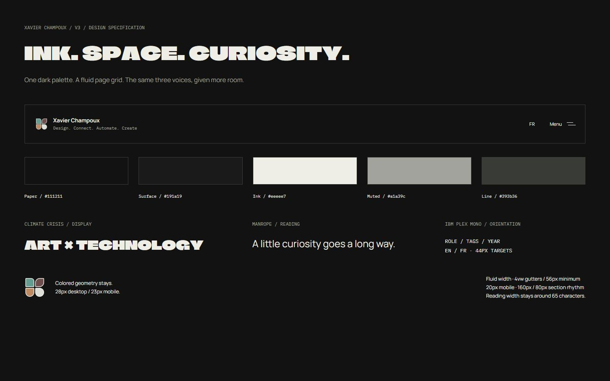

## 3. Home — two new compositions

Both proposals remove the machine, intro sequence, hints, Skip/Replay and playback controls. All four statements appear immediately: **I design. I connect. I automate. I create.** Roles remain **Frontend Developer, UI/UX Designer, Technical Artist and Programmer**. The description and “A little curiosity goes a long way” are visible copy, not a hidden interaction prompt.

### A. Art × Technology — recommended

Two oversized lines establish the central idea. The offset second line creates movement through composition before any animation is added. A small lower-left introduction, four quiet statements and the role list balance the two lower-right actions. This adapts the spatial hierarchy of [Mike Wilcock's Home](https://mikewilcockdesign.com/) while retaining our identity, typefaces and content.

**Strengths:** immediate visual identity, clear next actions, strong separation between expressive title and useful information. **Tradeoff:** the supporting lines are intentionally quiet; keep them readable and avoid adding competing animation. Mobile removes the large lateral offset, keeps whole words and preserves the breathing space.

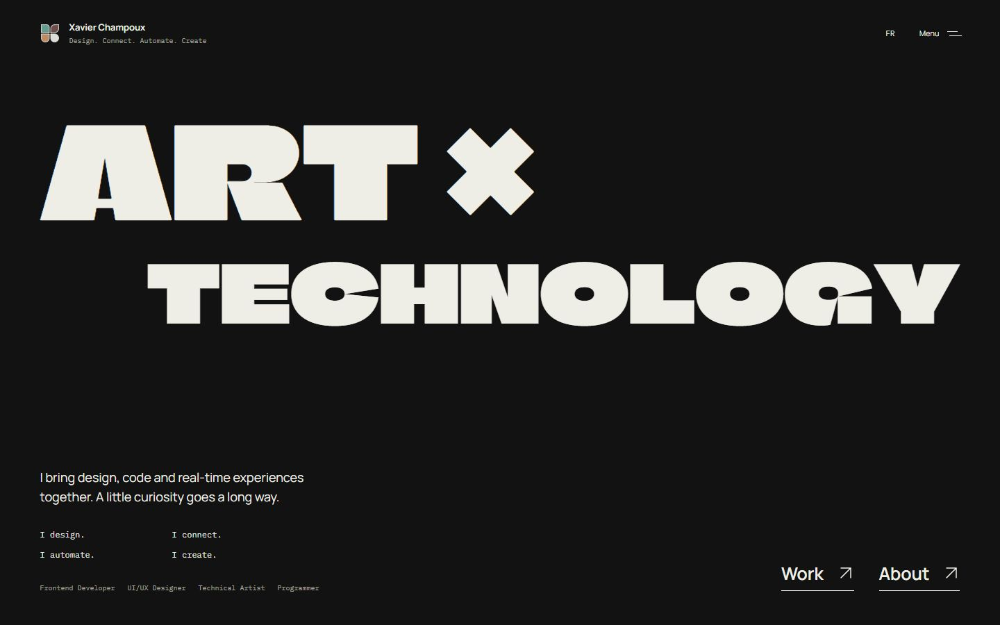

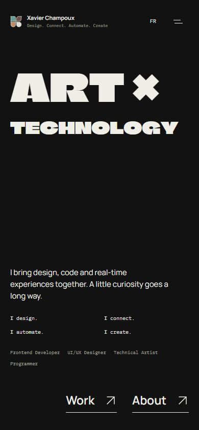

### B. Four statements

The four verbs become the composition itself. Deliberate horizontal offsets suggest the range of practice without partitioning it into rigid disciplines. Supporting curiosity copy and roles sit below; Work/About remain the next step. The desktop page can scroll to preserve the negative space rather than compressing the statements into a 900px frame.

**Strengths:** direct personal voice and a particularly clear connection to the header descriptor. **Tradeoff:** less immediate recognition of the art/technology theme and a longer desktop arrival. Never reveal the statements one at a time as required content; any entrance treatment must leave the full message available.

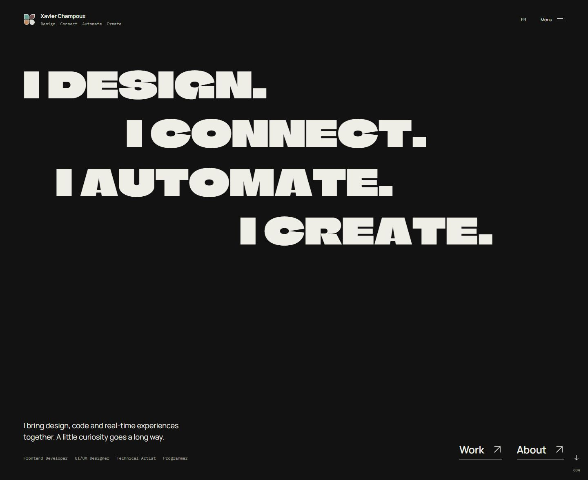

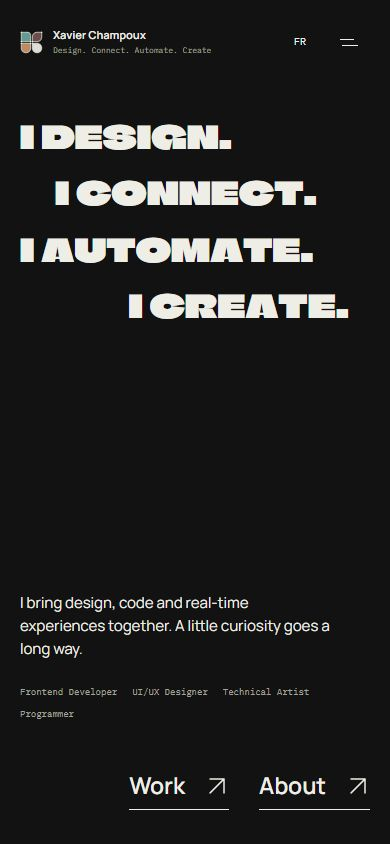

A possible pen-triggered experience belongs to a future easter egg. It is outside launch scope, does not reserve a machine-shaped space, and is not a dependency for understanding or navigating Home.

## 4. Menu — two simple left-aligned alternatives

Both show only Home, Work, Archive and About beneath the shared header. There is no Explore label, 01–04 range heading, machine, caption, page footer or scroll control. Archive's only global navigation entry remains here. The right side stays empty for now.

### A. Bare stack — recommended

Large left-aligned words and a generous hit area make the destinations unmistakable. The quiet right field is intentional. The French “À propos” remains a complete label on mobile.

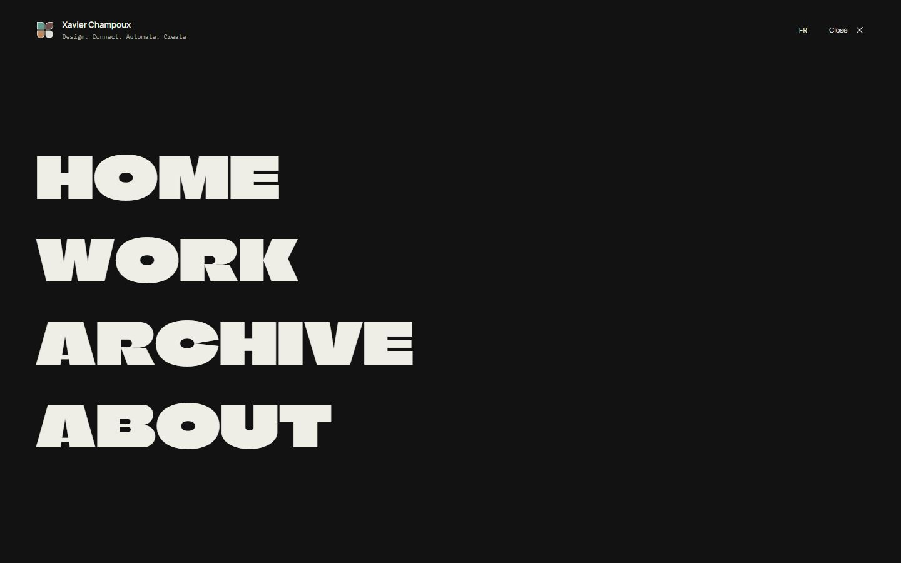

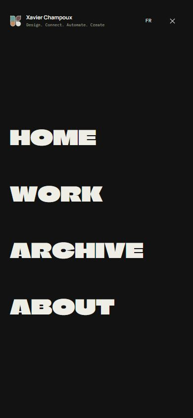

### B. Separated rows

Smaller words occupy generous horizontal rows, separated by subtle internal rules. This gives pointer travel a more explicit structure and leaves more background space for a later artistic treatment. Its tradeoff is a more conventional list character.

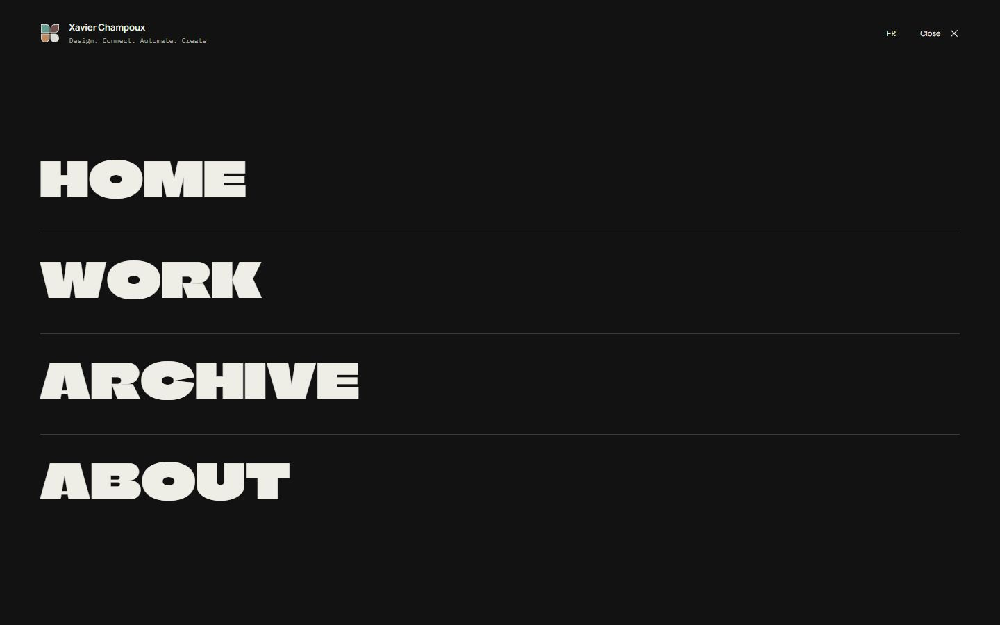

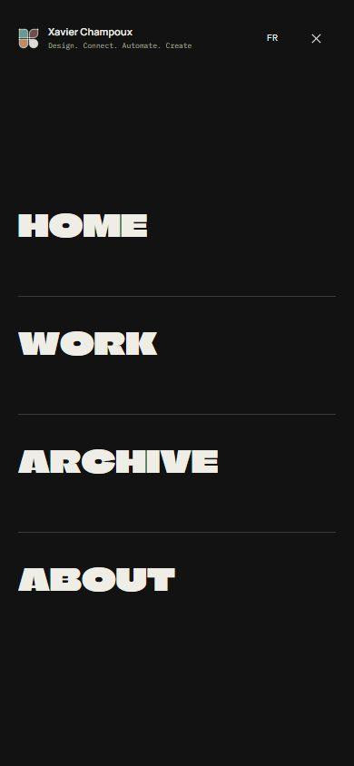

**Application behavior to implement after review:** open as a full-screen modal navigation surface; lock underlying scrolling, mark the background inert, focus the close control, contain Tab/Shift+Tab, close with Escape, and return focus to the opener. Preserve the originating page and scroll position. The isolated study uses separate linked views and does not claim to implement the modal focus lifecycle.

## 5. Work — evidence first or an expressive list

Both alternatives place the upper-right introduction **above** a substantially larger Work heading. Both preserve **Feltkutur → Ryker → Schluter → Simona** in visual, document and mobile order. Neither adds an arrow beside a project name. The separate underlined “View project” action in A retains its diagonal arrow.

### A. Spacious editorial — recommended

Metadata and concise project context sit beside substantial existing imagery. Projects are separated by generous vertical space; each can receive a restrained coordinated reveal. Mobile stacks image before its descriptive block without changing project order. Simona uses its landscape source image `0.webp` as the listing preview instead of stretching a portrait cover.

**Strengths:** communicates the work before requiring a click, supports different project types, and makes selected work feel deliberately curated. **Tradeoff:** longer page; avoid excessive delay or pinned scrolling between projects.

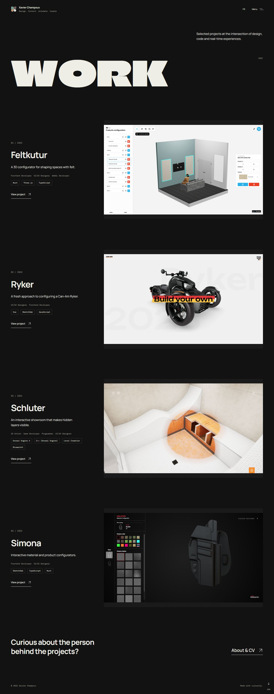

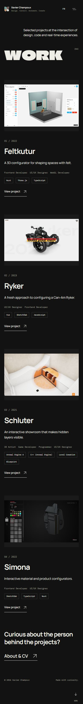

### B. Large editorial rows

Project name, specific contribution roles, tool/technique tags and year form larger rows than Archive. Desktop hover/focus can add an image-only preview. Touch uses the full text row as the link and requires no preview gesture.

**Strengths:** fast scanning, strong typography and close alignment with Archive's browsing model. **Tradeoff:** project imagery is less discoverable on touch. A future list/grid toggle remains deferred; these are two design alternatives, not two implemented display modes.

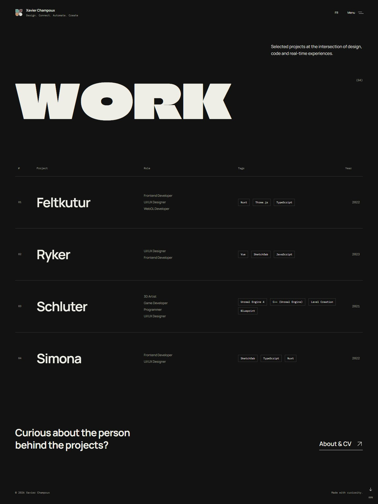

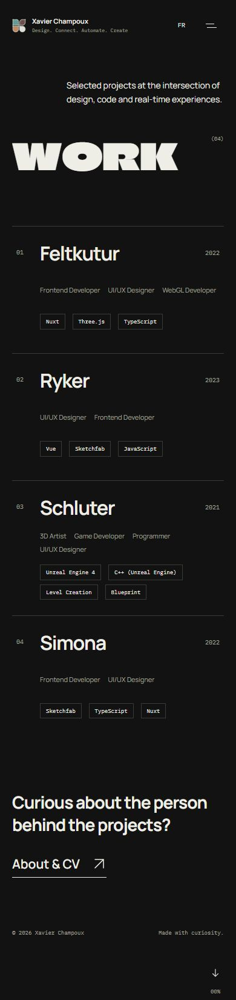

Schluter retains its Technical Art context. Its tags explicitly retain **Unreal Engine 4, Level Creation and Blueprint**, alongside source tools. Role badges describe actual project contributions rather than claiming four mutually exclusive professional categories. Summaries are design-review copy, not independently verified outcomes.

## 6. Archive — roles and tags

Archive contains the **12 remaining active projects**; it excludes the four selected works and Portfolio V1/V2. Both proposals show index, Project, **Role**, **Tags** and Year. A project may have several roles. Mobile places labeled Role and Tags groups below title/year, preserving information without horizontal scrolling.

### A. Open table

Restrained rectangular filter controls and plain typographic metadata produce the quietest archive. Decorative lines organize the rows; the entire link remains a large target. This is the more editorial, less interface-like option.

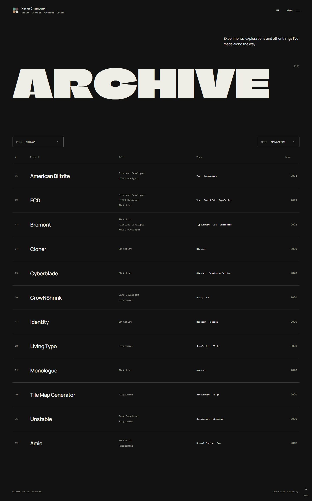

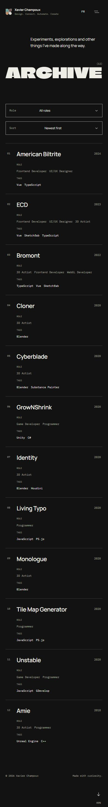

### B. Rounded controls and badges — recommended

Rounded filters and neutral pill-shaped roles/tags add softness. The shapes help distinguish metadata from project names without assigning every project to an exclusive color category. This is particularly useful when multiple roles are present. The tradeoff is more visual texture; keep badges neutral and spacing generous.

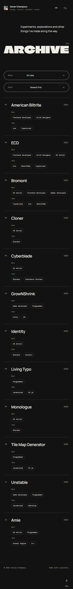

### Preview and future filter contract

- Active row uses **Surface**; keyboard focus also has an independent Ink outline. The preview is only a larger floating image, around 440px at the desktop reference size. It has no added title, year, caption, card, frame or border. Any text already inside the source image is part of that image.
- Fine pointer: damp the following position and clamp the preview away from the active title, header and scroll corner. Keyboard: stationary placement. Reduced motion: stationary placement without tilt or pursuit. Touch: text rows only; tapping opens the project.
- Default filter is all roles. The supported IDs come from retained project data: `frontenddeveloper`, `uiuxdesigner`, `webgldeveloper`, `artist3d`, `gamedeveloper`, `programmer`.
- Future URL state is **`role=<role-id>` plus `sort=newest|oldest|title`**. One role is selected at a time; a multi-role project matches any of its own roles. Empty role means all. Invalid values normalize to all/newest. This replaces the proposed broad-discipline filter contract.
- Preserve role/sort through locale changes, project visits and browser history. Application Back must also restore the Archive scroll position. The study demonstrates role/sort URLs and locale preservation; production history restoration remains a later application check.

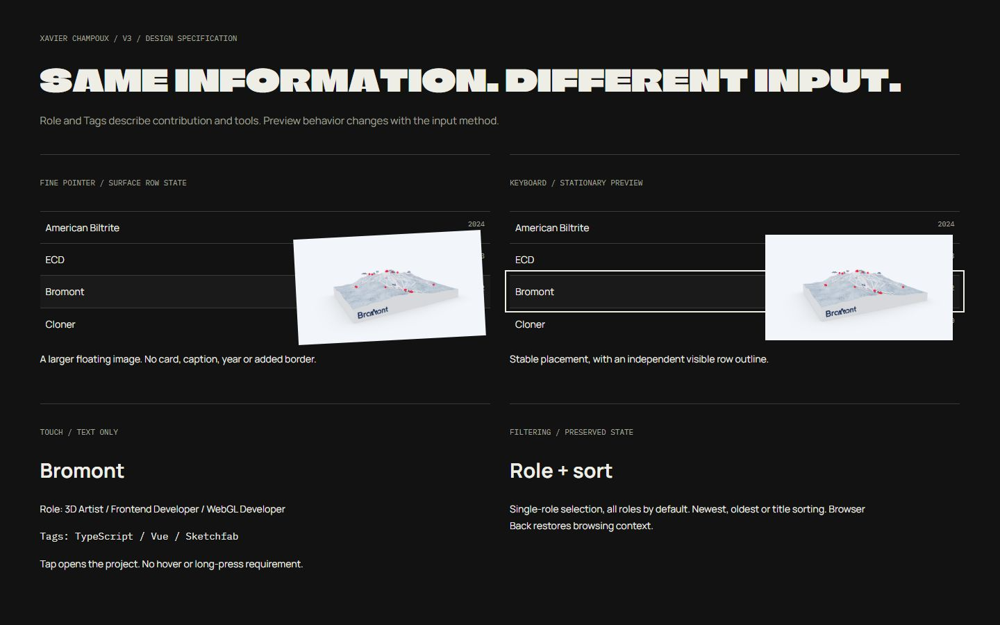

## 7. About — editorial sidebar, preserved content

Both retain portrait, three personal passages, the four capability sections, CV, robotics interest and contact. Both remove profile project links and the rule above Experience. The sidebar contains the requested lists; the main column uses the right-hand space without stretching reading paragraphs across it.

**What I do:** Web Development; 3D & Real-time Graphics; UI/UX Design; Game Design & Development; Tools & Pipelines.

**What motivates me:** Procedural; Automation; Simulation; Optimization; Aesthetics; Organization.

| Capability | Retained development stack |
|---|---|
| Frontend Development | Nuxt, Vue, Tailwind CSS, TypeScript, Three.js, Node.js |
| UI/UX Design | Figma, Adobe XD, Miro, Adobe Photoshop, Adobe Illustrator |
| Technical Art | Blender, Unreal Engine, Substance Painter, Houdini |
| Programming | TypeScript, C++, Python, PowerShell |

Stacks are tool lists, not claims of equal proficiency. They retain the agreed content sourced from [About.jpg](docs/refs/About.jpg) and [PLAN.md](PLAN.md). Four capabilities describe breadth; Archive roles describe individual contributions.

### A. Sidebar and broad CV rows — recommended

A compact portrait/list sidebar contrasts with a broad editorial main column. Date, position and organization use distinct CV columns, reducing the former unused space on the right. Capability sections form a two-column desktop grid. Mobile moves the sidebar above the main text and linearizes the CV.

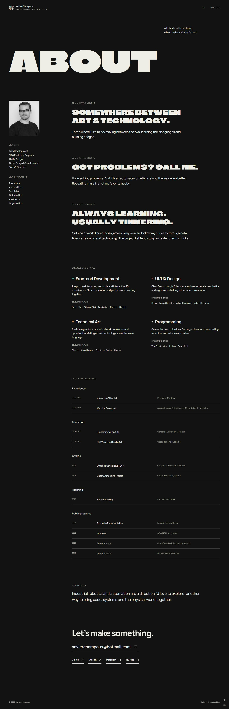

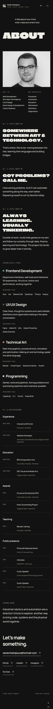

### B. Stronger chapters and grouped CV

Larger personal chapter headings and more separation make the narrative more expressive. Experience spans the main column; the shorter CV categories share two columns. This uses the right side more efficiently, at the cost of a slightly less uniform CV reading rhythm. On mobile all categories return to one linear sequence.

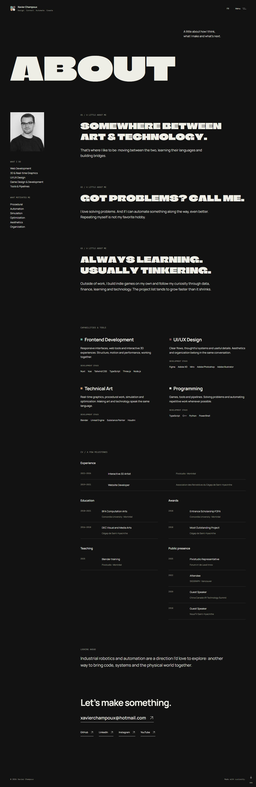

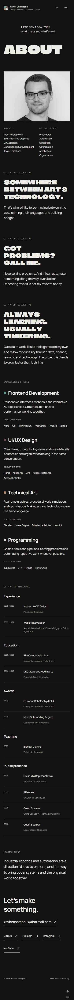

**Factual status:** CV entries, dates, job titles, qualifications, awards, teaching, public appearances and contact destinations are retained source material and remain **unverified for publication**. The conversational personal and capability copy is an editable draft. Review both languages before launch; the design is not evidence that those facts have been independently checked. The isolated [CV source](docs/design_v3/source/cv.js) makes that review explicit and editable.

## 8. Individual projects — two templates, two collection endings

Both use the hierarchy of [Fun Arena](https://mikewilcockdesign.com/work/fun-arena): prominent title, concise facts, broad lead media and clearly separated context. Project facts and contribution copy come from this portfolio's retained data, not the reference site's client claims.

### A. Broad masthead and sequential media — recommended

Large title, compact facts strip, first media item, two reading sections, then a predominantly single-column sequence. This is the safer choice for complex interface screenshots because there is no enlargement interaction. Portrait screenshots remain centered at a sensible width rather than becoming enormous full-width images.

Selected-work example, **Feltkutur**:

Archive example, **ECD**:

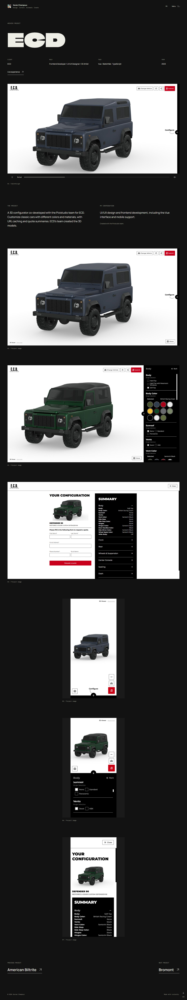

### B. Asymmetric opening and paired sequence

Title and facts occupy different sides of the opening, followed by the broad first item. Later media pairs retain left-to-right, then top-to-bottom source order. Mobile becomes one column in exactly that order. This option produces a more varied editorial rhythm but reduces screenshot size on desktop; use it only where the source media remains legible.

Selected-work example, **Feltkutur**:

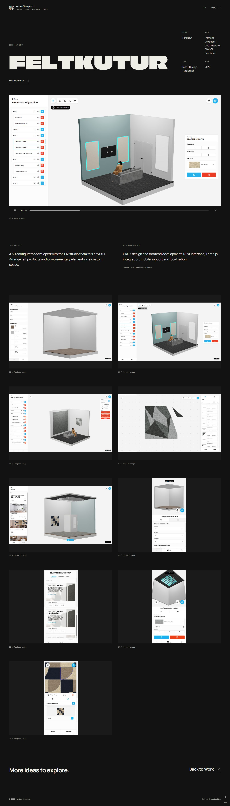

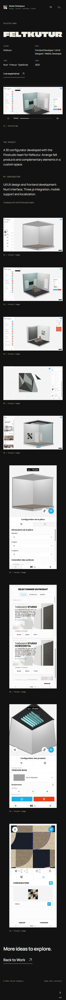

Archive example, **ECD**:

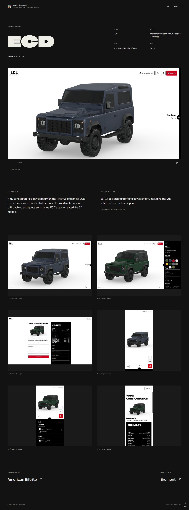

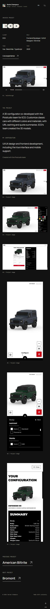

### Media and collection rules

The media array is authoritative. **Feltkutur:** first video, then images `0.webp` through `8.webp` — ten items. **ECD:** first video, then images `0.webp` through `5.webp` — seven items. The complete catalog contains **118 ordered media items** across 16 active projects. Pairing never sorts by type, dimensions or aesthetics. The leading poster represents the first video; it does not insert a new cover before the data. ECD uses landscape `0.webp` for that poster representation.

**Planned application video behavior:** muted inline autoplay when visible and ready, pause when off-screen or the tab is hidden, explicit pause/resume, seeking and unmute. Never enable sound automatically. If autoplay is blocked, show a poster and Play. Reduced-motion or data-saving preferences start with poster/Play. Loading does not wait for gallery videos. Keep images/videos inline: **no enlargement, lightbox, zoom dialog or custom fullscreen action**.

**Study limitation:** the exported screens use source posters and illustrative video controls. They show placement and intended state; they do not run the production video pipeline or demonstrate autoplay, audio, seeking, failure handling or off-screen pausing. Those behaviors require later application testing.

Selected projects finish with **Back to Work**. Archive projects finish with **Previous / Next** in the preserved filtered/sorted Archive sequence. Direct visits use newest-first with stable slug tie-breaking; omit missing neighbors at the ends, without wrapping or mixing selected work into the sequence. ECD demonstrates American Biltrite / Bromont neighbors. Archive has no Back to Work ending and no dedicated return-to-Archive link; browser Back restores browsing context.

Project context, individual contribution and team credits remain editable review copy. The Feltkutur/ECD examples retain Pixistudio attribution and ECD's model-creation credit. Review exact wording with the project owner before publishing.

## 9. Loading — only identity and readiness

This is a full-screen readiness state with **no header, footer, tagline, central loading caption, selected profile, press-any-key prompt, menu or scroll corner**. The prior [Loading.jpg](docs/refs/Loading.jpg) informs the quiet console-like step treatment, while V3 removes its extra content.

### A. Small mark, quiet progress — recommended

A small centered logo anchors the screen. Completed/current steps sit lower-left; the numeric percentage sits lower-right. The tension comes from the distance between these three elements, not additional decoration.

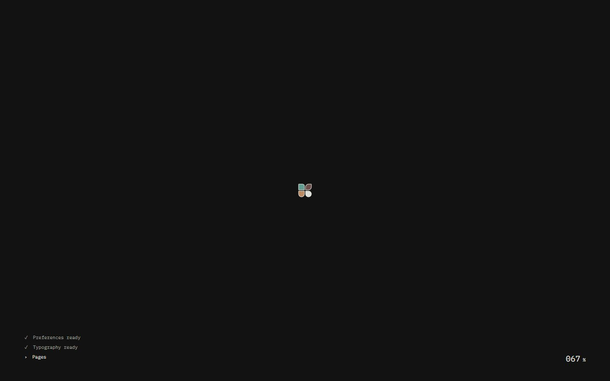

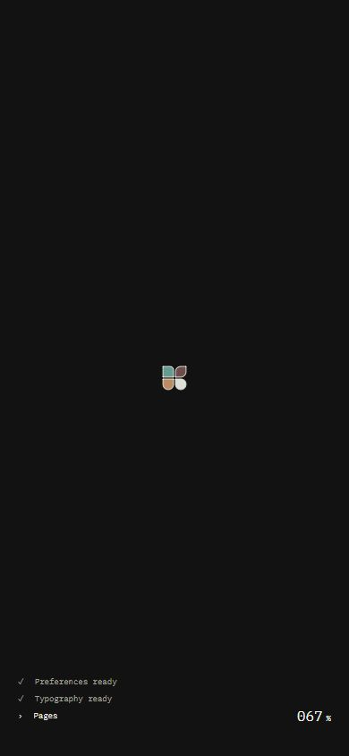

### B. Larger identity and counter

The logo has more presence, while a large display counter becomes the secondary focal point. Completed steps recede and the active step stays clearer. Mobile raises the steps above the counter to protect longer localized text. This is more expressive but can make a very short load feel disproportionately prominent.

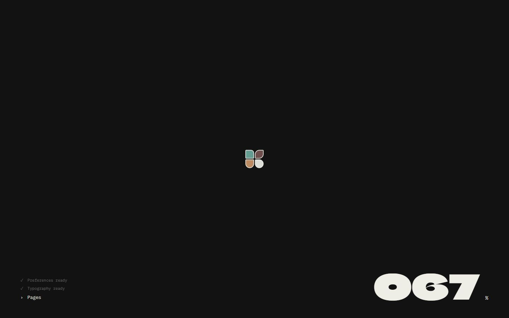

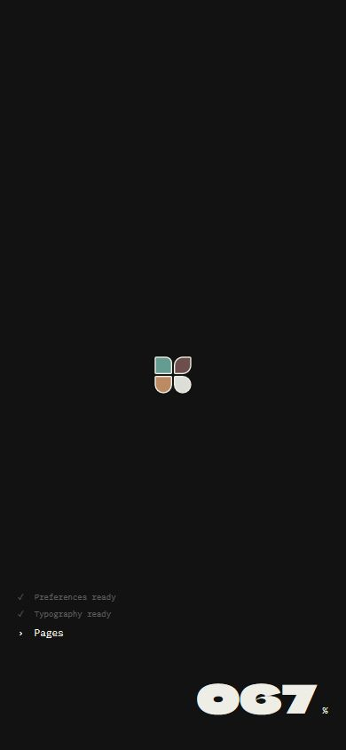

Progress measures **completed essential readiness tasks**, not elapsed time or arbitrary tweening. The study illustrates three equal tasks: preferences, typography and initial page readiness; 2/3 rounds to 67%. Exported percentages are specified states, not a simulated delay sequence. Production tasks should have explicit completion/failure outcomes and never depend on the whole gallery loading.

If already ready, proceed immediately. Do not add a minimum display time, wait at 99%, replay this screen on ordinary route changes, or require a click. Optional media failure leaves text/navigation usable. Essential failures need an accessible retry or usable fallback rather than an indefinite blocker. Reduced motion uses an immediate handoff. A polite concise status can announce task changes; do not announce every numeric increment.

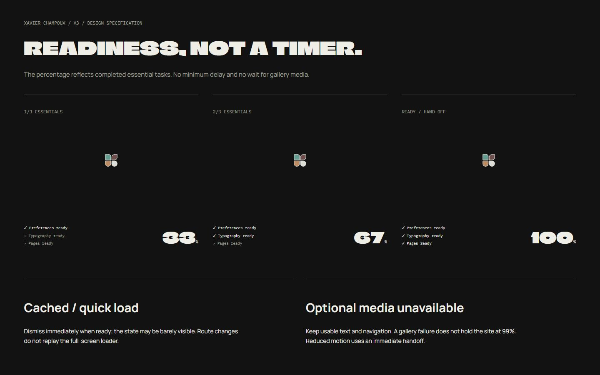

## 10. Links, scroll control and motion contract

### Underlined actions

Use the up-right arrow at 45°. Primary links have a resting underline and run **one 480ms out/in cycle on hover or focus entry**; avoid an endless loop while someone reads. The secondary comparison slides the underline in over 250ms. Keep a separate 2px focus outline with clear offset, and retain visible underlines on touch. Reduced motion leaves a static underline.

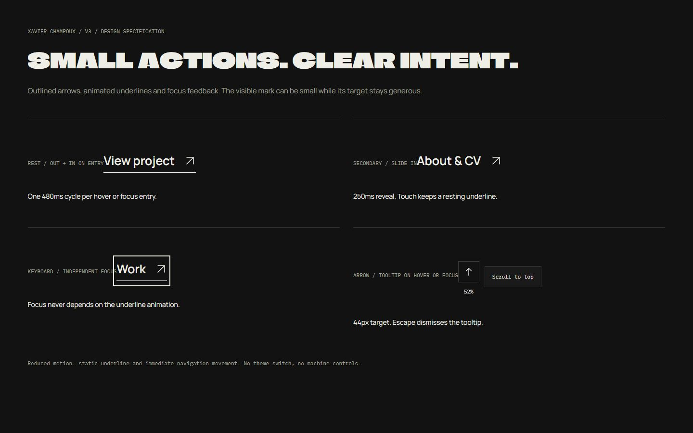

### Bottom-right scroll corner

The permanent visible content is only an arrow and percentage. At the top: down arrow. After approximately 8px of scrolling: up arrow. The tooltip and accessible name change between **Scroll down / Scroll to top** and **Défiler vers le bas / Retour en haut**. Down advances into the page; up returns to the beginning.

The arrow has a 44px target. Tooltip appears on pointer hover or keyboard focus, remains visible while its trigger is active, and dismisses with Escape. Progress is a labeled progress value, not an `aria-live` stream. It reports the document scroll position, never acts as a drag handle, and updates after layout/media changes.

Desktop places the corner in the outer gutter. Mobile reserves a **72px bottom utility area**, including safe-area allowance in production, so the fixed control cannot cover content or media controls. Preview images must remain clear of it. Hide the control on loading, menu and non-scrolling views. It may appear on Home B if its content exceeds the viewport.

**Export convention:** full-page images show the utility once at the document end, using the initial 0% state, so it does not mask a row in a tall screenshot. In the live study it is fixed to the viewport corner and reflects actual scrolling. Static screenshots do not represent a final scroll position.

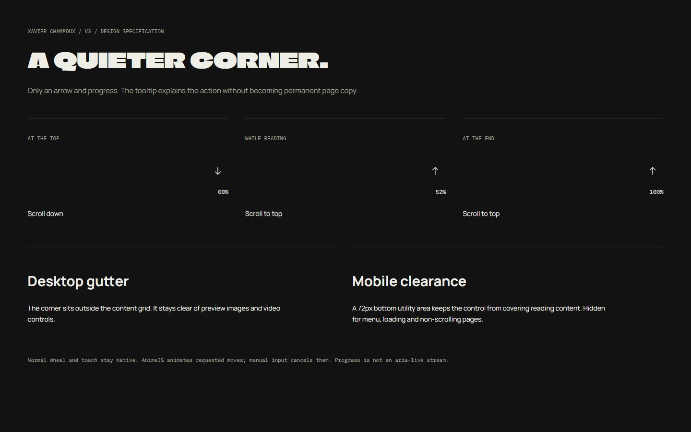

### AnimeJS smooth scrolling

Use AnimeJS for **requested anchor moves and scroll-to-top**, while ordinary wheel/touch scrolling remains native. The study's corner move animates a scroll-position proxy for **650ms with `out(3)` easing**; manual wheel, touch or navigation keys cancel it. Reduced motion moves immediately. Application anchor navigation must also account for the fixed header and move focus appropriately to the destination.

Use AnimeJS `onScroll` for coordinated reveals or restrained scroll-linked effects. Its official documentation describes connecting scroll observers to animations/timelines; this does not require replacing native document scrolling. [AnimeJS onScroll documentation](https://animejs.com/documentation/events/onscroll/) was opened in Browser on 14 November 2026. The isolated study uses the repository's existing **Anime.js 4.5.0** copy; [dependency provenance and license](docs/design_v3/vendor/README.md) are retained without changing app dependencies.

The optional `motion=live` study demonstrates a one-time image reveal. Default exports keep all content visible. Proposed page/menu motion is described separately in the final section; exact reference-site durations or libraries are not inferred from screenshots.

## 11. French examples and responsive behavior

French is a complete launch locale, not a shortened alternate design. Header uses **Concevoir. Connecter. Automatiser. Créer**. Home statements use **Je conçois. Je connecte. J’automatise. Je crée.** Locale controls show the uppercase destination language. Tool/product names retain their proper names; roles, navigation, status, tooltips and reading copy are localized.

### Home A — desktop and mobile

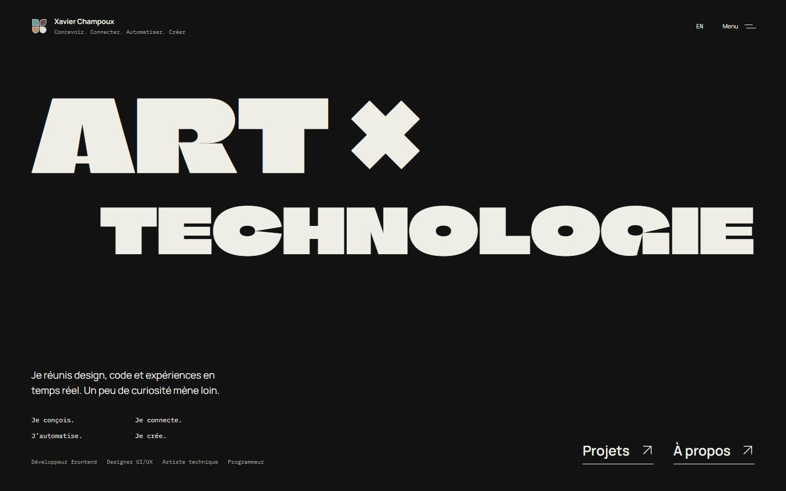

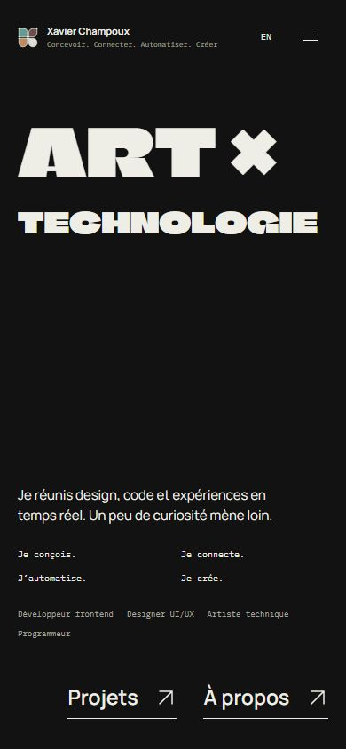

### Menu A — mobile

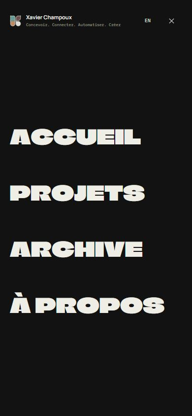

### Work B — mobile

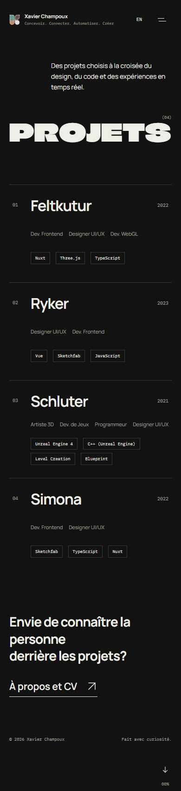

### Archive B — mobile

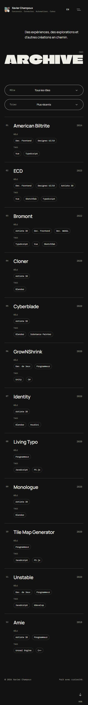

### About A — desktop

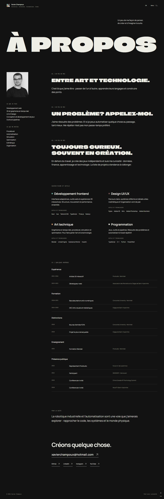

### Project A — mobile

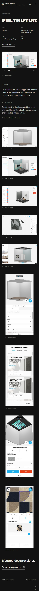

### Loading A — mobile

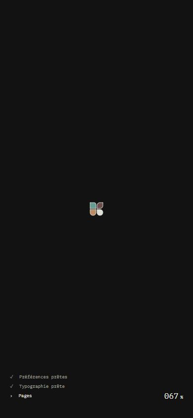

### Responsive and accessible rules

| Situation | Required behavior |
|---|---|
| 320px French layout | Fit complete display words; wrap prose/metadata; stack layout and controls; no horizontal page overflow. |
| Wide desktop | Fluid 4vw gutters; generous composition, bounded type sizes, approximately 65ch reading measure; preserve aspect ratio and constrain portrait media. |
| Enlarged text / zoom | Allow longer pages and wrapping; never lock Home/menu to an unscrollable height; keep all four statements and actions. Recheck at 200% text size and 400% zoom during application QA. |
| Keyboard | Logical document order, visible focus, full-row project links, native selects and stationary previews. Menu focus containment/restoration belongs to the application overlay. |
| Touch | 44px targets, no hover-dependent information, no preview requirement, static underlines and bottom-control clearance. |
| Reduced motion | No required text reveal, moving preview, underline cycle, animated scroll or loading transition. Optional media starts on poster/Play. |
| Fonts or optional media unavailable | Keep useful text, navigation and aspect-ratio placeholders; font failure must not make readiness wait forever. |
| Screen reader | Semantic headings/landmarks, meaningful link labels, localized icon names, decorative SVGs hidden, useful media descriptions. Do not announce progress on every scroll. |

No launch 3D experience remains, so a machine/WebGL fallback is no longer part of the page. A future easter egg would require its own keyboard, touch and static alternative before being added.

## 12. Editable studies and validation

The isolated [study](docs/design_v3/source/studio.html), [styles](docs/design_v3/source/studio.css), [view source](docs/design_v3/source/views.js), [shared helpers](docs/design_v3/source/core.js), [retained catalog](docs/design_v3/source/catalog.json) and [CV source](docs/design_v3/source/cv.js) live only under `docs/design_v3/`. They use the local fonts and existing project imagery. No V3 image is an AI-generated concept illustration or a new production asset.

From the repository root, rebuild the isolated bundle with `node docs/design_v3/source/build.mjs`, then run `node docs/design_v3/source/server.mjs`. Preview at `http://localhost:4180/docs/design_v3/source/studio.html?page=home&variation=a`. Other `page` values are `menu`, `work`, `archive`, `about`, `project`, `loading`; `variation=b` selects the alternate and `locale=fr` selects French. Project examples use `slug=feltkutur` or `slug=ecd`. Boards use `page=foundations|links|previews|scroll|readiness`. `motion=reduce` explicitly demonstrates the reduced-motion branch; `motion=live` enables the optional image reveal. `capture=1` is documentation export mode only.

The studies make layout, link states, filters, previews and corner scrolling reviewable. Video controls and readiness task progression are illustrative; menu is a linked study view. Do not mistake this for an application rebuild or production behavior acceptance.

### Completed documentation checks

- Inspected all exported screens in grouped comparison sheets for cropping, readability, spacing, dark consistency and mobile composition. Full-page Work captures were adjusted so the fixed mobile utility does not obscure project text.
- Recorded **45 browser layouts**: all 40 screen exports plus five boards. Verified fonts loaded, image decoding, document width, absence of horizontal overflow, four Home statements, selected-work order, recognized roles and complete project media sequence.
- Checked **32 additional responsive layouts**: all 16 primary proposal/collection combinations at **320px French** and **1920px English**. Layout width, local images/fonts and minimum interaction targets passed. Fixed the narrow French About B heading overflow before the final exports.
- Exercised role filtering plus title sorting, preservation through the locale link, AnimeJS scroll-to-top, manual interruption, tooltip focus/Escape, and the explicit reduced-motion study branch.
- Audited every local document image/link, font signature, retained media path, screen count and source-data order. Original V1/V2 documents and the baseline application files retain their starting hashes.

Evidence: [final audit](docs/design_v3/validation.json), [browser export records](docs/design_v3/browser-validation.json), [responsive records](docs/design_v3/responsive-validation.json), [interaction observations](docs/design_v3/interaction-validation.json), [screen manifest](docs/design_v3/screens/manifest.json), [board manifest](docs/design_v3/boards/manifest.json), [reference provenance](docs/design_v3/references/manifest.json), [font provenance](docs/design_v3/fonts/manifest.json). Run the file/data audit with `node docs/design_v3/source/audit.mjs`; this is separate from application tests.

### Review decisions before the rebuild

- [ ] Select A or B for each view; confirm any combination of recommended options.
- [ ] Confirm the Home A title scale, supporting-copy size and lower-right actions.
- [ ] Choose Work A's visible imagery or Work B's faster list; keep the list/grid toggle deferred.
- [ ] Confirm Archive B's neutral roundness and role-based filter vocabulary.
- [ ] Review English/French personal copy, all CV facts, contribution statements, team credits and contact destinations.
- [ ] Confirm inline-only project media, autoplay policy/fallbacks and collection-specific endings.
- [ ] Confirm Loading A's restrained mark and genuine readiness model.
- [ ] Accept the proposed motion budget below; retain native wheel/touch and reduced-motion alternatives.

Later **application** validation must cover actual fixed-header behavior, menu focus lifecycle, real screen-reader use, text enlargement/zoom, browser history scroll restoration, autoplay policies, media failures, network/data-saving behavior and performance. The documentation checks above do not substitute for those tests.

## 13. Reference evidence and motion findings

The six snapshots below were captured directly in **Browser on 14 November 2026**. All are **live-site views**, not collection pages, published case studies or generated approximations. Creator attribution is **Mike Wilcock** (the site wordmark reads Michael Wilcock). Reference imagery remains attributed research material, separate from production assets. V1/V2 reference collections remain available in their original documents; V3 adds this focused evidence set.

### R1. Home — typographic composition

**Creator:** Mike Wilcock · **Source:** [Home](https://mikewilcockdesign.com/) · **Kind:** live site · **Captured:** 2026-11-14.

Observed: staggered oversized name, small lower-left introduction and lower-right action. Decision: use spatial contrast for Home A, retaining our own fonts and content. Proposed entrance timing is ours, not measured from this snapshot.

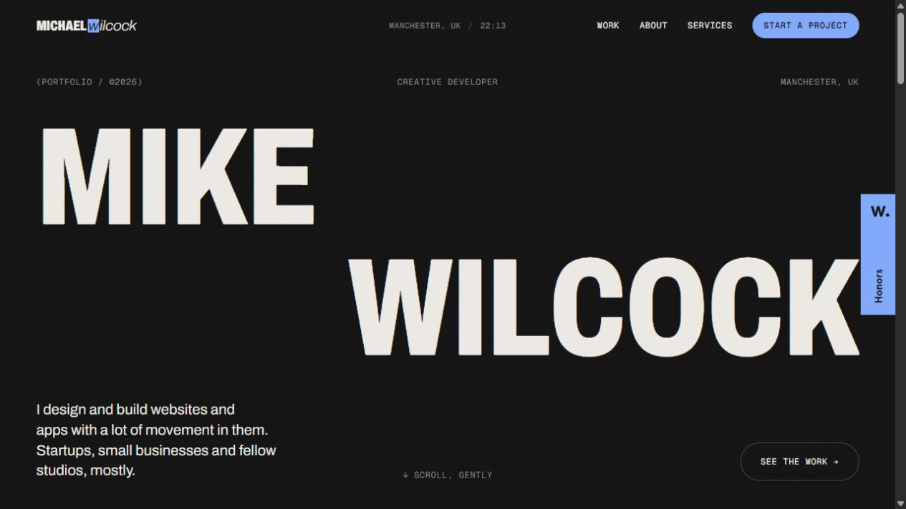

### R2. Work — list

**Creator:** Mike Wilcock · **Source:** [Work](https://mikewilcockdesign.com/work) · **Kind:** live site · **Captured:** 2026-11-14.

Observed: very large heading, metadata rows and a visible List/Grid control. Decision: compare a larger-row Work B against editorial Work A. No toggle enters our launch scope.

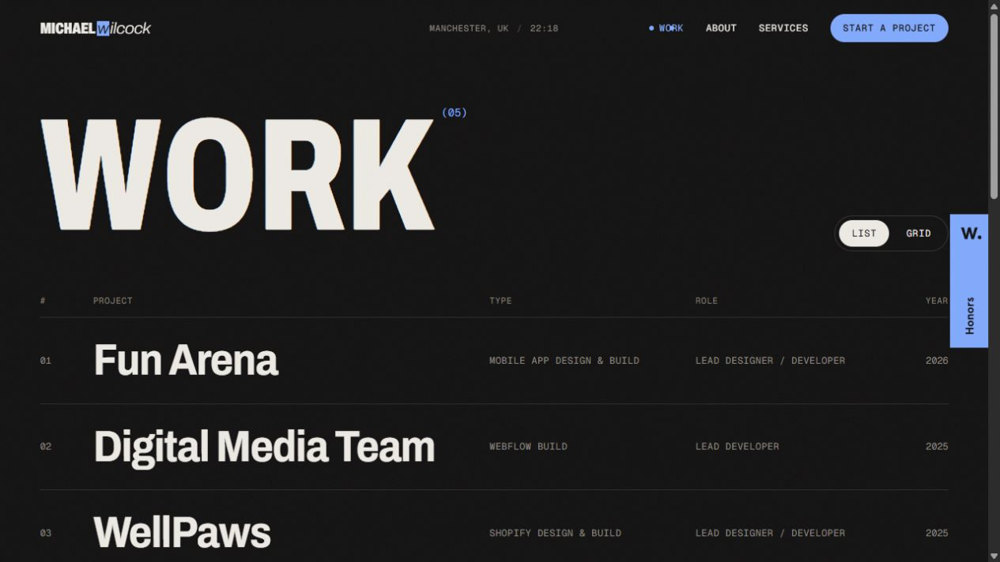

### R3. Work — grid after interaction

**Creator:** Mike Wilcock · **Source:** [Work](https://mikewilcockdesign.com/work) · **Kind:** live site, control changed in Browser · **Captured:** 2026-11-14.

Observed: activating the display control changes the listing into image cards. Decision: keep image visibility as a key tradeoff when evaluating our two Work proposals. The capture records the resulting state, not its transition duration.

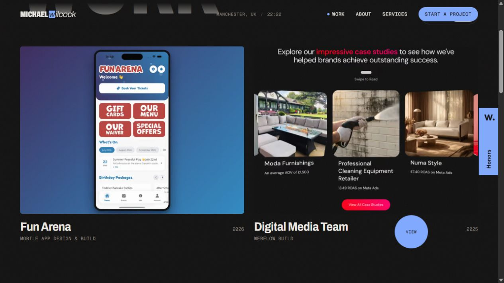

### R4. Fun Arena — opening

**Creator:** Mike Wilcock · **Source:** [Fun Arena](https://mikewilcockdesign.com/work/fun-arena) · **Kind:** live project page · **Captured:** 2026-11-14.

Observed: prominent title, compact facts and broad lead image. Decision: establish project identity before explanatory sections. Client facts and metrics from the reference are not reused in this portfolio.

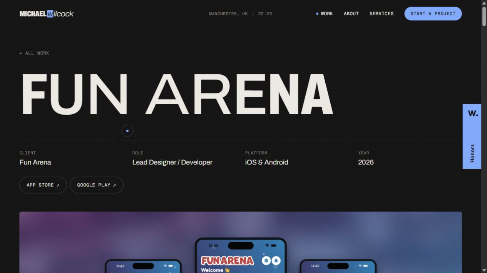

### R5. Fun Arena — overview

**Creator:** Mike Wilcock · **Source:** [Fun Arena](https://mikewilcockdesign.com/work/fun-arena) · **Kind:** live project page, scrolled · **Captured:** 2026-11-14.

Observed: small left section label, right reading column and broad vertical spacing. Decision: use narrow reading measures within the fluid page. The snapshot was reframed to include the actual Overview label.

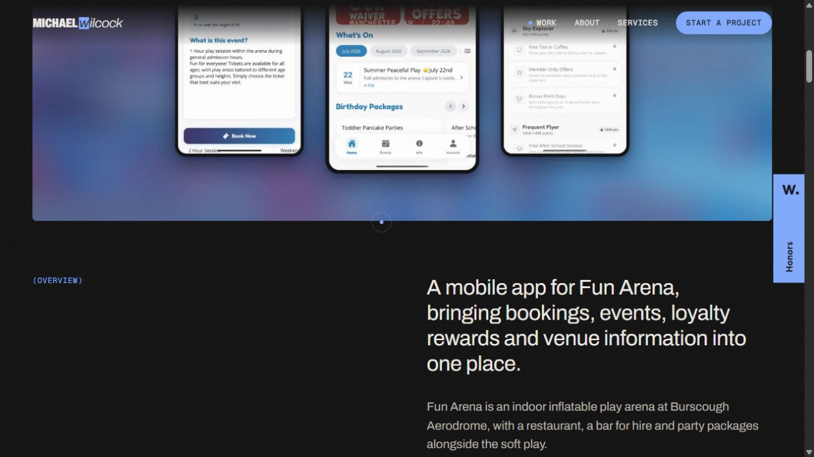

### R6. Fun Arena — media composition

**Creator:** Mike Wilcock · **Source:** [Fun Arena](https://mikewilcockdesign.com/work/fun-arena) · **Kind:** live project page, scrolled · **Captured:** 2026-11-14.

Observed: paired media at different vertical offsets. Decision: test a paired sequence in Project B, while retaining our source order and a single mobile column.

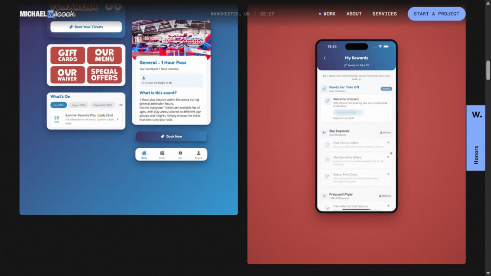

### Observed behavior versus proposed adaptation

| Evidence from Browser interaction | Proposed adaptation for this portfolio |
|---|---|
| Work's List/Grid control changes the visible composition. | Evaluate our A/B proposals now; defer a user-facing toggle. |
| Project text and media enter progressively while scrolling; visible state settles after movement. | Small one-time image reveal, approximately 16px translation and 650ms opacity/position transition. Never gate important text. |
| Navigation was observed with a colored stepped transition treatment in the reference review. Static snapshots cannot establish its timing or implementation. | Consider a restrained 350–500ms page wipe/fade using our dark palette; coordinate with page readiness, focus and history. Do not copy the reference's signature artwork. |
| Title, metadata and media have distinct visual layers. | Coordinate a short title/metadata entrance, then leave content still. Home's four statements are always present and understandable. |

**Proposed motion budget, subject to review:** menu surface 300–400ms with a small link stagger; project image reveal 650ms; action underline 480ms; secondary underline 250ms; requested scroll moves 650ms. Preview pursuit should be subtle and input-specific. Loading may hand off with a brief opacity transition only when useful, never an artificial readiness delay. These numbers are design recommendations, not measured reference behavior.

Use AnimeJS timelines and `onScroll` to coordinate the approved effects after the layout is selected. Keep native wheel/touch, cancel requested movement when visitors intervene, preserve usable content before animation begins, and remove nonessential movement under reduced motion. Animation should reinforce the spacious composition and navigation rather than compensate for missing information.
