# V4 — Final portfolio design handoff

**Final visual specification · 14 November 2026 · Application implementation pending**

V4 consolidates the accepted direction into one final design for every view. It supersedes conflicting proposals in [DESIGN.md](DESIGN.md), [DESIGN_V2.md](DESIGN_V2.md) and [DESIGN_V3.md](DESIGN_V3.md); those documents and all their assets are preserved. [PLAN.md](PLAN.md) now records these decisions. This iteration changes documentation and isolated studies only: **no application code, routes, package manifest or production dependency changes**.

The visitor journey remains **Home → Work → About/CV**, with Archive reached through the menu. The audience is an employer, collaborator or client looking for evidence of design and development ability. The final composition gives that evidence room while keeping navigation direct.

## 1. Final decisions and deliverables

| View | Final decision |
|---|---|
| Home | V3 Four Statements' lower composition, with its large display area entirely empty. |
| Menu | V1 numbered full-width rows, separators and diagonal arrows, with V3's large typography and spacing. |
| Work | Large editorial rows; wrapping profile badges and tags. |
| Archive | Rounded filters/badges; profile-based filtering and image-only previews. |
| About | Strong personal chapters/sidebar opening, then full-width profiles, CV and everything below. |
| Selected project | Broad masthead and source-order single-column media; Back to Work ending. |
| Archive project | Same template; adjacent Archive project ending. |
| Loading | Top-left five-line OS-style history, large bottom-right counter, no logo. |

There are **32 final screens**: eight views × desktop/mobile × English/French. Five implementation boards and five attributed prior-study references bring the embedded image total to **42**. There are no A/B choices left to resolve in the default design. The immersive first-video treatment is explicitly optional and separate from the default.

Screen references use **1440 × 900 desktop** and **390 × 844 mobile**. Scrolling views have full-page exports at the same width. Open an image to inspect its original resolution; comparison sheets are for composition, not small-type inspection.

Comparison sheets: [Home](docs/design_v4/review-home.jpg), [Menu](docs/design_v4/review-menu.jpg), [Work](docs/design_v4/review-work.jpg), [Archive](docs/design_v4/review-archive.jpg), [About](docs/design_v4/review-about.jpg), [Projects](docs/design_v4/review-project.jpg), [Loading](docs/design_v4/review-loading.jpg), [Boards](docs/design_v4/review-boards.jpg), [Reference lineage](docs/design_v4/review-references.jpg). The comparison sheets' gray background is review furniture, not a website theme.

## 2. Shared visual foundations

### Dark palette and identity

| Token | Exact value | Use |
|---|---|---|
| Paper | `#111211` | Page, header, menu, loading, tooltips and FAB fill |
| Surface | `#191A19` | Active rows and quiet supporting surfaces |
| Ink | `#EEEEE7` | Main text, arrows, focus and progress arc |
| Muted | `#A1A39C` | Secondary information and dates |
| Line | `#393B36` | Decorative rules, badge borders and inactive progress track |
| Frontend | `#649C91` | Frontend profile swatch / logo shape |
| UI/UX | `#6F4E4C` | UI/UX profile swatch / logo shape |
| Technical Art | `#BE8B61` | Technical Art profile swatch / logo shape |
| Programming | `#DEDED8` | Programming profile swatch / logo shape |

Retain the colored logo geometry at **28px desktop / 23px mobile**; it is absent from Loading. No theme switch, sun/moon control or light variant returns. Ordinary copy uses Ink or Muted, not the darker swatch colors. Approximate contrast: Ink/Paper 16.11:1; Muted/Paper 7.36:1; Ink/Surface 14.98:1; Muted/Surface 6.84:1. Line is structural, not a sufficient focus or form-control boundary; filters use the clearer Muted boundary.

Use **Climate Crisis** for major display headings, **Manrope** for reading/project names, and **IBM Plex Mono** for labels, badges and metadata. Climate Crisis uses the retained YEAR 1979 setting and normal weight; do not synthesize a bold variant. Local WOFF2 files, source information and OFL licenses are retained in [font provenance](docs/design_v4/fonts/manifest.json).

| Element | Desktop | Mobile |
|---|---|---|
| Main page heading | Fluid 12.4vw, bounded approximately 90–194px; fit complete localized title | Approximately 15.2vw; fit complete title |
| Menu title | Fluid 6.3vw, bounded approximately 60–108px | Approximately 9.2vw, fit within number/title/arrow columns |
| Work project title | 49px Manrope | 27px, 24px at very narrow width |
| Archive project title | Restrained Manrope list scale | 21px |
| Personal chapter heading | Climate Crisis, approximately 34–52px | 29px; 25px at 320px |
| Body | Manrope, mainly 16–19px | Mainly 15–17px |
| Profile/tag badge | Mono, approximately 10px / 9px | Approximately 9–10px / 8–9px in dense metadata |
| Header right labels / icons | Approximately 11px / 16px | Approximately 10px / 15–16px |

### Layout, header and actions

Use a **fluid full-width grid**, with desktop gutters `max(56px, 4vw)` and mobile gutters 20px. Keep reading passages around 65 characters wide. Major sections have about **160px desktop / 80px mobile** separation. The breakpoint for compact tables and stacked layouts is **700px**. Long pages are intentional; do not compress the gallery or About content to hit an arbitrary page length.

The compact fixed header is 96px desktop / 84px mobile with equivalent content clearance. Its left descriptor is **Design. Connect. Automate. Create** / **Concevoir. Connecter. Automatiser. Créer**. Locale destinations are uppercase FR/EN. The mobile menu keeps its accessible name while the visible word is omitted. Small visible controls retain at least 44 × 44px targets. Header and footer have no framing rule.

Underlined actions retain a **45° up-right arrow** and one **480ms out/in underline cycle** on hover or focus entry. Keep a separate 2px Ink focus outline with offset. Touch retains a resting underline; reduced motion removes the cycle. Project names in Work have no attached arrow. Menu row arrows are the deliberate exception and occupy their own right column.

Use restrained outlined icons. Project media retains its source color; the portrait stays monochrome. Default media uses contained proportions and constrained portrait widths. No new generated production imagery is introduced. Retained cursor/noise components remain subject to the integration and accessibility rules in PLAN.md; the studies use the system pointer and do not bake a noise texture into the exported media.

## 3. Canonical profiles, badges and data

Every role/tag presentation uses rounded badges. Profile badges contain a **7px square color swatch**, text and a fully rounded border; tools/techniques use neutral pills without a profile swatch. Default padding is approximately 5px × 10px for profiles and 4px × 9px for tags. Text labels carry the meaning independently of color. About's profile headings retain the same colored square without turning each heading into a navigation control.

| Original contribution | Derived profile | Stable ProfileId |
|---|---|---|
| Frontend Developer / WebGL Developer | Frontend Development | `frontend` |
| UI/UX Designer | UI/UX Design | `uiux` |
| 3D Artist | Technical Art | `art` |
| Game Developer / Programmer | Programming | `programming` |

Preserve the original contribution role array. Derive profile badges, deduplicate them, and sort in the canonical order **frontend → uiux → art → programming**. Do not derive assignments from the old five-deck categories. This avoids losing contribution information while displaying the four requested profiles consistently.

French labels are **Développement frontend**, **Design UI/UX**, **Art technique**, **Programmation**. Tool/product names retain their proper names. Home shows all four profile badges in a wrapping horizontal group. Work, Archive and project metadata use the same horizontal row-wrap layout for both profile badges and tags.

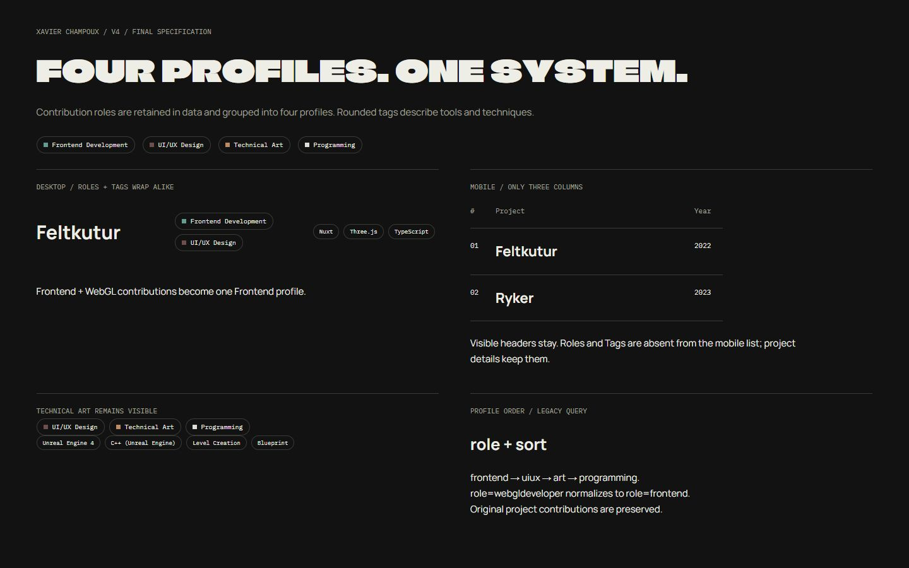

### Complete project mapping

| Project | Retained original contributions | Final visible profiles |
|---|---|---|
| American Biltrite | Frontend Developer, UI/UX Designer | Frontend Development, UI/UX Design |
| Amie | 3D Artist, Programmer | Technical Art, Programming |
| Bromont | 3D Artist, Frontend Developer, WebGL Developer | Frontend Development, Technical Art |
| Cloner | 3D Artist | Technical Art |
| Cyberblade | 3D Artist | Technical Art |
| ECD | Frontend Developer, UI/UX Designer, 3D Artist | Frontend Development, UI/UX Design, Technical Art |
| Feltkutur | Frontend Developer, UI/UX Designer, WebGL Developer | Frontend Development, UI/UX Design |
| GrowNShrink | Game Developer, Programmer | Programming |
| Identity | 3D Artist | Technical Art |
| Living Typo | Programmer | Programming |
| Monologue | 3D Artist | Technical Art |
| Ryker | UI/UX Designer, Frontend Developer | Frontend Development, UI/UX Design |
| Schluter | 3D Artist, Game Developer, Programmer, UI/UX Designer | UI/UX Design, Technical Art, Programming |
| Simona | Frontend Developer, UI/UX Designer | Frontend Development, UI/UX Design |
| Tile Map Generator | Programmer | Programming |
| Unstable | Game Developer, Programmer | Programming |

This mapping reflects the source role data, not independent verification of responsibilities. In particular, a Technical Art badge does not override the ECD model-ownership credit. Review contributions and credits before publication. [Machine-readable mapping](docs/design_v4/profile-mapping.json).

### Future filter/type contract

The implementation should define `ProfileId = 'frontend' | 'uiux' | 'art' | 'programming'` separately from retained contribution role IDs. Projects keep their original roles and expose derived profiles. Tags retain tools/techniques; Schluter keeps **Unreal Engine 4, Level Creation and Blueprint**.

Archive URL state remains **`role=<profile-id>`** plus **`sort=newest|oldest|title`**. Missing role means all profiles; default sort is newest. One selected profile matches any project containing it. Normalize older contribution IDs through the mapping above, replacing the URL without adding a history entry; invalid roles become all and invalid sort becomes newest. Preserve canonical state through locale changes, project links and browser history. No production API or route is changed during this documentation iteration.

## 4. Home — intentional empty space

Retain V3 Four Statements' header, lower-left introduction and lower-right Work/About actions. **Remove the four oversized statements entirely** and leave that space blank. No box, placeholder label, hidden duplicate statements or replacement artwork appears. A visually hidden portfolio heading preserves a useful document structure.

The lower-left introduction includes the curiosity phrase and the four canonical profile badges. On mobile, the introduction and profile group use the full available width. Work/About form two equal flex items across the full row, with space between each label and arrow. The lower content block has a 640px maximum width and stays centered at intermediate widths; phone layouts use all the width inside the 20px gutters. The blank field absorbs the remaining height. Use viewport-aware sizing, not V3 B's long fixed minimum height. Home has **no scroll-control markup**, even if enlarged text requires an accessible overflow exception. At normal reference sizes it fits without scrolling.

| English · desktop | English · mobile |
|---|---|
| 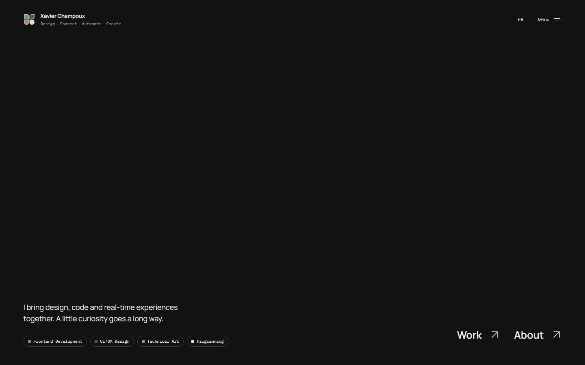 | 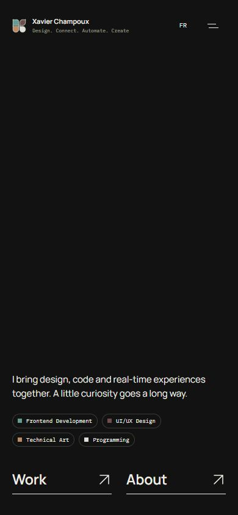 |
| **French · desktop** | **French · mobile** |
| 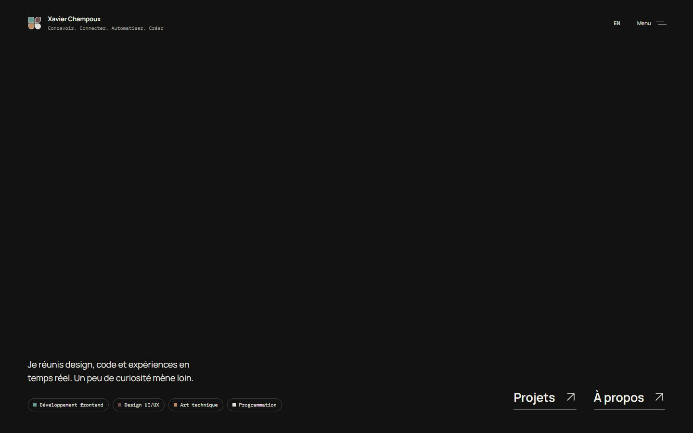 | 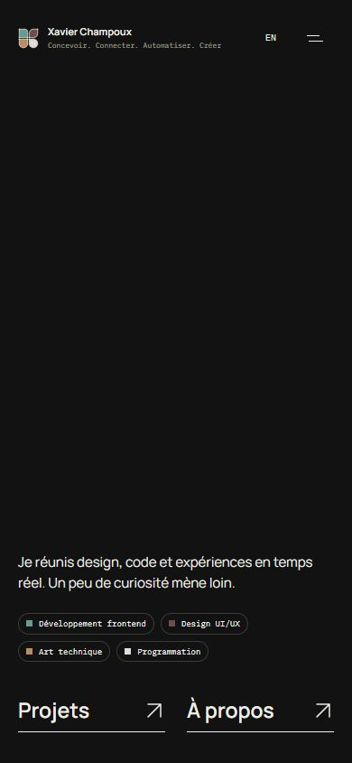 |

The future artwork/interactive replacement is outside this handoff. No machine, intro sequence, easter egg or loading milestone depends on the empty region.

## 5. Menu — numbered full-width rows

Use a three-column row: **01–04 index / oversized destination / up-right arrow**. Whole rows are links across the full content width, bounded only by the standard gutters. Thin internal separators divide them. Desktop rows are approximately 150px tall; mobile rows approximately 130px. Menu typography retains V3 A's scale and roomy rhythm, with complete French titles fitting between the number and arrow.

Keep Home, Work, Archive, About in that order. Do not restore V1's Explore label, separate range heading, header rule, theme icon or footer. The right arrow is approximately 42px desktop / 25px mobile. Hover uses a quiet Surface row; focus has an independent Ink outline.

| English · desktop | English · mobile |
|---|---|
| 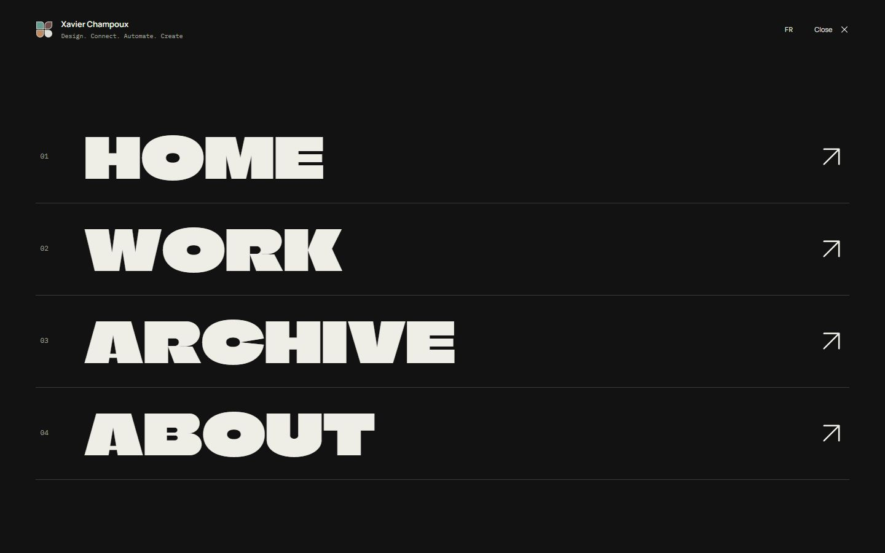 | 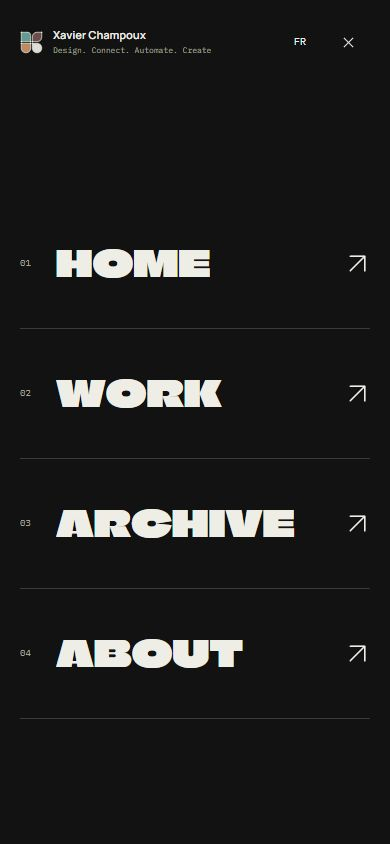 |
| **French · desktop** | **French · mobile** |
| 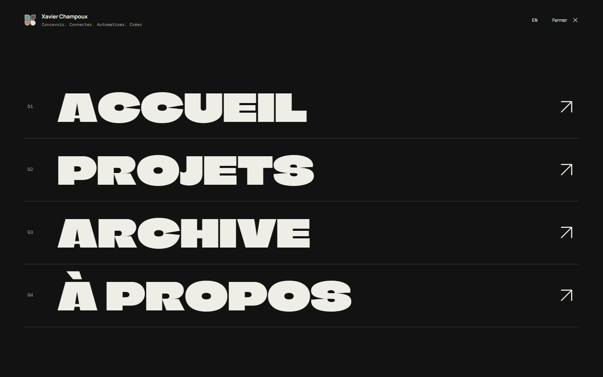 | 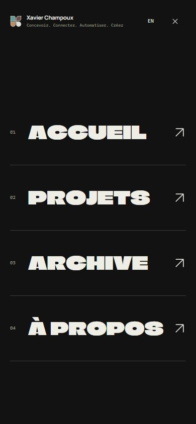 |

Implement as full-screen modal navigation: stop underlying inertia, lock background scrolling, make the underlying page inert, focus Close, contain focus, close with Escape and return focus to the opener. Preserve the originating page/scroll position. The study demonstrates this with a native dialog when opening Menu from another page; the direct menu URL is also available as an isolated composition.

## 6. Work — large rows

Keep the upper-right introduction and place the oversized Work/Projets heading beneath it, followed by a large breathing interval. Four approximately 230px desktop rows carry index, project, wrapping profiles, wrapping tags and year. Keep **Feltkutur → Ryker → Schluter → Simona** in visual, DOM and mobile order.

Project names have no arrow. The entire row opens the shared project template. Desktop pointer/focus previews remain image-only; no preview is required to understand a row. Keep the About/CV invitation and understated footer. A list/grid toggle is not part of the final design.

On mobile, keep the **visible # / Project / Year headers** and only those columns, with rows around 115px tall. Role and tag cells are hidden from both visual layout and the accessibility tree at this breakpoint; the complete information remains on project pages. Do not reintroduce the V3 stacked metadata below mobile names.

| English · desktop | English · mobile |
|---|---|
| 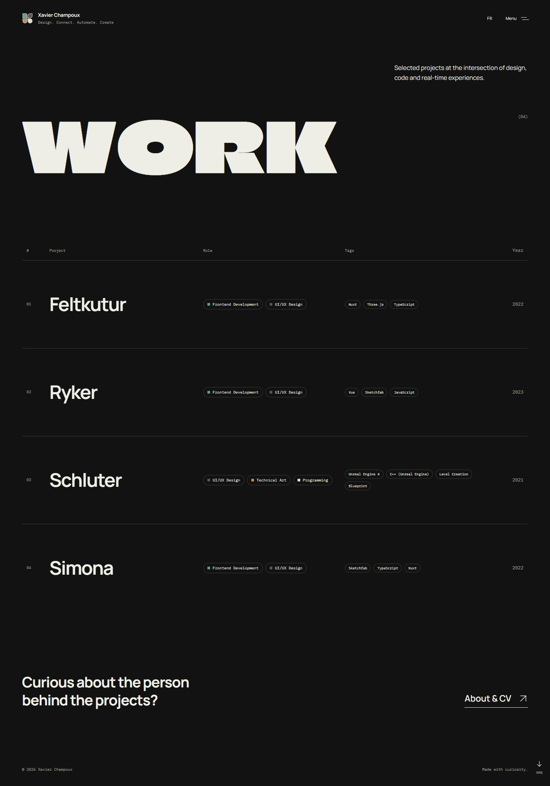 | 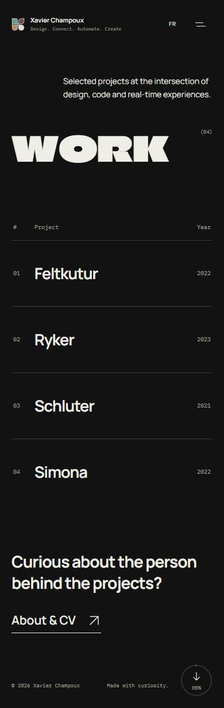 |
| **French · desktop** | **French · mobile** |
| 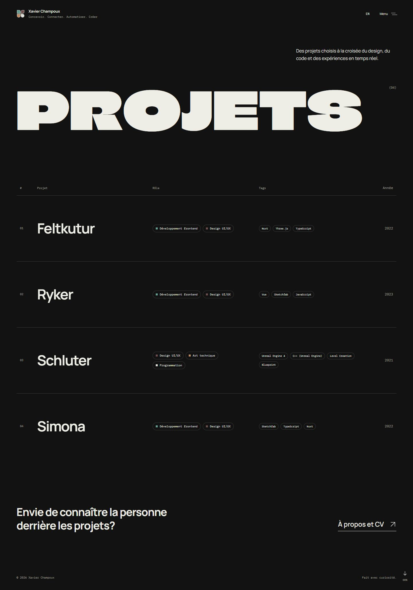 | 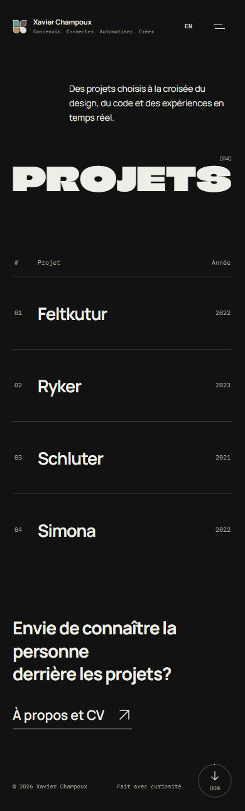 |

## 7. Archive — rounded controls, focused information

Retain the 12 non-selected active projects, rounded Role and Sort controls, neutral rounded tags and swatch profile badges. Desktop headers are #, Project, Role, Tags, Year. Rows are approximately 130px tall. Default ordering is newest first with stable slug tie-breaking within a year.

Mobile keeps filtering controls and the **# / Projet / Année** or **# / Project / Year** headers, followed only by those three columns. Do not add a hidden horizontal table or require a swipe to see the year.

| English · desktop | English · mobile |
|---|---|
|  | 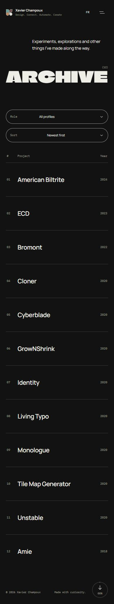 |
| **French · desktop** | **French · mobile** |
| 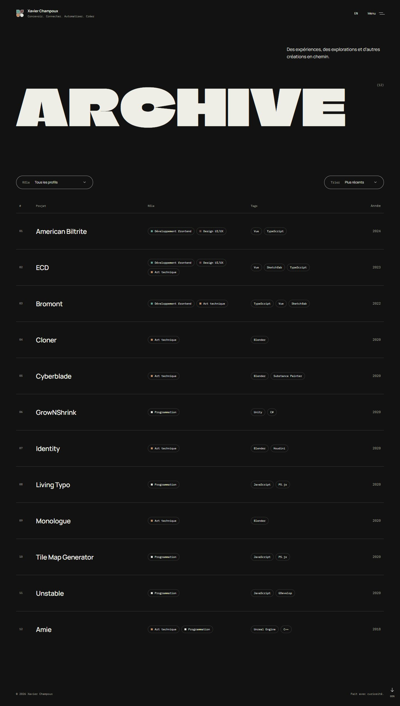 | 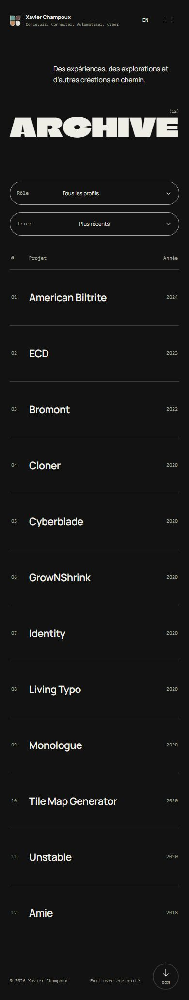 |

Pointer hover uses Surface on the active row and a larger floating source image without added name, date, caption, frame or border. Clamp around the header, active text and scroll control. Keyboard focus shows a stationary preview and independent outline. Touch remains text-only; reduced motion removes image pursuit/tilt. Any text or border already inside a source screenshot belongs to that image, not an added preview card.

Keep Archive's only global navigation entry in the menu. Direct links, refresh, filter/sort URLs and browser history remain supported. Browser Back from a project restores the list state and scroll position in the eventual application.

## 8. About — stronger chapters, then full width

The opening retains portrait and personal lists in the left sidebar, with the stronger V3 chapter headings in the main column. Preserve the three passages about art/technology, problem-solving/automation and curiosity/personal interests, including the conversational tone.

At **Four profiles. One curious mind.** / **Quatre profils. Un esprit curieux.**, close the sidebar composition. The profile grid, CV, robotics interest and contact then use the full content width. Paragraphs still retain a sensible measure. This is a structural change, not simply a wider right column.

Restore V2-style rules **beneath the profile, CV and Looking ahead section labels**. Do not add a separate rule immediately above Experience. The CV uses broad date / position or qualification / organization columns, not the V3 grouped category grid. On mobile the reading sequence becomes linear; dates and organization details remain readable.

| English · desktop | English · mobile |
|---|---|
| 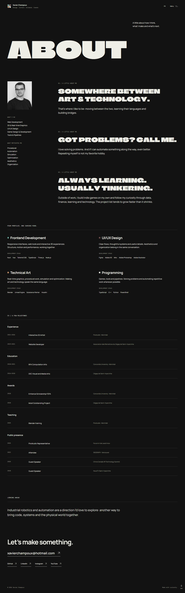 | 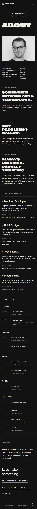 |
| **French · desktop** | **French · mobile** |
| 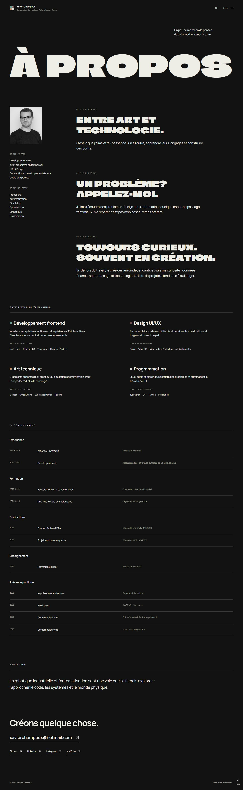 | 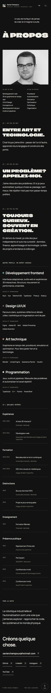 |

**What I do:** Web Development; 3D & Real-time Graphics; UI/UX Design; Game Design & Development; Tools & Pipelines.

**What motivates me:** Procedural; Automation; Simulation; Optimization; Aesthetics; Organization.

| Profile | Retained development stack |
|---|---|
| Frontend Development | Nuxt, Vue, Tailwind CSS, TypeScript, Three.js, Node.js |
| UI/UX Design | Figma, Adobe XD, Miro, Adobe Photoshop, Adobe Illustrator |
| Technical Art | Blender, Unreal Engine, Substance Painter, Houdini |
| Programming | TypeScript, C++, Python, PowerShell |

Stacks describe tools, not equal proficiency. Keep profile project links removed. Preserve the robotics interest and source contact destinations. **CV facts, dates, awards, qualifications, public appearances and contribution claims remain unverified for publication**; narrative copy remains an editable draft in both languages. Visual finalization does not establish factual accuracy. The [CV source](docs/design_v4/source/cv.js) and [About source](docs/design_v4/source/about.js) retain that content for review.

## 9. Projects — broad masthead and sequential media

Use the broad title, compact client/project/profile/tag/year facts and a wide first media item. Follow with context and contribution sections, then a spacious single-column media sequence. The metadata uses the shared wrapping badges. Its layout uses flex, never CSS grid: a horizontal facts row on desktop, and a vertical definition list on mobile with each Client/Project, Role, Tags and Year entry on its own line. Badge groups wrap within their entry. Remove all per-image/per-video captions such as “01 / Project image”; preserve meaningful alternative descriptions and team credits in the narrative.

### Selected-work example — Feltkutur

| English · desktop | English · mobile |
|---|---|
|  | 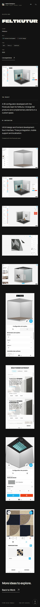 |
| **French · desktop** | **French · mobile** |
|  | 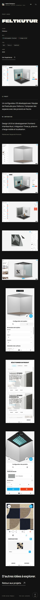 |

### Archive example — ECD

| English · desktop | English · mobile |
|---|---|
| 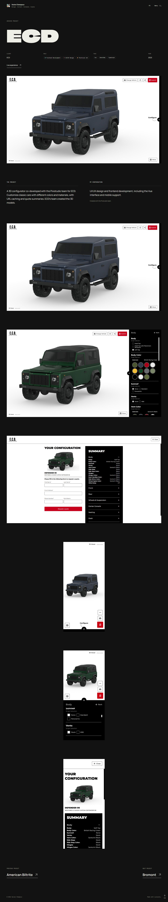 | 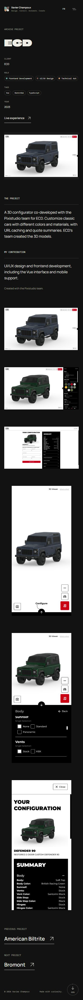 |
| **French · desktop** | **French · mobile** |
| 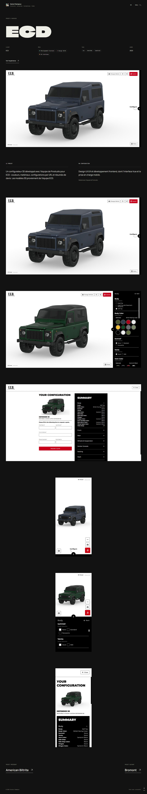 | 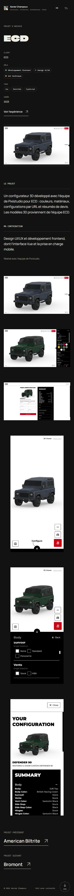 |

Feltkutur has **ten ordered items**: first video, then images 0–8. ECD has **seven**: first video, then images 0–5. The retained catalog has **118 ordered media items across 16 active projects**. Data order is authoritative; never insert a cover before a first video or regroup by media type. A poster represents that first video and does not add a media item. ECD uses landscape 0.webp as its inspection poster.

Contain media in the default layout, preserve proportions, and center portrait screenshots at a constrained width (approximately 480px desktop / 280px mobile). There is no image enlargement, lightbox, zoom dialog or fullscreen action.

Selected projects finish with **Back to Work / Retour aux projets**. Archive projects finish with **Previous / Next** in the preserved profile-filtered/sorted sequence. Direct visits use newest-first with stable slug tie-breaking; omit unavailable neighbors at the ends without wrapping. ECD demonstrates American Biltrite / Bromont in the default sequence. Never mix selected work into Archive neighbors or add a Back to Work ending to an Archive project.

### Video behavior and optional immersive lead

Default video behavior is muted inline autoplay when visible and ready, pausing off-screen and when the tab is hidden. There is no persistent toolbar, seek bar, audio control or fullscreen action. Click/tap or Enter/Space on the focused video surface toggles pause/resume. An accessible name and focus outline identify the surface. **Minimal Play appears only when explicit activation is needed**—blocked autoplay, manual pause, ended playback, reduced motion or data-saving preferences. Sound never starts automatically and no unmute control is included in this design.

The optional variation applies only to the **first video**: begin within content gutters, expand toward 100vw × 100svh while passing through the viewport, then continue the same source sequence. It may use cover cropping, so parts of interface footage can be lost. It is not the required default and must not duplicate the media item or open an enlargement view. Reduced motion keeps the contained poster/video in normal flow. Exact implementation of that optional effect is deferred; its three-stage visual is sufficient to preserve the idea without making it a launch requirement.

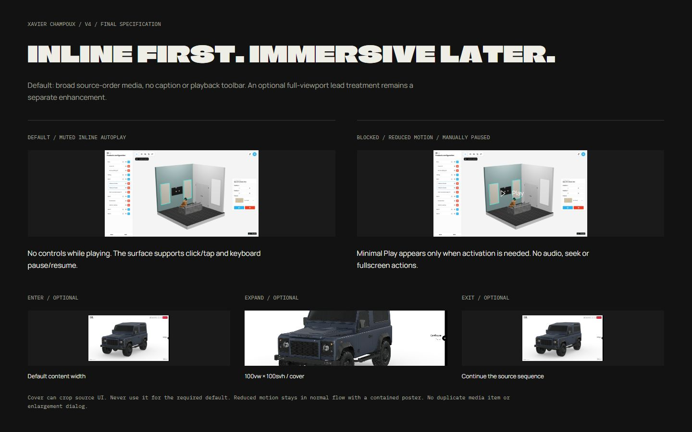

**Export convention:** screen images use source posters for stable composition and suppress live playback while capturing. The editable study runs actual local video outside capture mode. This browser session verified muted autoplay, explicit keyboard play/pause and off-screen pausing; cross-browser autoplay policies and real-device behavior remain application QA.

## 10. Loading — OS-style history and large counter

Use a blank dark field with the message history at top-left and a large Climate Crisis counter at bottom-right. **No logo**, header, footer, tagline, center label, profile selection or press-any-key prompt appears. Mobile retains the same arrangement with a smaller counter and room for wrapped French messages.

| English · desktop | English · mobile |
|---|---|
|  | 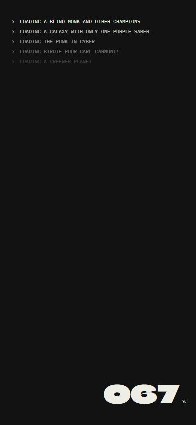 |
| **French · desktop** | **French · mobile** |
| 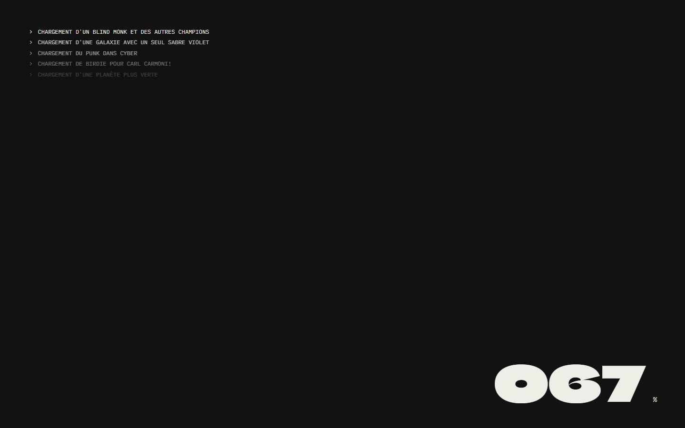 | 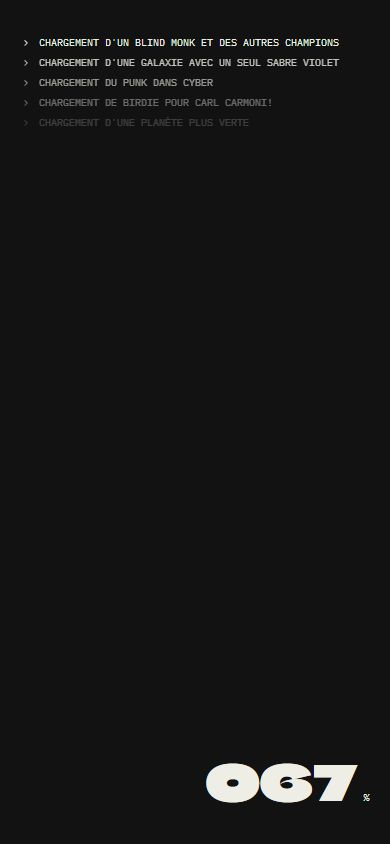 |

Use uppercase IBM Plex Mono with a compact 4px gap between messages and no minimum row height. Use Google Material Icons’ chevron_right SVG as the console prompt, not a text arrow. The original sentence corpus stays unchanged; uppercase is a presentation treatment. See [icon provenance](docs/design_v4/vendor/README.md). New messages appear at the top and push older sentences down. Keep at most five, with opacity **100%, 80%, 60%, 40%, 20%** from newest to oldest. History fades are decorative; a separate concise status announces actual readiness, not every playful sentence. Newest text stays fully readable.

Use all 16 existing localized messages verbatim, choosing a shuffled non-repeating sequence about every **800ms** while loading persists. Once all 16 are exhausted, hold the last five rather than inventing or repeating messages. A restrained approximately 240ms downward settling animation may accompany insertion; reduced motion updates the list immediately.

The percentage is **independent of the message count**. Production progress reflects completed essential readiness tasks, such as shell, catalog and required typography readiness. Do not delay to display five lines, simulate a percentage timer, wait for gallery media or pause at 99%. Dismiss as soon as usable. A cached load may show almost nothing. Optional media errors leave navigation/text usable; essential failures need an accessible fallback/retry instead of indefinite loading. Route changes do not replay document-entry loading.

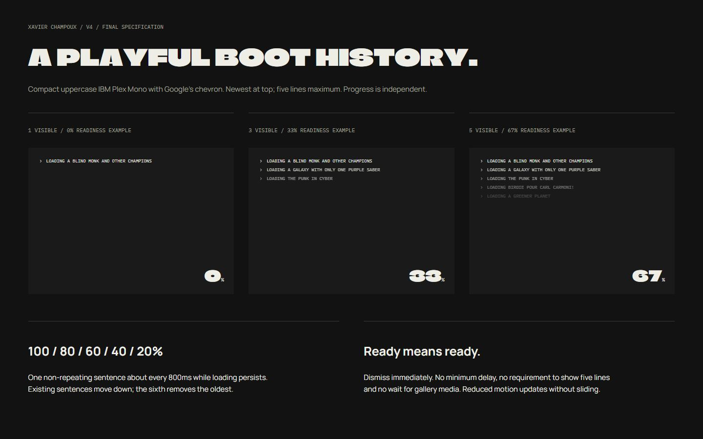

**Study boundary:** the loading view intentionally holds an illustrative 67% state so the design and message insertion can be inspected. It is not connected to an application readiness pipeline. The live log demonstrates capped non-repeating history; the board's percentage examples specify intended task-based states rather than measured application loading.

### Retained message corpus

Source: [existing loading composable](app/composables/useLoading.ts) and the existing locale files. Wording is retained, including personal references and spelling; it is not fabricated task output.

| Key | English | French |
|---|---|---|
| 1 | Loading a blind monk and other champions | Chargement d'un blind monk et des autres champions |
| 2 | Loading a galaxy with only one purple saber | Chargement d'une galaxie avec un seul sabre violet |
| 3 | Loading the punk in cyber | Chargement du punk dans cyber |
| 4 | Loading birdie pour carl carmoni! | Chargement de birdie pour carl carmoni! |
| 5 | Loading a greener planet | Chargement d'une planète plus verte |
| 6 | Loading dubstep.mp3 | Chargement de dubstep.mp3 |
| 7 | Loading crankdat's playlist | Chargement de la playlist de crankdat |
| 8 | Loading le francais | Chargement du français |
| 9 | Loading english.dll | Chargement de english.dll |
| 10 | Loading lofi boy and girl | Chargement du lofi boy and girl |
| 11 | Loading mon québec la place que j'ai choisi | Chargement de mon Québec, la place que j'ai choisie |
| 12 | Loading an orange mushroom (and pink bean...) | Chargement d'un orange mushroom (et d'un pink bean...) |
| 13 | Loading numbers and data | Chargement des nombres et des données |
| 14 | Loading my own video game (eventually) | Chargement de mon propre jeu vidéo (éventuellement) |
| 15 | Loading le coeur à ses raisons | Chargement du coeur à ses raisons |
| 16 | Loading the escape to the room | Chargement de l'évasion à la salle |

## 11. Scroll control, tooltip and motion ownership

### Floating control

Desktop retains the discreet bottom-right arrow/percentage in the outer gutter. Mobile uses a **56 × 56px circular FAB** floating over content, 20px from the right and `20px + env(safe-area-inset-bottom)` from the bottom. It has Paper fill, a 20px arrow and approximately 9px progress numerals underneath the arrow, inside the button.

The outline fills clockwise from twelve o'clock. Use a normalized 100-unit SVG circle so its dash offset is `100 - progress`. The inactive track uses Line and the active arc uses Ink. At the top show down; after about 8px of scrolling show up. Down advances into the page; up returns to the beginning. Progress is clamped to 0–100 from the current document's scroll range and is not a live announcement or drag control.

Remove the fixed mobile bottom strip and the added page-end padding. The scroll indicator aligns with the footer/content end instead of sitting below an artificial clearance area. The FAB intentionally overlays content during reading; the mobile footer leaves horizontal room for it without adding bottom clearance. Hide controls entirely on Home, menu and Loading; do not merely hide Home's control visually.

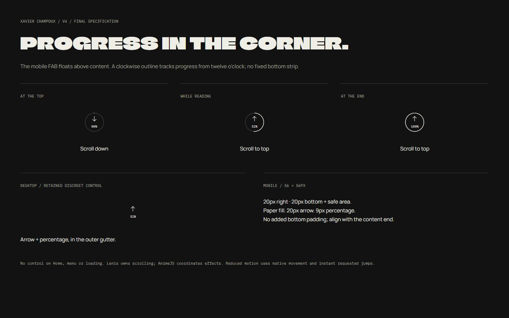

### Tooltip and focus

Tooltips use **Paper #111211**, Ink text, subtle Line border and **4px corners**, distinct from fully rounded badges. Show on pointer hover or keyboard focus, retain the associated accessible name and dismiss with Escape. Tooltip wording changes with the action: Scroll down / Scroll to top, or Défiler vers le bas / Retour en haut. Clamp localized content within the viewport.

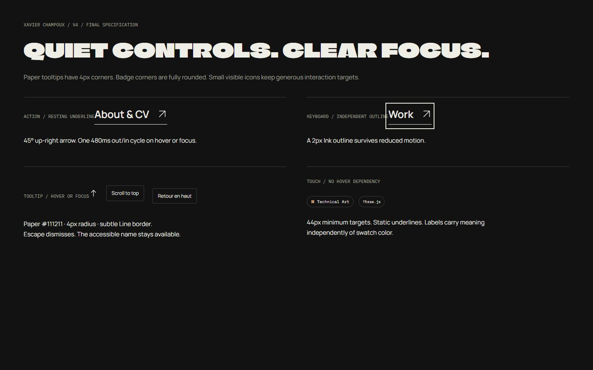

### Lenis + AnimeJS

Use **Lenis 1.3.27** as the single owner of document movement and requested anchor/top moves. Coordinate visual effects with the existing **Anime.js 4.5.0**. AnimeJS's onScroll smoothing applies to linked animation playback; it is not a replacement for a wheel/touch scrolling layer. Sources: [Lenis official documentation](https://github.com/darkroomengineering/lenis), [pinned Lenis release](https://github.com/darkroomengineering/lenis/releases/tag/v1.3.27), [AnimeJS smooth scroll](https://animejs.com/documentation/events/onscroll/scrollobserver-synchronisation-modes/smooth-scroll/), [AnimeJS onScroll](https://animejs.com/documentation/events/onscroll/).

The isolated study enables `smoothWheel:true`, `syncTouch:true`, wheel interpolation 0.1, touch interpolation 0.075 and touch inertia exponent 1.7. Multipliers stay 1; there is no infinite scrolling or section snapping. Requested top moves use about 650ms cubic-out easing and remain interruptible. Progress reads the resulting document position. Remove V3's competing AnimeJS scroll-position proxy and avoid CSS smooth scrolling on top of Lenis.

Respect reduced motion, preserve keyboard movement and zoom, let nested controls retain their expected interaction, stop inertia at navigation and suspend underlying movement while Menu is open. Older/unsupported touch environments must fall back to native movement instead of trapping gestures. Lenis documents touch limitations on older iOS; physical-device verification remains required. Local preview copies and licenses are isolated under [vendor provenance](docs/design_v4/vendor/README.md); no production dependency was added.

Retain the 480ms underline cycle, optional 650ms restrained reveal, and short coordinated route/menu transitions. No animation may be required to reveal essential content. Exact future route-transition tuning must stay within the approved restrained direction; the primary layouts and information remain usable before effects begin.

## 12. Responsive, accessible and content acceptance

| Context | Final requirement |
|---|---|
| Normal Home | Fit the viewport with no scroll control; preserve blank upper area and visible copy/actions. |
| 320px French | Complete display labels; wrapped copy; visible three-column table headers; no horizontal page overflow. |
| Wide desktop | Fluid gutters, bounded type and contained media; reading measures remain restrained. |
| Enlarged text | Allow vertical growth. Stack About lists/profiles/CV and Home actions when needed; do not clip content or prevent necessary scrolling. Home still omits the control. |
| Keyboard | Clear outlines, meaningful names, full-row links, native selects, stationary previews, video Enter/Space and modal focus restoration. |
| Touch | At least 44px targets; 56px FAB; no preview/hover requirement; safe-area offsets, without added page-end clearance. |
| Reduced motion | Native movement/instant requested jumps, static underlines and log insertion, stationary previews, video poster/Play, no immersive expansion. |
| Loading/media failure | Useful text/navigation, stable dimensions and fallback; optional gallery failures do not block readiness. |
| Screen reader | Logical headings/landmarks, localized labels, informative alternatives, hidden decorative SVGs and non-live reading progress. |

All four capability stacks and personal lists remain. Review both languages, CV facts, contact destinations, source project roles and team credits before public release. The design is visually final; factual publication review remains separate.

## 13. Editable studies and verification evidence

Preview: [Home](http://localhost:4181/docs/design_v4/source/studio.html?page=home), [Menu](http://localhost:4181/docs/design_v4/source/studio.html?page=menu), [Work](http://localhost:4181/docs/design_v4/source/studio.html?page=work), [Archive](http://localhost:4181/docs/design_v4/source/studio.html?page=archive), [About](http://localhost:4181/docs/design_v4/source/studio.html?page=about), [Feltkutur](http://localhost:4181/docs/design_v4/source/studio.html?page=project&slug=feltkutur), [ECD](http://localhost:4181/docs/design_v4/source/studio.html?page=project&slug=ecd), [Loading inspection state](http://localhost:4181/docs/design_v4/source/studio.html?page=loading). Add `locale=fr` for French. These links need the local preview server.

Editable sources: [shared helpers](docs/design_v4/source/core.js), [page views](docs/design_v4/source/views.js), [About](docs/design_v4/source/about.js), [project template](docs/design_v4/source/project.js), [final styles](docs/design_v4/source/studio.css), [runtime behavior](docs/design_v4/source/runtime.js), [specification boards](docs/design_v4/source/boards.js), [catalog](docs/design_v4/source/catalog.json). All live under the documentation folder. The inherited foundation stylesheet supports the accepted identity; final overrides and rendered views define V4.

From the repository root: `node docs/design_v4/source/build.mjs` refreshes the isolated bundle and locale copies; `node docs/design_v4/source/server.mjs` starts the loopback preview. `motion=reduce` selects the reduced-motion branch. `text=large` is the 200% type stress mode. `capture=1` freezes video at source posters and renders a deterministic five-line loading state.

**Export convention:** headers appear once at the document start and the scroll control once at the document end, at its initial 0% state, to prevent fixed elements from masking content in tall captures. In the live study the header/control are viewport-fixed, Menu is modal, progress updates and video plays. Export-only placement is not the final interaction specification.

### Completed documentation checks

- Reviewed the final layouts for dark consistency, clipping, spacing and composition. This refinement regenerates only the 26 affected screens and three affected boards. The six unaffected screens, two unaffected boards and five reference images retain their previous bytes. Updated only the affected comparison sheets.
- Recorded **37 browser exports**, with loaded fonts/images/posters, no horizontal overflow, minimum target checks, normal Home fit, profile vocabulary, selected-work order, mobile column visibility, About full-width sections and complete project media order.
- Recorded **24 additional layouts**: all eight views at 320px French, 1920px English and 390px French with the explicit 200% type stress mode. Enlarged Home/menu may grow vertically; normal Home does not.
- Checked Home at 640, 700, 768 and 1024px in both languages: full-width/equal mobile actions, the 640px content cap, and the retained desktop arrangement all fit without overflow. At the end of a mobile scrolling page, progress reaches 100% with zero added bottom padding and no overlap between the FAB and footer text.
- Exercised the live 56px FAB/progress ring, return-to-top, tooltip focus/Escape, menu focus containment/scroll suspension/restoration, legacy-role normalization, profile filtering/sort, muted autoplay, keyboard video play/pause, off-screen pausing, capped loading history and reduced-motion branch.
- Audited relative links, all 42 image references, fonts, 16-project profile mapping, **118 ordered media items / 119 retained asset paths**, and preservation hashes for the earlier application/design files.

Records: [final audit](docs/design_v4/validation.json), [export measurements](docs/design_v4/browser-validation.json), [responsive checks](docs/design_v4/responsive-validation.json), [interaction observations](docs/design_v4/interaction-validation.json), [screen manifest](docs/design_v4/screens/manifest.json), [board manifest](docs/design_v4/boards/manifest.json), [profile mapping](docs/design_v4/profile-mapping.json), [preservation baseline](docs/design_v4/preserved-files.json). Rerun file/data verification with `node docs/design_v4/source/audit.mjs`.

**Verification limits:** the type stress mode is not a substitute for browser/OS zoom testing. Mobile viewport checks are not physical touch-device tests. Loading percentage is an inspection state, not a completed application readiness pipeline. Cross-browser autoplay rejection, data-saving conditions, actual page-history restoration and production performance remain application acceptance work. No production test/build is claimed from this documentation-only task.

## 14. Design lineage and source attribution

The following are **prior local portfolio design studies**, created in this collaboration for Xavier Champoux, copied without modification into V4 references. They are not fresh live-site captures. Reviewed for V4 on **14 November 2026**. V1/V2 source documents are dated 13 November; V3 is dated 14 November. Their exact individual export timestamps are not asserted. [Reference manifest](docs/design_v4/references/manifest.json).

### V1 menu — row anatomy

Original: [menu-dark-desktop.jpg](docs/design/screens/menu-dark-desktop.jpg), in DESIGN.md. Used for numbers, rows, separators and right arrows. Its old header rule, theme icon, Explore/range labels and footer are deliberately not carried into V4.

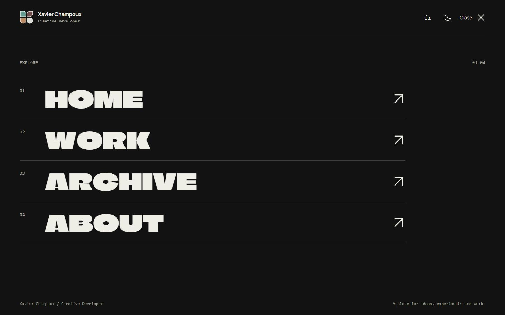

### V3 menu — scale and rhythm

Original: [menu-a-desktop.jpg](docs/design_v3/screens/menu-a-desktop.jpg). Used for large type and generous vertical spacing, expanded to full-width rows in V4.

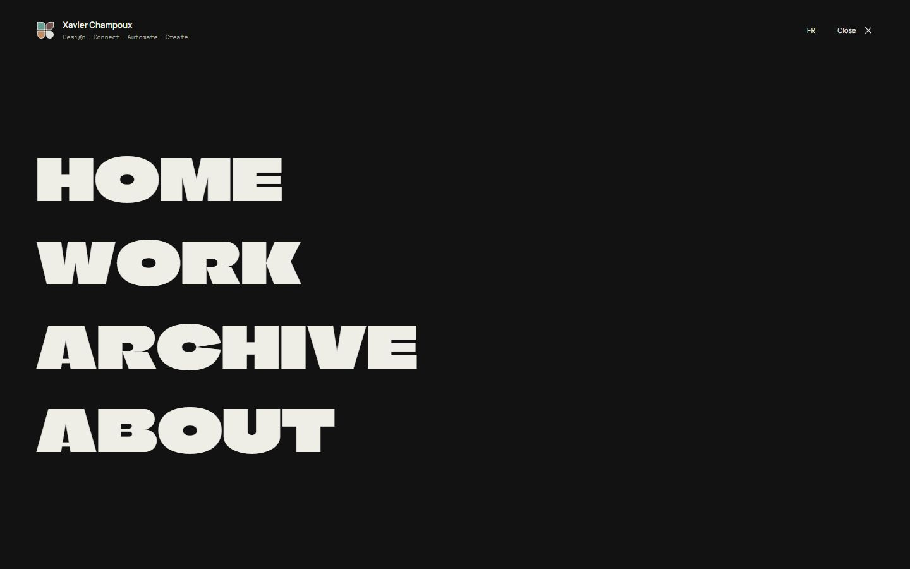

### V2 About — full-width lower sections

Original: [about-editorial-dark-desktop.jpg](docs/design_v2/screens/about-editorial-dark-desktop.jpg). Used for the full-width profile/CV transition, profile title and underlined section labels; V4 retains the newer strong opening and broad CV columns.

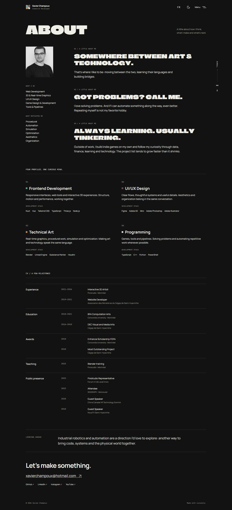

### V3 Four Statements — supporting composition

Original: [home-b-desktop.jpg](docs/design_v3/screens/home-b-desktop.jpg). Used only for the lower copy/action relationship and overall negative space. All oversized words are removed in V4.

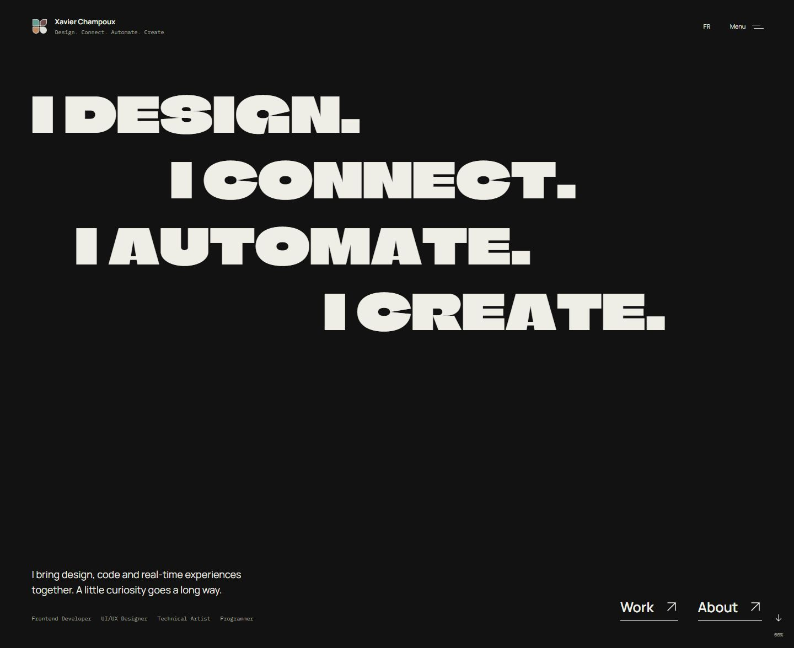

### V2 Archive — swatch lineage

Original: [archive-updated-dark-desktop.jpg](docs/design_v2/screens/archive-updated-dark-desktop.jpg). Used for the small profile color swatches. V4 adds rounded profile/tag pills and uses the contribution-derived mapping above, not V2's experimental project assignments.

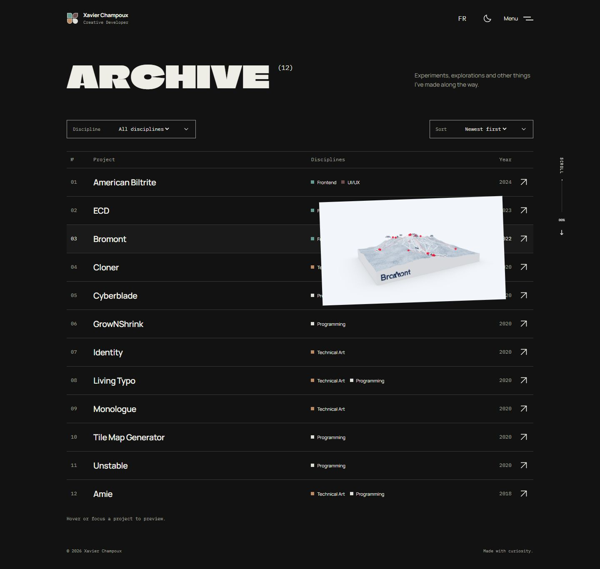

External inspiration remains attributed in the preserved earlier documents, including Mike Wilcock's typography, Work and Fun Arena hierarchy. V4 adds no unverified claims about those sites' motion. Lenis/AnimeJS links above describe actual library capabilities; the selected choreography and timings are this portfolio's specification.

## 15. Implementation acceptance checklist

- [ ] Reproduce these final layouts in both languages using the retained dark tokens/fonts/header.
- [ ] Home has an empty display region, visible supporting content/actions, normal viewport fit and no scroll-control element.
- [ ] Menu has four numbered full-width rows/arrows and correct focus/scroll lifecycle.
- [ ] Work/Archive/project profile badges wrap horizontally like tags. Keep the three-column mobile tables, desktop facts row and mobile vertical facts list; preserve collection order/membership.
- [ ] About leaves the sidebar after its opening, retains stacks/lists and uses full-width CV/lower sections without the extra Experience rule.
- [ ] Media follows complete source order with no captions/toolbars/enlargement; muted autoplay and Play/pause fallback work, and collection endings are correct.
- [ ] Loader uses the existing bilingual corpus, five-level history and real readiness, with no forced duration or gallery dependency.
- [ ] One Lenis scroll owner handles wheel/touch/anchors; FAB progress, content-end alignment without extra padding, tooltips, safe areas and reduced motion remain correct.
- [ ] Validate real touch devices, keyboard/screen reader, browser zoom, media/network failures, history and performance in the application.
- [ ] Review factual content and credits before publication. Keep the optional immersive first video and future Home artwork separate from the required default.
